# Rang thử trên panel + board THẬT — 12/10/2026

Bàn thử dùng **HMI thật và board thật, không nối tải**:

- HMI: panel Delta DOP-110WS thật, chạy bản LO83.
- Board: STM32 thật, chạy firmware `f43afea`. Relay và đầu ra không nối động cơ, van hay đầu đốt.
- Nhiệt độ BT/ET: mạch ESP32 giả lập cùng lò ảo `lo_nhiet.py`, vì không có trống rang.
- Lửa: người bấm nút tay vào chân CH1 mỗi lần board mở gas.

Kết quả: **10/10 mẻ đạt** — 5 hồ sơ, mỗi hồ sơ một mẻ rang thường (lưu hồ sơ) và một mẻ AUTO chạy lại hồ sơ đó.

| Ô | Hồ sơ | Rang thường — xả | AUTO — BT lúc nạp → xả |
|---|---|---|---|
| 5 | thu1 | 13:49 · 218,8 °C | 193,2 °C → 13:43 · 220,9 °C |
| 6 | thu2 | 13:14 · 217,3 °C | đạt |
| 7 | thu3 | 14:11 · 222,3 °C | 183,8 °C → 14:06 · 227,4 °C |
| 8 | thu4 | 11:22 · 206,6 °C | 183,3 °C → 11:24 · 211,8 °C |
| 9 | thu5 | 12:02 · 219,2 °C | 202,9 °C → 12:00 · 224,3 °C |

Các mẻ bị huỷ với mã 414 trong ngày đều do người chưa bấm nút lửa kịp: firmware đóng gas đúng 75 s
sau khi mở, báo 414 và tắt START — đúng thiết kế, không phải lỗi máy.

## Bẫy đã gặp (đã sửa trong kịch bản thử)

- Lửa thật là ô `$59`; cột `lua` trong `lo.csv` là lửa giả lập của lò ảo.
- Ô hồ sơ là nút đảo: bấm lại đúng ô đang chọn thì board không tải lại. Căn cứ đã nạp là `$118 = 1`
  (không phải mã 102); nạp hụt thì chọn ô bên cạnh rồi quay về.
- Nút Bắt đầu mẻ có lúc phải giữ 2,0 s.

## Ảnh màn panel thật (chụp qua VNC)

### Rang thường — lúc nổ lần 1 và sau khi xả

| Ô | Nổ lần 1 | Sau xả |
|---|---|---|
| 5 | 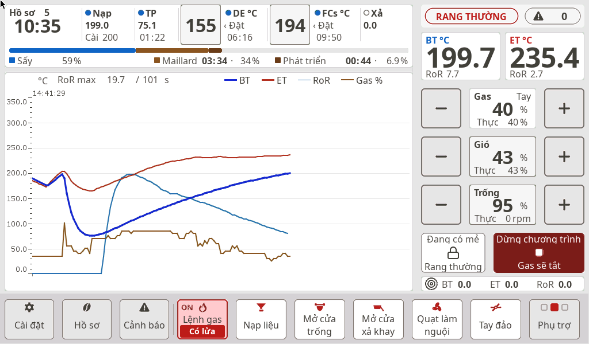 | 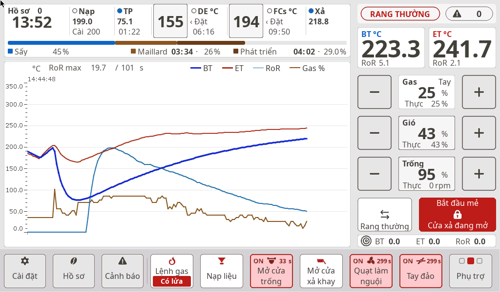 |
| 6 | 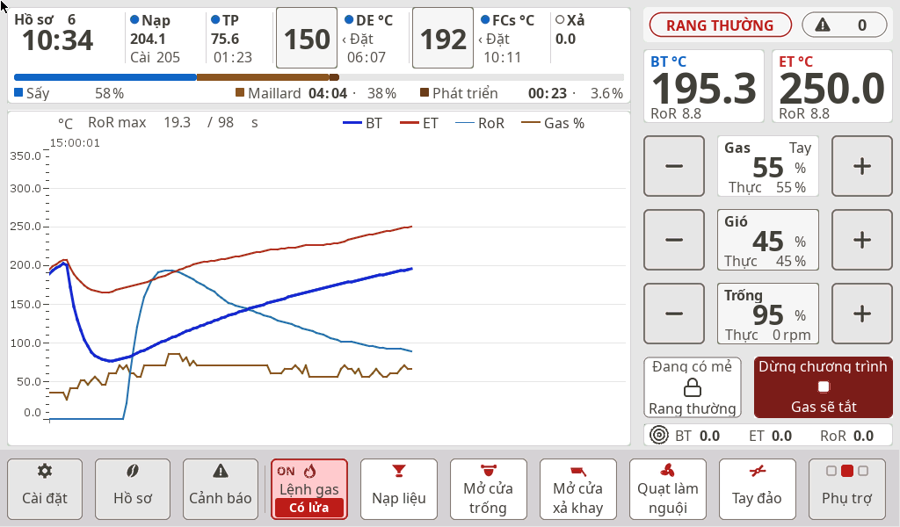 | 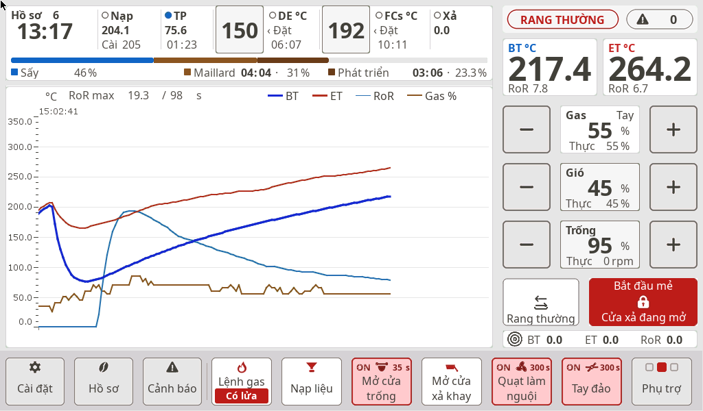 |
| 7 |  | 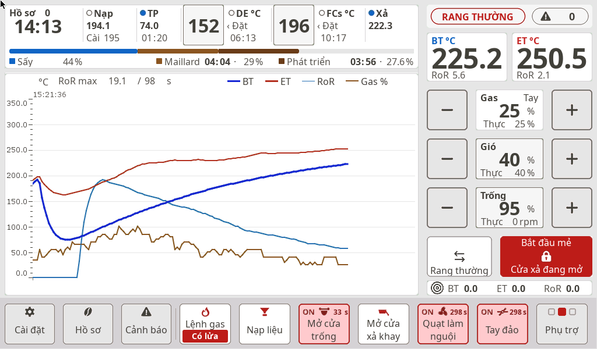 |
| 8 |  | 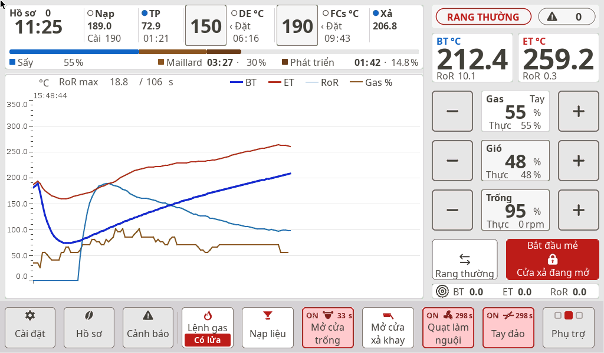 |
| 9 | 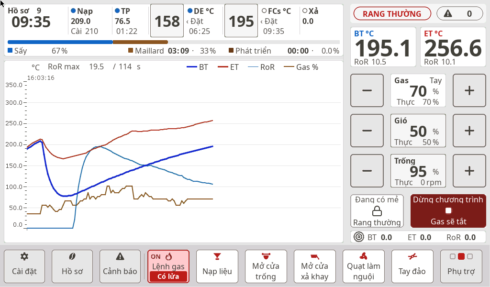 | 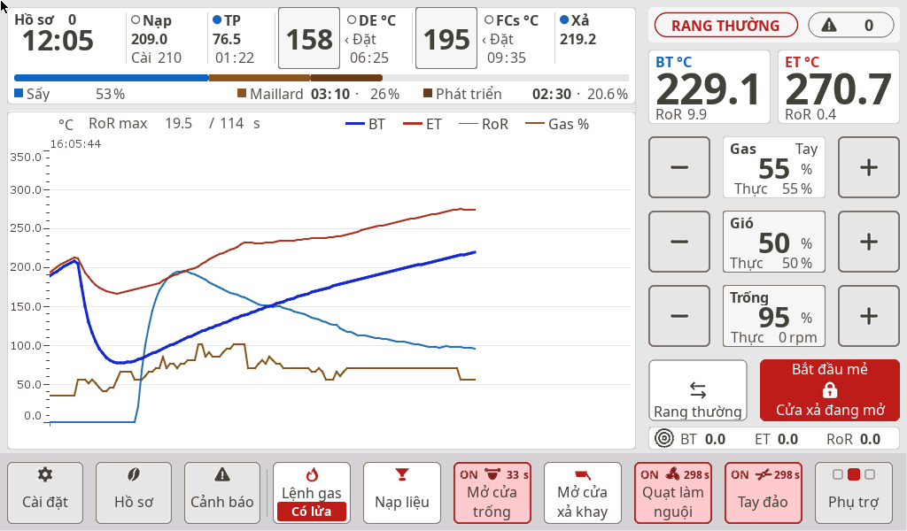 |

### AUTO — màn chạy tự động và sau khi xả

| Ô | Vào AUTO | Sau xả |
|---|---|---|
| 5 | 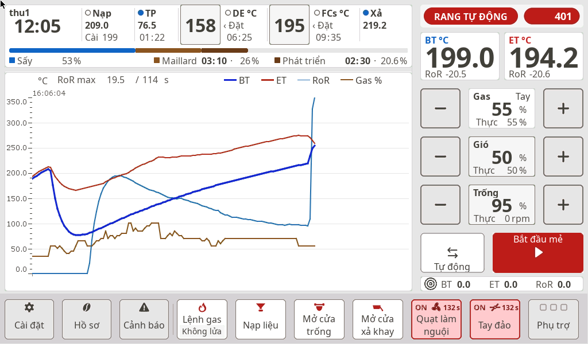 | 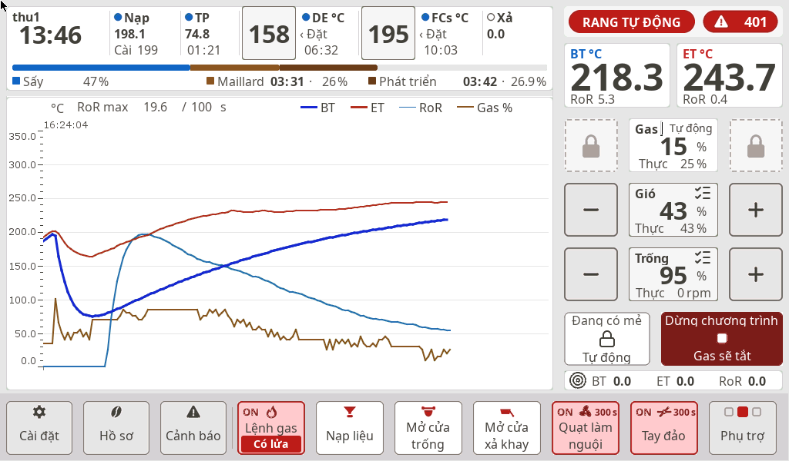 |
| 6 | 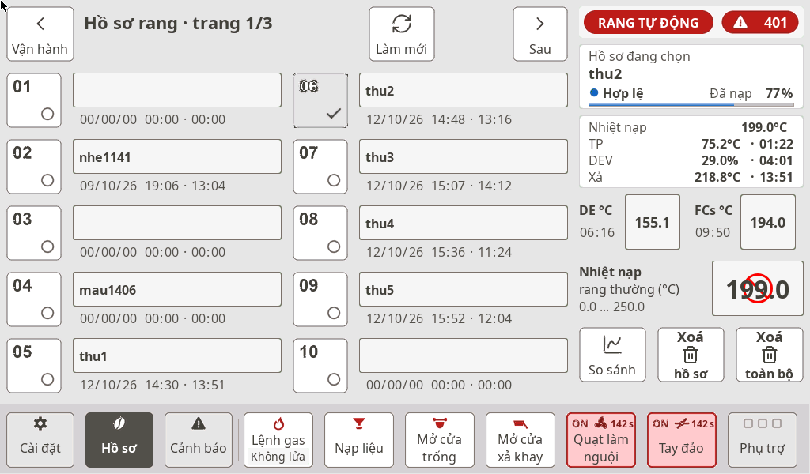 | 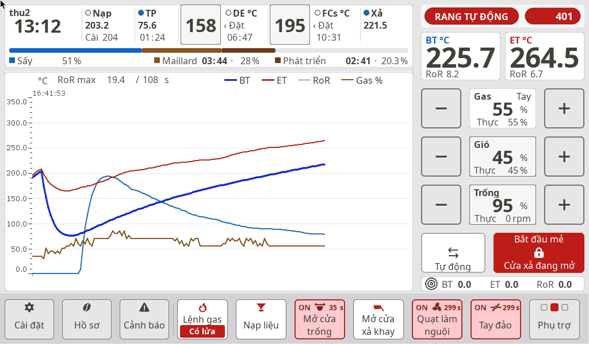 |
| 7 | 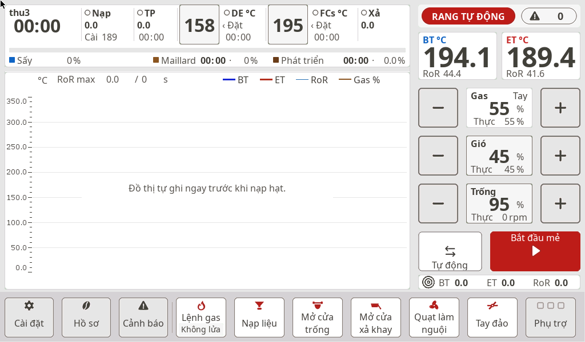 | 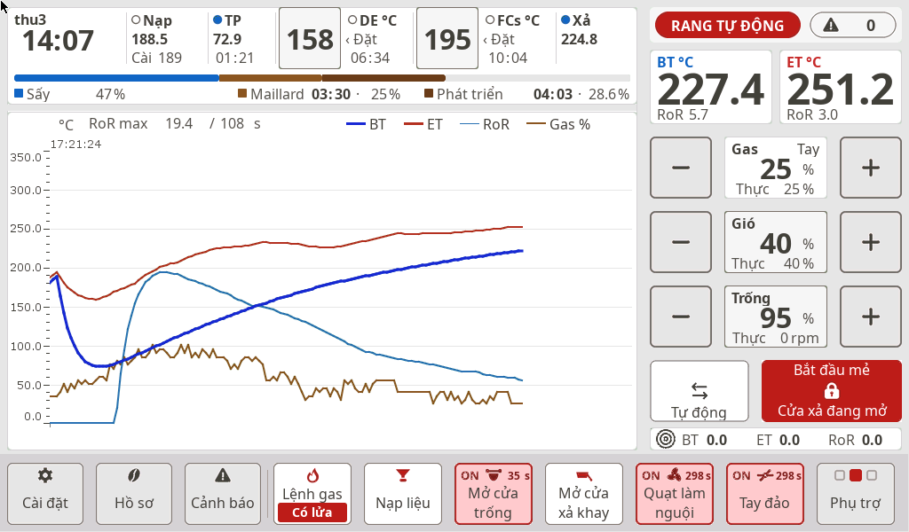 |
| 8 | 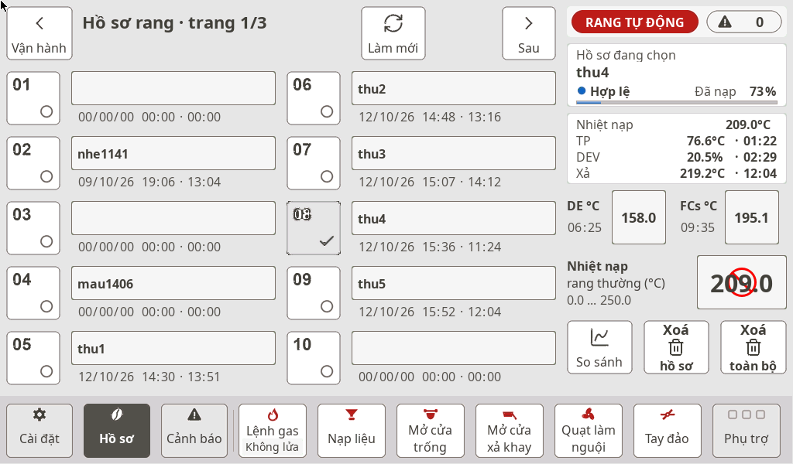 | 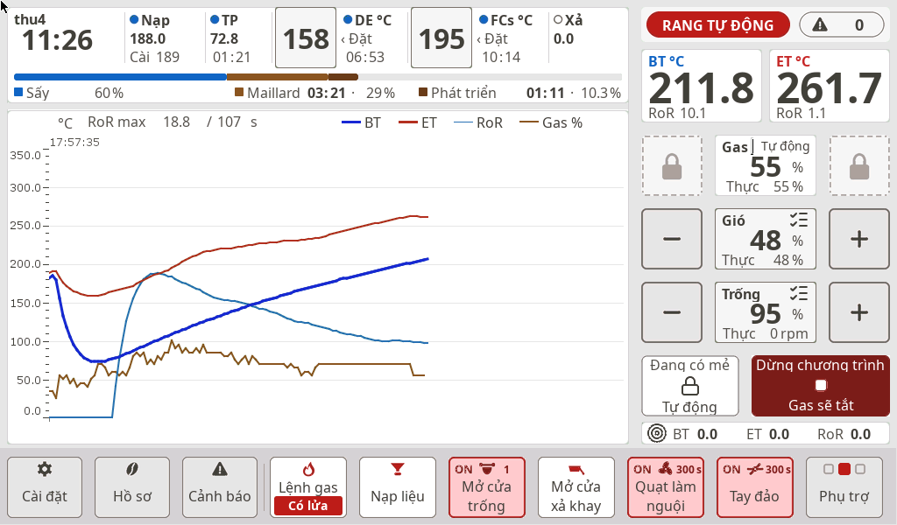 |
| 9 | 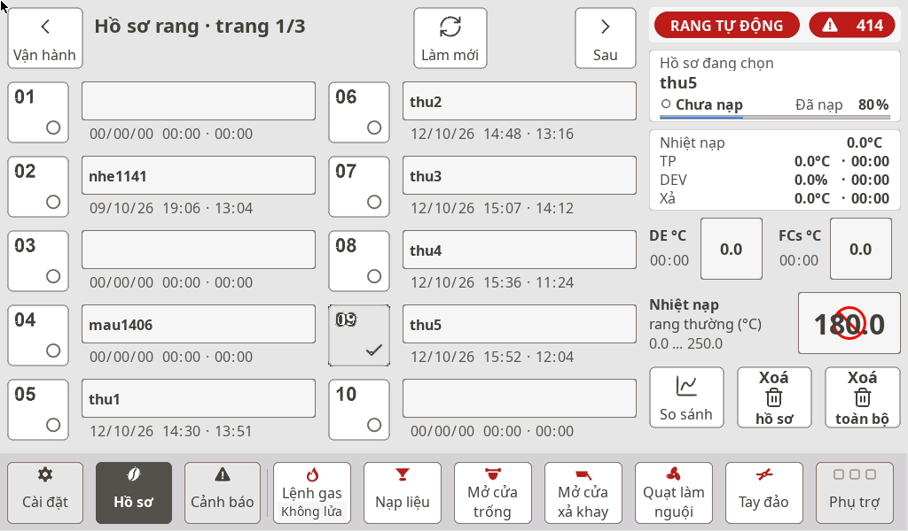 | 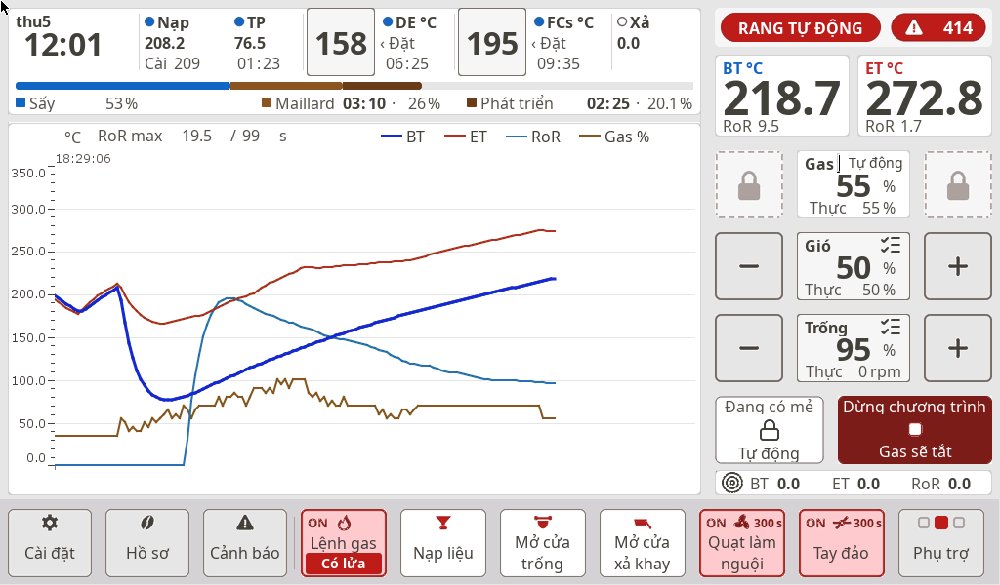 |

Bộ đầy đủ (4.011 ảnh, log, `lo.csv`) nằm ở thư mục thử nghiệm của repo HMI, không đưa lên đây.
