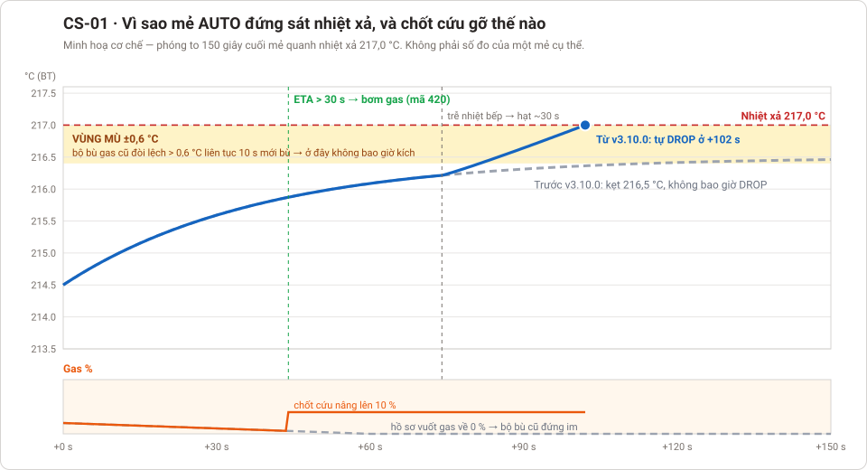

# Case study — lỗi gặp trên máy thật

Mỗi case ghi lại một lỗi khách báo: triệu chứng, vì sao xảy ra, đã sửa ở bản nào, và **bài thử nghiệm thu** để chạy lại
trước mỗi lần giao máy hoặc sửa phần liên quan. Tên khách không ghi ở đây (repo công khai) — chỉ mã máy.

| Mã | Lỗi | Máy | Sửa ở | Bài thử |
|:--|:--|:--|:--|:--|
| [**CS-02**](CS-02_cai-dat-tren-hmi-firmware-bo-qua.md) | Ô "Chế độ xả khay" trên HMI mà firmware **bỏ qua**; ô **bù nhiệt Agtron** và 7 thông số an toàn **không có trên HMI v28** | OTL-30 HMI v28 (110WS) | firmware env v28 + HMI LO111 | 3 mẻ trên bàn thử: xả khay BẬT / TẮT, bù Agtron 0,5 / 0 °C |
| [**CS-01**](CS-01_auto-dung-sat-nhiet-xa-khong-drop.md) | Mẻ AUTO đứng sát nhiệt xả, máy **không tự DROP** | OTL-30, gas NP, không áp hút | [v3.10.0](https://github.com/TCL-DA/coffee-roaster-auto-control/releases/tag/v3.10.0) | 9 ca T1–T9 + [hồ sơ mẫu thật](CS-01_ho-so-mau.csv), làm được trên bàn thử không lửa |

## Thêm case mới

1. Đặt tên `CS-NN_<mo-ta-ngan>.md`, theo khung của CS-01: khách báo gì → vì sao → đã sửa gì → kết quả máy thật →
   **bài thử nghiệm thu** (bảng ca thử + tiêu chí đạt) → bài học.
2. Có hình minh hoạ thì để script vẽ cạnh đó (`ve_minh_hoa_csNN.py`) để vẽ lại được.
3. Thêm một dòng vào bảng trên, và nhắc mã case trong ghi chú của bản phát hành có bản sửa.
