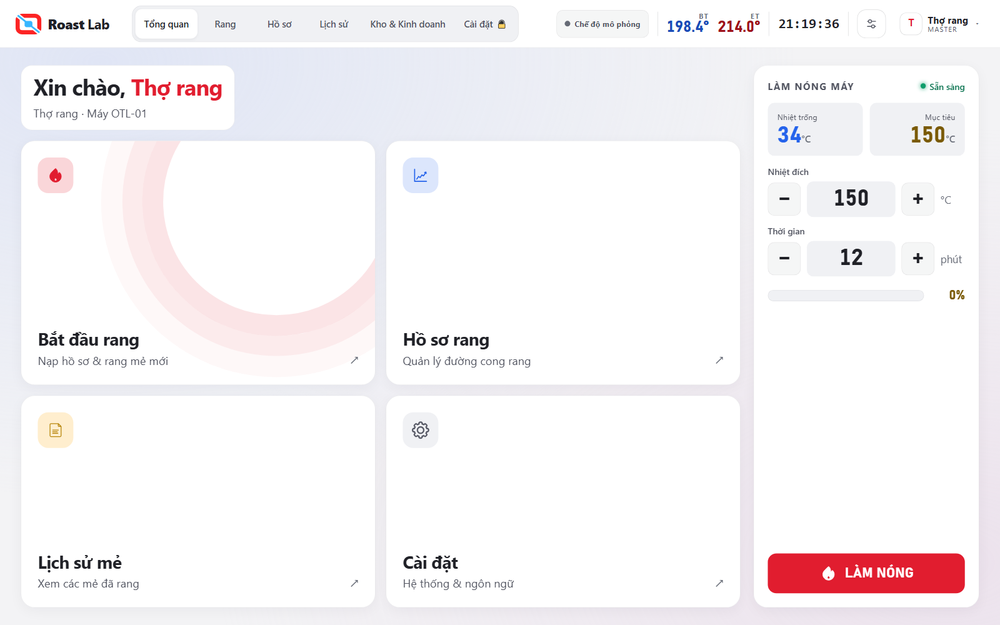
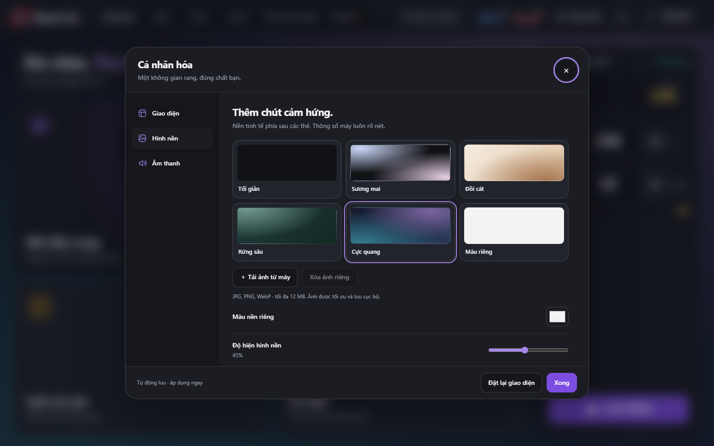

# OTL Roast Lab — nâng cấp giao diện và cá nhân hóa

Ngày cập nhật: 06/09/2026.

## Sử dụng

Đóng rồi mở lại bản phát triển bằng `python tools/roast_lab_hmi.py`. Bấm biểu tượng
hai thanh trượt cạnh tài khoản, hoặc **Tài khoản → Cá nhân hóa**.
Bản `.exe` đã đóng gói trước đây cần đóng gói lại mới có giao diện này.

- **Giao diện:** sáng, tối hoặc theo hệ thống; sáu màu nhấn và màu tự chọn;
  chuyển động mượt hoặc giảm chuyển động. Màu chữ tự điều chỉnh độ tương phản.
- **Hình nền:** tối giản, sương mai, đồi cát, rừng sâu, cực quang, màu riêng hoặc
  ảnh từ máy; chỉnh độ hiện và độ mờ. Ảnh JPG/PNG/WebP tối đa 12 MB được thu nhỏ
  và chuyển thành JPEG cục bộ. Ảnh hỏng không thay thế ảnh đã lưu.
- **Âm thanh:** ba chất âm chạm, âm lượng, giọng đọc, mốc rang, báo động và nhịp RoR.
  Chất âm chạm không thay đổi âm báo động.
- Tùy chọn tự lưu trên thiết bị và được đưa vào gói trạng thái của app.
  **Đặt lại giao diện** giữ cài đặt âm thanh và ảnh riêng đã tải lên.

Các thẻ hiển thị thông số giữ nền kín để dễ đọc khi chọn ảnh hoặc màu nền đậm.
Hệ điều hành yêu cầu giảm chuyển động thì app luôn tuân theo.

## Lỗi đã sửa

1. Escape trong hộp hỏi nạp sớm từng bị hiểu là chọn chờ rồi tự nạp.
   Đóng hộp thoại nay trả kết quả hủy riêng; chỉ bấm nút Chờ mới bật chờ tự nạp.
2. Escape vừa hủy xác nhận vừa đổi toàn màn hình.
3. Hai hộp xác nhận liên tiếp làm Promise của thao tác đầu bị treo;
   bàn phím Tab có thể thoát khỏi hai lựa chọn xác nhận.
4. Màu tự chọn luôn dùng chữ trắng, khó đọc trên vàng/xanh sáng.
5. Lưu trạng thái thất bại vẫn bị đánh dấu đã lưu, không thử lại.
6. Tùy chọn âm thanh hỏng có thể tạo âm lượng ngoài dải hoặc thay trạng thái AudioContext.
7. Tắt giọng đọc không dừng lời đang nói; âm thanh đã hẹn vẫn có thể phát sau khi tắt tổng.
8. Một số nút tài khoản, hồ sơ và tùy chỉnh quá nhỏ sau khi co giao diện về màn laptop.
9. Nhãn pha tiếng Anh bị tràn trên màn 1280×800.

Bảng cá nhân hóa tự đóng khi có cảnh báo máy, để cảnh báo được nhìn thấy ngay.
Các thẻ điều hướng tổng quan và nút tài khoản/kết nối hỗ trợ Enter và Space.

## Kiểm chứng

- `python tools/test_ui_personalization.py`: lưu/tải lại, theme hệ thống,
  tương phản, ảnh hỏng/SVG, bộ nhớ đầy, dữ liệu lưu hỏng, âm thanh, bàn phím,
  hủy chờ nạp, cảnh báo máy, thử lại lưu trạng thái và giảm chuyển động.
- Kiểm bảng cá nhân hóa ở 1920, 1366, 1024 và 390 px; toàn bộ trang chính
  bằng bộ dò bố cục ở 1920×1080, 1366×768 và 1280×800, cả tiếng Việt và tiếng Anh.
- Kiểm hồi quy: `test_ui_vacuum.py`, `test_ui_ror.py`, `test_ui_toolbar.py`,
  `test_ui_autodrop.py`, `test_ui_compat_roast.py`, `test_ui_live.py`,
  `test_ui_portpick.py`, `test_otl_link.py`, `test_roast_derive.py`.
- Cập nhật bốn bài kiểm tra cũ: dùng ID nút ổn định, đẩy dữ liệu mô phỏng qua
  `dsApply` đúng luồng nhận dữ liệu, và chờ điều kiện đóng hộp chọn cổng thay vì
  thời gian cố định. Ảnh từ các bài kiểm tra lưu trong `_codex_temp/ui-tests`.
- Kiểm thêm trên WebView2 của Windows với thư mục dữ liệu riêng, không có cầu điều khiển máy.

Chưa chạy một mẻ trên phần cứng thật. Lượt cập nhật này không sửa hoặc nạp firmware,
không đổi dữ liệu vận hành hiện có. Khung màn rang vẫn giữ kiến trúc co theo tỷ lệ;
bản cá nhân hóa có bố cục riêng thích ứng với cửa sổ hẹp.

## Ảnh minh họa

