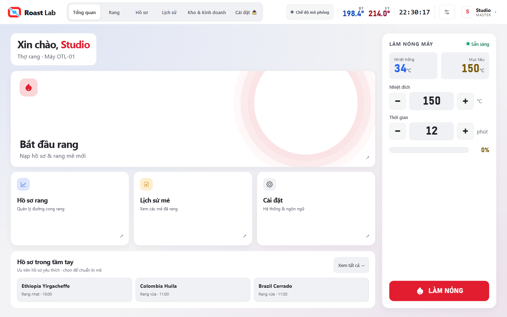

# Phân tích bố cục OTL Roast Lab — lượt hai

Ngày: 06/09/2026. Mục tiêu: thao tác rang dễ hiểu, số đo dễ đọc, giao diện tinh gọn
và chuyển động có tác dụng định hướng. Đánh giá từ sáu màn của app chạy trong
Chromium, dùng dữ liệu thử; không suy diễn dữ liệu kho thật từ màn không có cầu Python.

## Quan sát và thay đổi đã làm

| Khu vực | Bằng chứng ở bản trước | Tác động | Thay đổi lượt này |
|---|---|---|---|
| Tổng quan | Bốn thẻ lớn gần như ngang nhau; tên chức năng và biểu tượng cách xa nhau | Cài đặt có trọng lượng thị giác gần bằng tác vụ rang | Một thẻ bắt đầu rang phủ hàng đầu, ba thẻ chức năng phụ cùng hàng dưới |
| Chọn hồ sơ | Tổng quan chỉ có nút đi tới trang hồ sơ | Người dùng phải chuyển trang mới thấy lựa chọn cụ thể | Hàng ba hồ sơ ưu tiên yêu thích, có tên/mức rang/thời gian và nút xem tất cả |
| Màu nền | Bảng lịch sử và nhãn cài đặt nằm trực tiếp trên nền tùy chọn | Một bức ảnh có vùng sáng tối mạnh có thể làm giảm khả năng đọc | Trang dữ liệu có bề mặt kín, phân biệt với khoảng nền trang trí ngoài rìa |
| Cài đặt | Menu trái và form cùng nằm trên một vùng nền rộng | Ranh giới điều hướng và nội dung thiếu rõ ràng | Hai vùng có nền và đường viền nhẹ; thanh lưu vẫn ở vị trí dưới cùng |
| Điều hướng | Nền chọn tab đổi chỗ tức thì | Không thấy mối liên hệ giữa vị trí trước/sau | Một nền chọn trượt trong 320 ms; nút và nhãn đứng yên |
| Cá nhân hóa | Chuyển mục chỉ ẩn/hiện nội dung | Chuyển cảnh hơi đột ngột | Nội dung vào nhẹ trong 260 ms; phản hồi nhấn/hover trên ô lựa chọn |
| Hình nền | Chọn nền mới thay ngay | Mảng màu đổi đột ngột ở nền | Hình nền xuất hiện dần trong 450 ms, không dịch chuyển thẻ dữ liệu |
| Màn rang | Hiệu ứng trượt áp dụng cho cả pane | Các nút có thể lệch vị trí trong khoảnh khắc vào trang | Chỉ đổi độ hiện trong 180 ms; không dịch chuyển pane rang |

Khoảng trống vẫn cần có để đọc từ xa. Việc bo góc mềm, dùng nền trung tính và nét
viền mảnh là lựa chọn thẩm mỹ cho yêu cầu “sang, mịn”; không phải bằng chứng rằng
mọi người dùng sẽ thao tác nhanh hơn. Cần thử với thợ rang thực tế để đo điều đó.

## Cách tổ chức chuyển động

- Thanh chọn tab di chuyển, còn vị trí nút cố định. Sau đổi ngôn ngữ hoặc kích thước
  cửa sổ, nền chọn được đo lại theo chính nút đang hoạt động.
- Nội dung phụ dịch 7 px và hiện dần. Không chạy chuyển cảnh lặp khi có từng mẫu nhiệt.
- Nền ảnh chỉ chuyển khi chọn nền khác, không chạy lại khi kéo âm lượng hoặc độ mờ.
- Không thêm hiệu ứng đếm cho BT/RoR; dữ liệu mới tiếp tục hiện theo cơ chế có sẵn.
- Chế độ giảm chuyển động của app/hệ điều hành tắt cả chuyển trang, nền và tab trượt.
- Lối tắt hồ sơ kiểm tra mẻ đang chạy: chuyển về màn rang và báo lý do, không đổi hồ sơ.

## Ba hướng nên làm tiếp

1. **Màn rang theo công việc thực tế:** bảng tóm tắt BT/RoR/thời gian ở trên, điều khiển
   gas–gió–trống theo nhóm cố định. Thanh thiết bị phụ cần có chế độ thu gọn dễ tìm.
   Chưa thay toàn bộ màn rang trong lượt này vì cần quan sát thợ sử dụng thật.
2. **Bảng làm nóng:** khoảng giữa tiến trình và nút hiện còn rộng. Có thể dùng cho
   hướng dẫn bước kế tiếp, nhưng phải lấy đúng trạng thái máy; không điền trang trí
   hoặc hiện “sẵn sàng nạp” chỉ từ dữ liệu mô phỏng.
3. **Lịch sử và hồ sơ:** thêm tìm kiếm, khoảng ngày, xem trước đường cong từ mẻ đã lưu.
   Biểu đồ thu nhỏ cần dữ liệu thật; không vẽ một đường cong trang trí rồi khiến người
   dùng nhầm là kết quả rang. Tên dài cần kiểm cả danh sách, thẻ và hộp chỉnh sửa.

Khung màn chính vẫn co theo tỷ lệ thiết kế. Bộ dò còn nhắc một số nút nhỏ ở Rang và
Cài đặt trên laptop 1366 px; tăng đồng loạt sẽ làm chật hàng điều khiển. Đây là phần
cần giải quyết cùng việc bố trí lại màn rang, không coi kiểm bố cục đạt là đạt hết cảm ứng.

## Tham chiếu thiết kế

- [Apple Human Interface Guidelines](https://developer.apple.com/design/human-interface-guidelines/):
  phân cấp thị giác để điều khiển hỗ trợ nội dung. Áp dụng vào tác vụ chính/phụ và
  bề mặt dữ liệu, không sao chép giao diện hệ điều hành.
- [Fluent 2 — Layout](https://fluent2.microsoft.design/layout): khoảng cách làm rõ
  quan hệ giữa thành phần. Áp dụng vào nhóm điều hướng, form và hàng hồ sơ.
- [Fluent 2 — Motion](https://fluent2.microsoft.design/motion): chuyển động nhất quán
  giúp duy trì cảm giác quen thuộc. Áp dụng vào nền tab chọn và thời lượng chuyển cảnh.

## Kiểm chứng và xem thử

- `tools/test_ui_layout_motion.py`: thứ tự hồ sơ yêu thích, tên dài/chèn HTML,
  chọn đúng hồ sơ, chặn đổi hồ sơ khi đang rang, căn nền tab VI/EN theo cửa sổ,
  màn rang không trượt, giảm chuyển động.
- Chạy lại bộ cá nhân hóa, toolbar, rang tương thích và luồng mẻ trực tiếp.
- Đo tràn/đè qua sáu tab, VI/EN ở 1920×1080, 1366×768 và 1280×800.
- Video quay trực tiếp trong Chromium, dữ liệu thử, không có cầu điều khiển máy.
  MP4 giữ chuyển động tốt hơn GIF; độ mượt thực tế phụ thuộc màn hình và thiết bị.

[Xem video MP4](layout-v2-motion.mp4) · [Xem GIF](layout-v2-motion.gif)

