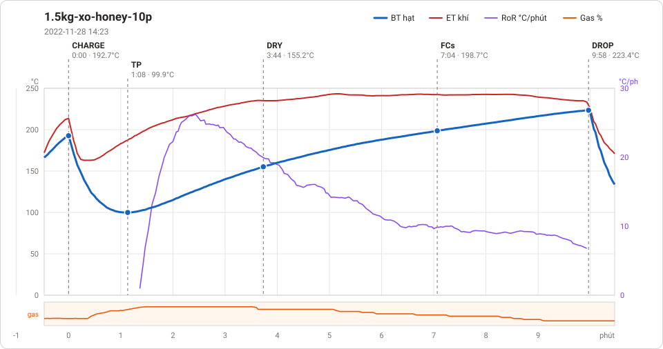
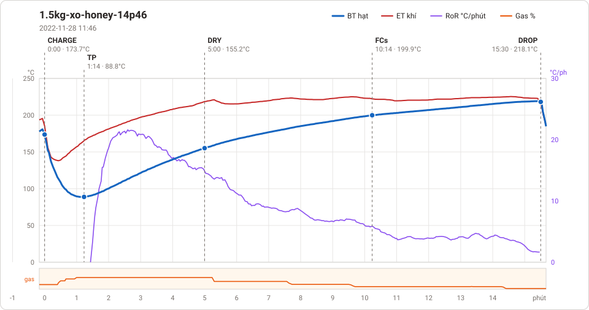

# Giản đồ rang — `1-3kg-auto-QN`

2 profile. Bấm tên để mở tệp `.alog` (tải về, mở bằng Artisan: `File → Open`). Giản đồ sinh tự động bằng [`tools/ve_gian_do_alog.py`](../../../tools/ve_gian_do_alog.py) — [về bảng tổng](../README.md).

### [1.5kg-xo-honey-10p](1.5kg-xo-honey-10p.alog)

**TP** 1:08 · 99.9°C · **DRY** 3:44 · 155.2°C · **FCs** 7:04 · 198.7°C · **DROP** 9:58 · 223.4°C  —  tổng **9:58** · DTR **29.1 %**

### [1.5kg-xo-honey-14p46](1.5kg-xo-honey-14p46.alog)

**TP** 1:14 · 88.8°C · **DRY** 5:00 · 155.2°C · **FCs** 10:14 · 199.9°C · **DROP** 15:30 · 218.1°C  —  tổng **15:30** · DTR **34.0 %**

