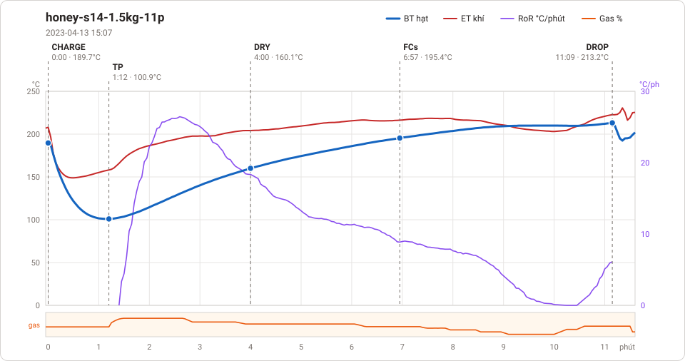
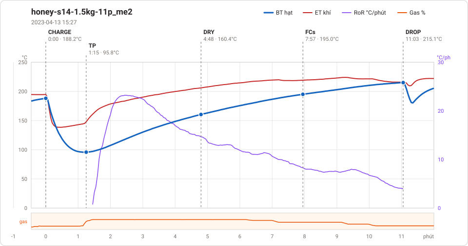
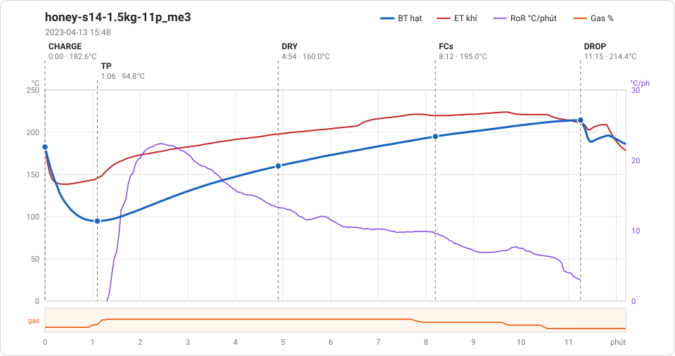

# Giản đồ rang — `10-OTL-03-EU-JPN`

3 profile. Bấm tên để mở tệp `.alog` (tải về, mở bằng Artisan: `File → Open`). Giản đồ sinh tự động bằng [`tools/ve_gian_do_alog.py`](../../../tools/ve_gian_do_alog.py) — [về bảng tổng](../README.md).

### [honey-s14-1.5kg-11p](honey-s14-1.5kg-11p.alog)

**TP** 1:12 · 100.9°C · **DRY** 4:00 · 160.1°C · **FCs** 6:57 · 195.4°C · **DROP** 11:09 · 213.2°C  —  tổng **11:09** · DTR **37.7 %**

### [honey-s14-1.5kg-11p_me2](honey-s14-1.5kg-11p_me2.alog)

**TP** 1:15 · 95.8°C · **DRY** 4:48 · 160.4°C · **FCs** 7:57 · 195.0°C · **DROP** 11:03 · 215.1°C  —  tổng **11:03** · DTR **28.1 %**

### [honey-s14-1.5kg-11p_me3](honey-s14-1.5kg-11p_me3.alog)

**TP** 1:06 · 94.8°C · **DRY** 4:54 · 160.0°C · **FCs** 8:12 · 195.0°C · **DROP** 11:15 · 214.4°C  —  tổng **11:15** · DTR **27.1 %**

