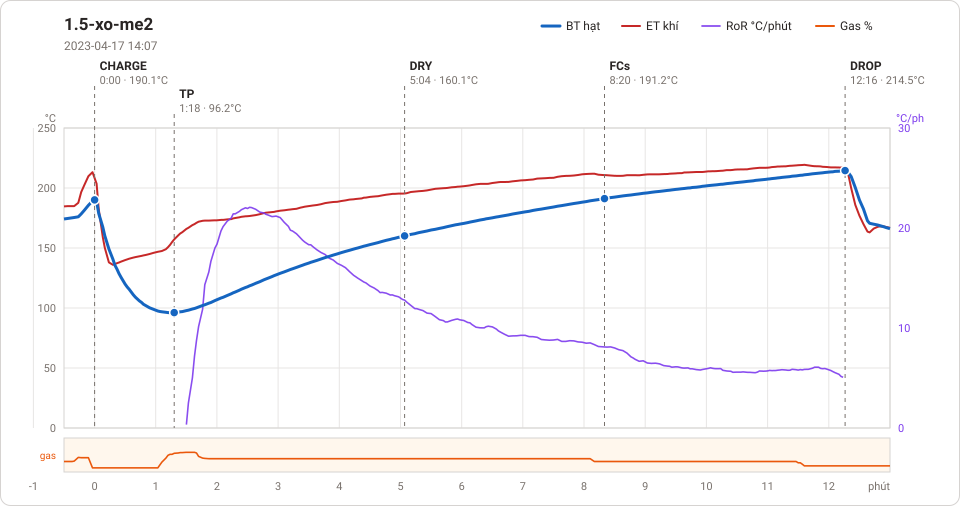
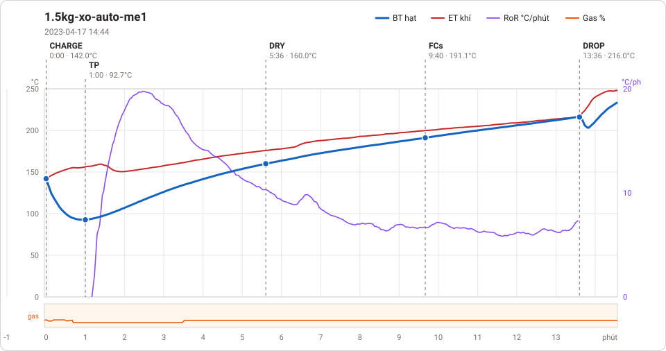
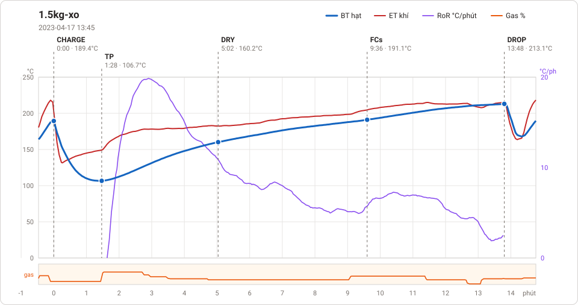
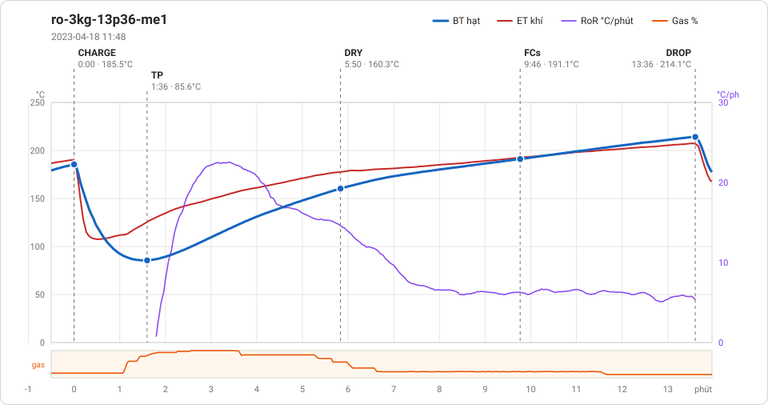
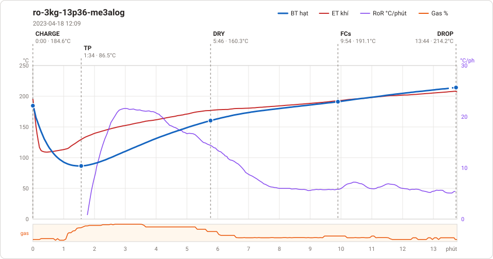

# Giản đồ rang — `11_OTL-03-Auto-LanBuonMe`

5 profile. Bấm tên để mở tệp `.alog` (tải về, mở bằng Artisan: `File → Open`). Giản đồ sinh tự động bằng [`tools/ve_gian_do_alog.py`](../../../tools/ve_gian_do_alog.py) — [về bảng tổng](../README.md).

### [1.5-xo-me2](1.5-xo-me2.alog)

**TP** 1:18 · 96.2°C · **DRY** 5:04 · 160.1°C · **FCs** 8:20 · 191.2°C · **DROP** 12:16 · 214.5°C  —  tổng **12:16** · DTR **32.1 %**

### [1.5kg-xo-auto-me1](1.5kg-xo-auto-me1.alog)

**TP** 1:00 · 92.7°C · **DRY** 5:36 · 160.0°C · **FCs** 9:40 · 191.1°C · **DROP** 13:36 · 216.0°C  —  tổng **13:36** · DTR **28.9 %**

### [1.5kg-xo](1.5kg-xo.alog)

**TP** 1:28 · 106.7°C · **DRY** 5:02 · 160.2°C · **FCs** 9:36 · 191.1°C · **DROP** 13:48 · 213.1°C  —  tổng **13:48** · DTR **30.4 %**

### [ro-3kg-13p36-me1](ro-3kg-13p36-me1.alog)

**TP** 1:36 · 85.6°C · **DRY** 5:50 · 160.3°C · **FCs** 9:46 · 191.1°C · **DROP** 13:36 · 214.1°C  —  tổng **13:36** · DTR **28.2 %**

### [ro-3kg-13p36-me3alog](ro-3kg-13p36-me3alog.alog)

**TP** 1:34 · 86.5°C · **DRY** 5:46 · 160.3°C · **FCs** 9:54 · 191.1°C · **DROP** 13:44 · 214.2°C  —  tổng **13:44** · DTR **27.9 %**

