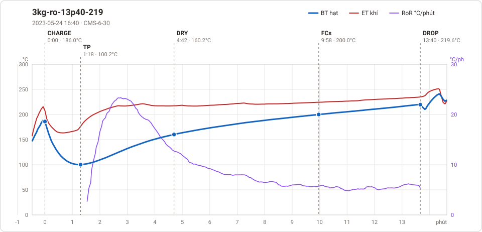

# Giản đồ rang — `18_5kg_QN_APHAP`

1 profile. Bấm tên để mở tệp `.alog` (tải về, mở bằng Artisan: `File → Open`). Giản đồ sinh tự động bằng [`tools/ve_gian_do_alog.py`](../../../tools/ve_gian_do_alog.py) — [về bảng tổng](../README.md).

### [3kg-ro-13p40-219](3kg-ro-13p40-219.alog)

**TP** 1:18 · 100.2°C · **DRY** 4:42 · 160.2°C · **FCs** 9:58 · 200.0°C · **DROP** 13:40 · 219.6°C  —  tổng **13:40** · DTR **27.1 %**

