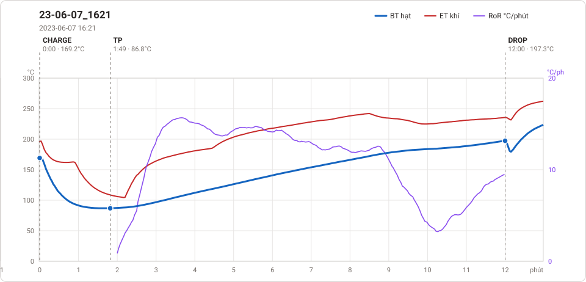

# Giản đồ rang — `22_OTL-03-Dalat`

1 profile. Bấm tên để mở tệp `.alog` (tải về, mở bằng Artisan: `File → Open`). Giản đồ sinh tự động bằng [`tools/ve_gian_do_alog.py`](../../../tools/ve_gian_do_alog.py) — [về bảng tổng](../README.md).

### [23-06-07_1621](23-06-07_1621.alog)

**TP** 1:49 · 86.8°C · **DROP** 12:00 · 197.3°C  —  tổng **12:00**

