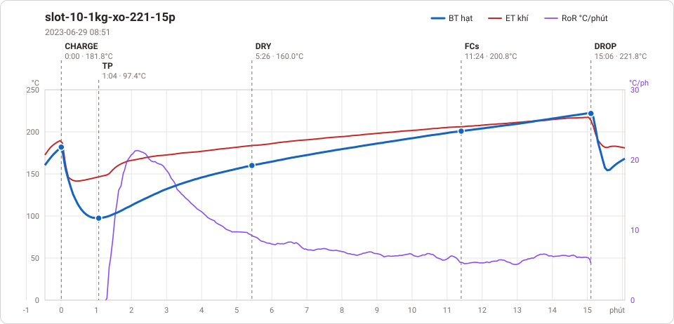
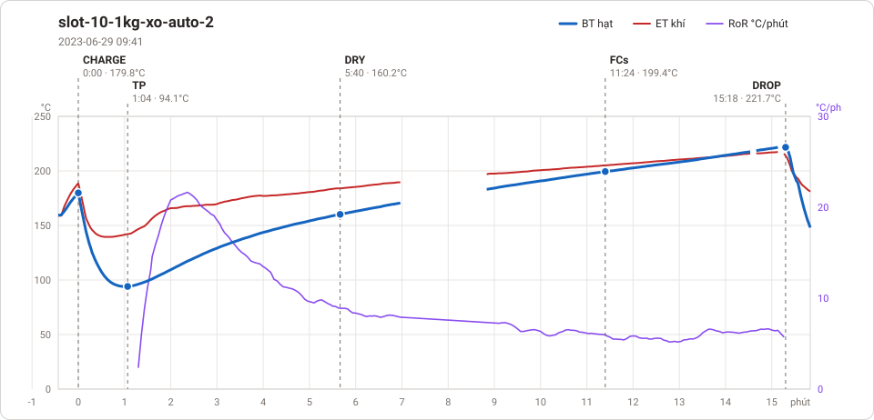
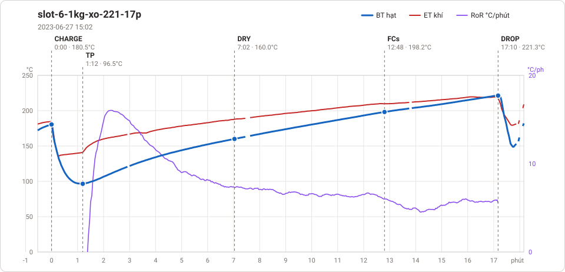
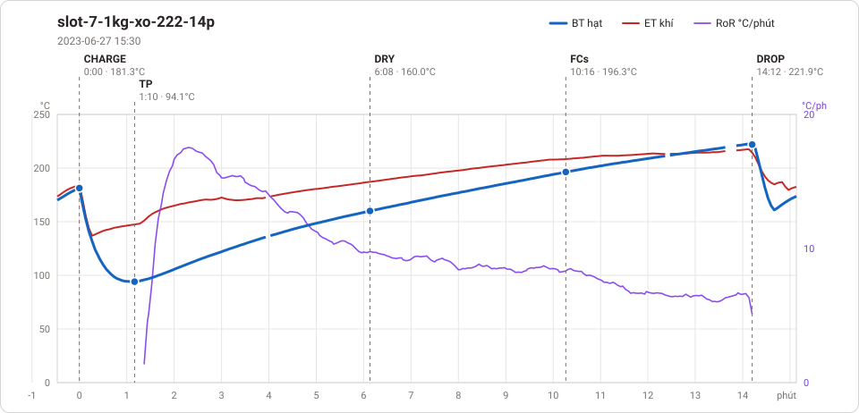
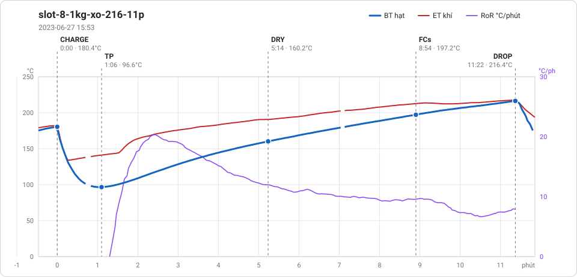
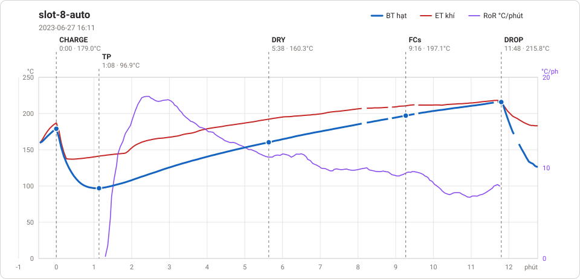

# Giản đồ rang — `26-1KG-AUTO-PHILIPPINES`

7 profile. Bấm tên để mở tệp `.alog` (tải về, mở bằng Artisan: `File → Open`). Giản đồ sinh tự động bằng [`tools/ve_gian_do_alog.py`](../../../tools/ve_gian_do_alog.py) — [về bảng tổng](../README.md).

### [slot-10 auto 1](slot-10%20auto%201.alog)

**TP** 1:10 · 89.7°C · **DRY** 6:10 · 160.1°C · **FCs** 10:48 · 197.2°C · **DROP** 14:56 · 221.8°C  —  tổng **14:56** · DTR **27.7 %**

### [slot-10-1kg-xo-221-15p](slot-10-1kg-xo-221-15p.alog)

**TP** 1:04 · 97.4°C · **DRY** 5:26 · 160.0°C · **FCs** 11:24 · 200.8°C · **DROP** 15:06 · 221.8°C  —  tổng **15:06** · DTR **24.5 %**

### [slot-10-1kg-xo-auto-2](slot-10-1kg-xo-auto-2.alog)

**TP** 1:04 · 94.1°C · **DRY** 5:40 · 160.2°C · **FCs** 11:24 · 199.4°C · **DROP** 15:18 · 221.7°C  —  tổng **15:18** · DTR **25.5 %**

### [slot-6-1kg-xo-221-17p](slot-6-1kg-xo-221-17p.alog)

**TP** 1:12 · 96.5°C · **DRY** 7:02 · 160.0°C · **FCs** 12:48 · 198.2°C · **DROP** 17:10 · 221.3°C  —  tổng **17:10** · DTR **25.4 %**

### [slot-7-1kg-xo-222-14p](slot-7-1kg-xo-222-14p.alog)

**TP** 1:10 · 94.1°C · **DRY** 6:08 · 160.0°C · **FCs** 10:16 · 196.3°C · **DROP** 14:12 · 221.9°C  —  tổng **14:12** · DTR **27.7 %**

### [slot-8-1kg-xo-216-11p](slot-8-1kg-xo-216-11p.alog)

**TP** 1:06 · 96.6°C · **DRY** 5:14 · 160.2°C · **FCs** 8:54 · 197.2°C · **DROP** 11:22 · 216.4°C  —  tổng **11:22** · DTR **21.7 %**

### [slot-8-auto](slot-8-auto.alog)

**TP** 1:08 · 96.9°C · **DRY** 5:38 · 160.3°C · **FCs** 9:16 · 197.1°C · **DROP** 11:48 · 215.8°C  —  tổng **11:48** · DTR **21.5 %**

