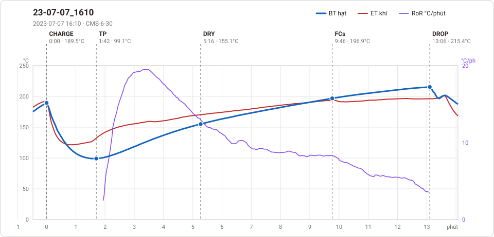

# Giản đồ rang — `28_OTL_03_VN_DAKNONG`

1 profile. Bấm tên để mở tệp `.alog` (tải về, mở bằng Artisan: `File → Open`). Giản đồ sinh tự động bằng [`tools/ve_gian_do_alog.py`](../../../tools/ve_gian_do_alog.py) — [về bảng tổng](../README.md).

### [23-07-07_1610](23-07-07_1610.alog)

**TP** 1:42 · 99.1°C · **DRY** 5:16 · 155.1°C · **FCs** 9:46 · 196.9°C · **DROP** 13:06 · 215.4°C  —  tổng **13:06** · DTR **25.4 %**

