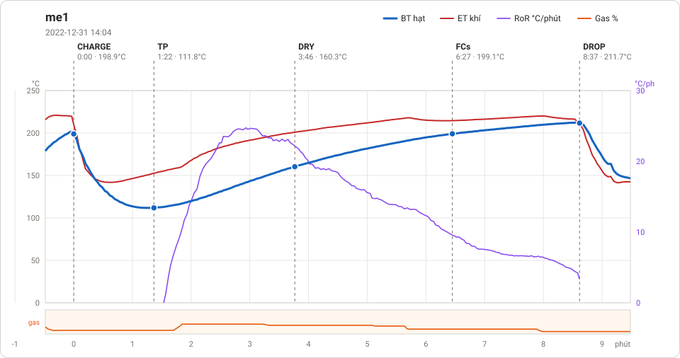

# Giản đồ rang — `3-auto-15kg-ductrong`

1 profile. Bấm tên để mở tệp `.alog` (tải về, mở bằng Artisan: `File → Open`). Giản đồ sinh tự động bằng [`tools/ve_gian_do_alog.py`](../../../tools/ve_gian_do_alog.py) — [về bảng tổng](../README.md).

### [me1](me1.alog)

**TP** 1:22 · 111.8°C · **DRY** 3:46 · 160.3°C · **FCs** 6:27 · 199.1°C · **DROP** 8:37 · 211.7°C  —  tổng **8:37** · DTR **25.1 %**

