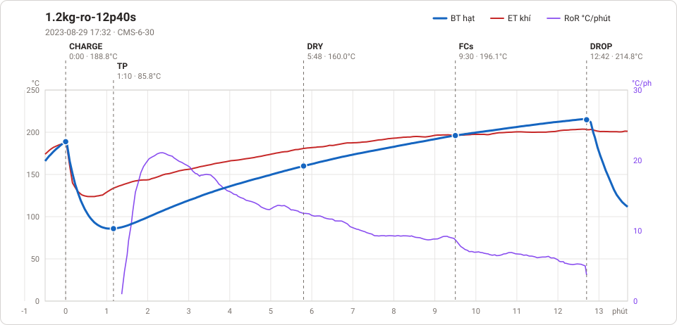
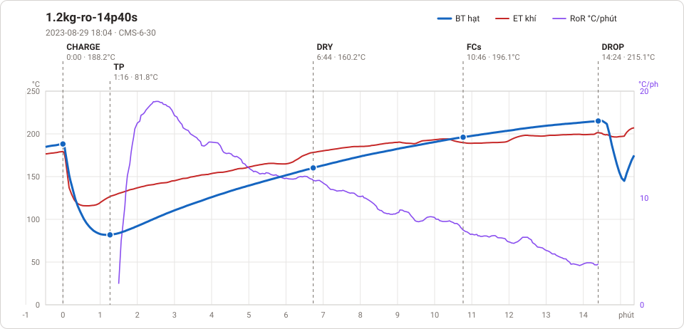

# Giản đồ rang — `31_OTL_01_EU_CYLINDER`

2 profile. Bấm tên để mở tệp `.alog` (tải về, mở bằng Artisan: `File → Open`). Giản đồ sinh tự động bằng [`tools/ve_gian_do_alog.py`](../../../tools/ve_gian_do_alog.py) — [về bảng tổng](../README.md).

### [1.2kg-ro-12p40s](1.2kg-ro-12p40s.alog)

**TP** 1:10 · 85.8°C · **DRY** 5:48 · 160.0°C · **FCs** 9:30 · 196.1°C · **DROP** 12:42 · 214.8°C  —  tổng **12:42** · DTR **25.2 %**

### [1.2kg-ro-14p40s](1.2kg-ro-14p40s.alog)

**TP** 1:16 · 81.8°C · **DRY** 6:44 · 160.2°C · **FCs** 10:46 · 196.1°C · **DROP** 14:24 · 215.1°C  —  tổng **14:24** · DTR **25.2 %**

