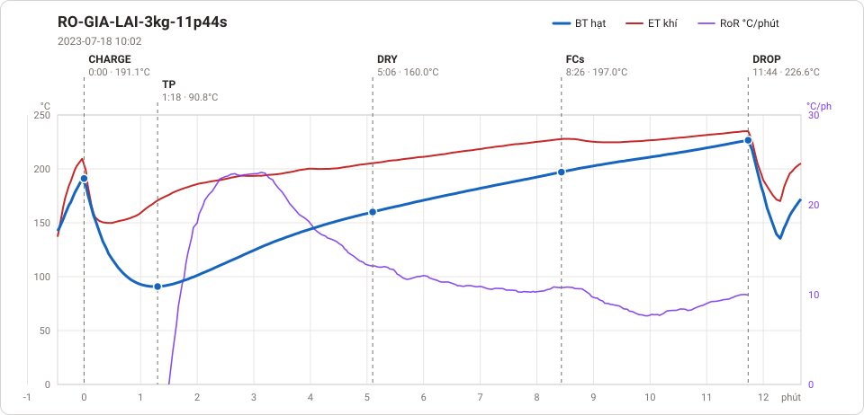

# Giản đồ rang — `32_OTL_06_EU_AUTO`

1 profile. Bấm tên để mở tệp `.alog` (tải về, mở bằng Artisan: `File → Open`). Giản đồ sinh tự động bằng [`tools/ve_gian_do_alog.py`](../../../tools/ve_gian_do_alog.py) — [về bảng tổng](../README.md).

### [RO-GIA-LAI-3kg-11p44s](RO-GIA-LAI-3kg-11p44s.alog)

**TP** 1:18 · 90.8°C · **DRY** 5:06 · 160.0°C · **FCs** 8:26 · 197.0°C · **DROP** 11:44 · 226.6°C  —  tổng **11:44** · DTR **28.1 %**

