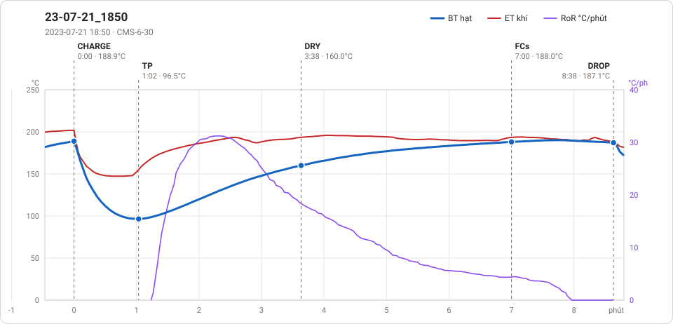
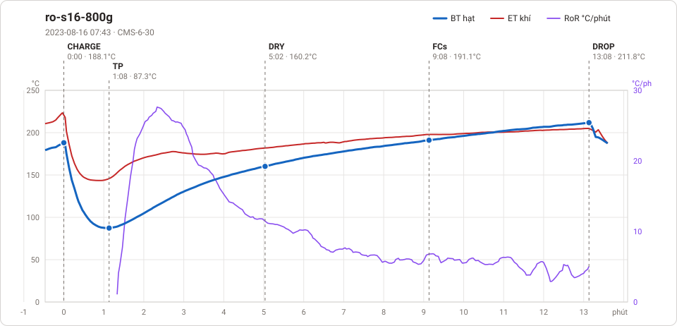
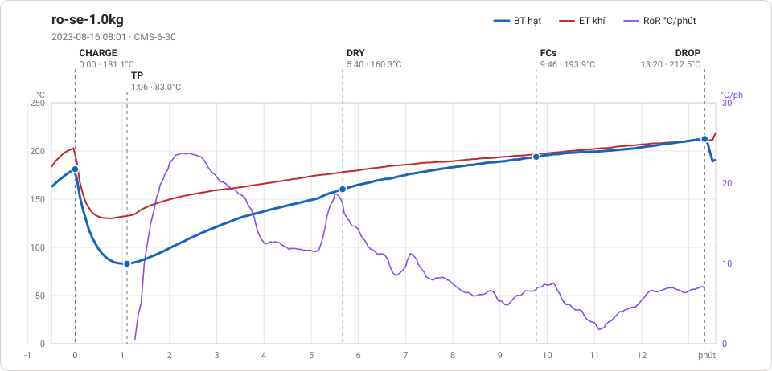
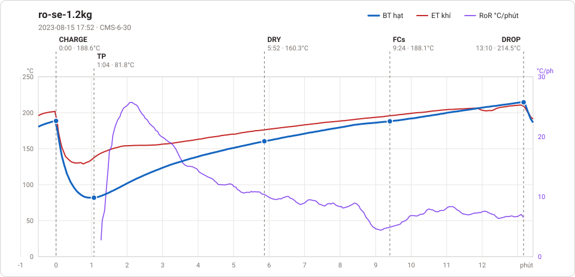

# Giản đồ rang — `33_OTL_01_EU`

4 profile. Bấm tên để mở tệp `.alog` (tải về, mở bằng Artisan: `File → Open`). Giản đồ sinh tự động bằng [`tools/ve_gian_do_alog.py`](../../../tools/ve_gian_do_alog.py) — [về bảng tổng](../README.md).

### [23-07-21_1850](23-07-21_1850.alog)

**TP** 1:02 · 96.5°C · **DRY** 3:38 · 160.0°C · **FCs** 7:00 · 188.0°C · **DROP** 8:38 · 187.1°C  —  tổng **8:38** · DTR **18.9 %**

### [ro-s16-800g](ro-s16-800g.alog)

**TP** 1:08 · 87.3°C · **DRY** 5:02 · 160.2°C · **FCs** 9:08 · 191.1°C · **DROP** 13:08 · 211.8°C  —  tổng **13:08** · DTR **30.5 %**

### [ro-se-1.0kg](ro-se-1.0kg.alog)

**TP** 1:06 · 83.0°C · **DRY** 5:40 · 160.3°C · **FCs** 9:46 · 193.9°C · **DROP** 13:20 · 212.5°C  —  tổng **13:20** · DTR **26.8 %**

### [ro-se-1.2kg](ro-se-1.2kg.alog)

**TP** 1:04 · 81.8°C · **DRY** 5:52 · 160.3°C · **FCs** 9:24 · 188.1°C · **DROP** 13:10 · 214.5°C  —  tổng **13:10** · DTR **28.6 %**

