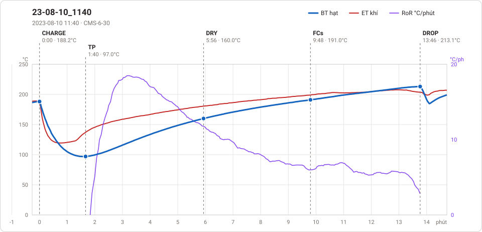

# Giản đồ rang — `34_OTL_03_HCM`

1 profile. Bấm tên để mở tệp `.alog` (tải về, mở bằng Artisan: `File → Open`). Giản đồ sinh tự động bằng [`tools/ve_gian_do_alog.py`](../../../tools/ve_gian_do_alog.py) — [về bảng tổng](../README.md).

### [23-08-10_1140](23-08-10_1140.alog)

**TP** 1:40 · 97.0°C · **DRY** 5:56 · 160.0°C · **FCs** 9:48 · 191.0°C · **DROP** 13:46 · 213.1°C  —  tổng **13:46** · DTR **28.8 %**

