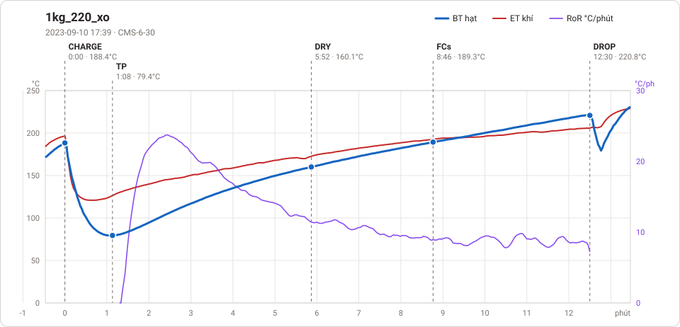

# Giản đồ rang — `35_OTL_01_EU_PRESSURE`

1 profile. Bấm tên để mở tệp `.alog` (tải về, mở bằng Artisan: `File → Open`). Giản đồ sinh tự động bằng [`tools/ve_gian_do_alog.py`](../../../tools/ve_gian_do_alog.py) — [về bảng tổng](../README.md).

### [1kg_220_xo](1kg_220_xo.alog)

**TP** 1:08 · 79.4°C · **DRY** 5:52 · 160.1°C · **FCs** 8:46 · 189.3°C · **DROP** 12:30 · 220.8°C  —  tổng **12:30** · DTR **29.9 %**

