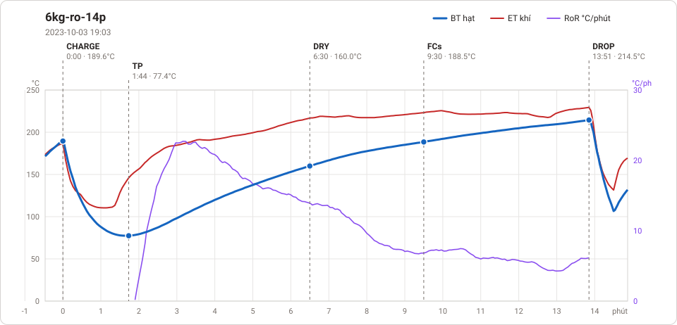

# Giản đồ rang — `38_OTL_06_HAO_HN`

1 profile. Bấm tên để mở tệp `.alog` (tải về, mở bằng Artisan: `File → Open`). Giản đồ sinh tự động bằng [`tools/ve_gian_do_alog.py`](../../../tools/ve_gian_do_alog.py) — [về bảng tổng](../README.md).

### [6kg-ro-14p](6kg-ro-14p.alog)

**TP** 1:44 · 77.4°C · **DRY** 6:30 · 160.0°C · **FCs** 9:30 · 188.5°C · **DROP** 13:51 · 214.5°C  —  tổng **13:51** · DTR **31.4 %**

