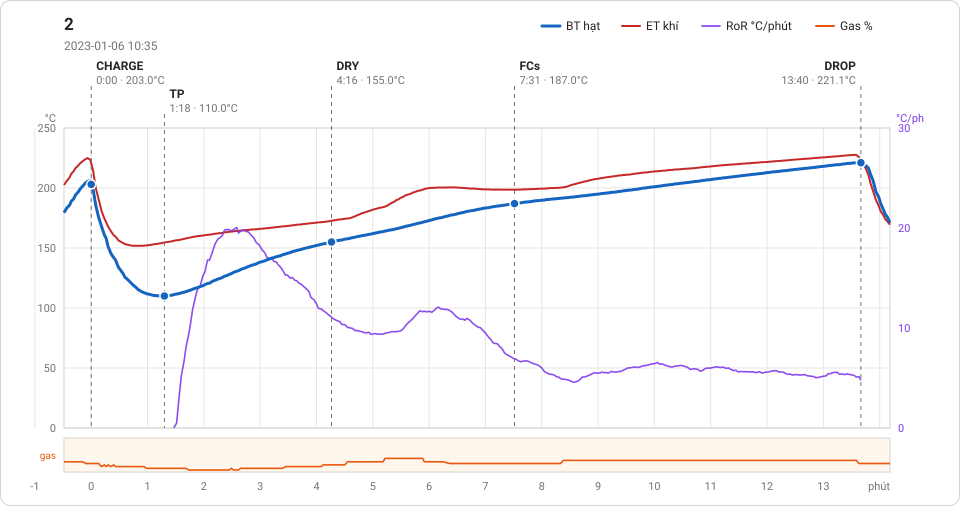
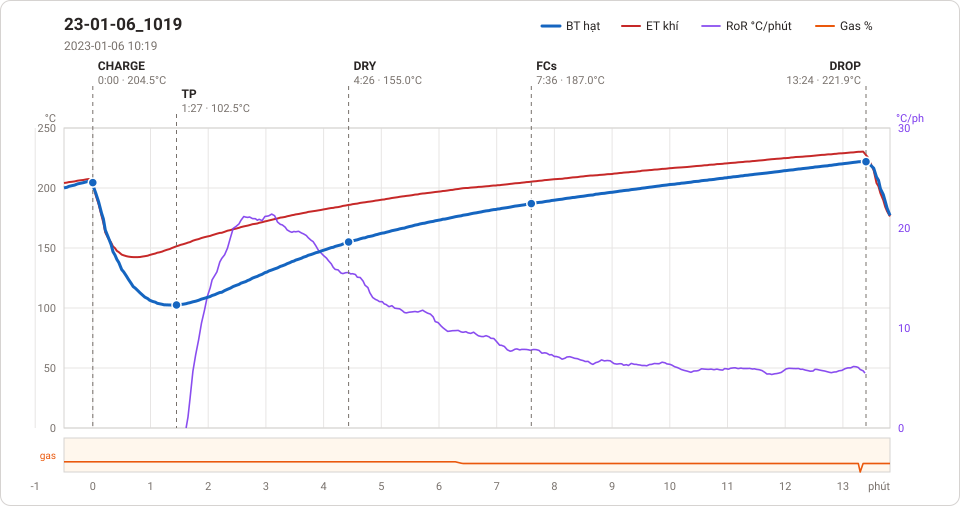

# Giản đồ rang — `4-12kg-athang`

2 profile. Bấm tên để mở tệp `.alog` (tải về, mở bằng Artisan: `File → Open`). Giản đồ sinh tự động bằng [`tools/ve_gian_do_alog.py`](../../../tools/ve_gian_do_alog.py) — [về bảng tổng](../README.md).

### [2](2.alog)

**TP** 1:18 · 110.0°C · **DRY** 4:16 · 155.0°C · **FCs** 7:31 · 187.0°C · **DROP** 13:40 · 221.1°C  —  tổng **13:40** · DTR **45.0 %**

### [23-01-06_1019](23-01-06_1019.alog)

**TP** 1:27 · 102.5°C · **DRY** 4:26 · 155.0°C · **FCs** 7:36 · 187.0°C · **DROP** 13:24 · 221.9°C  —  tổng **13:24** · DTR **43.3 %**

