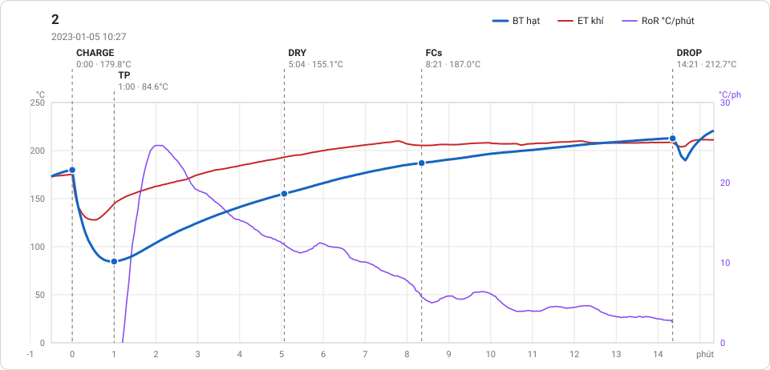
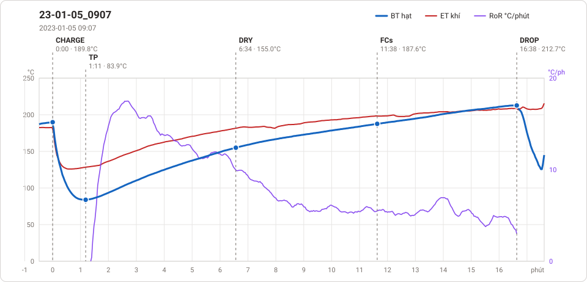

# Giản đồ rang — `4-1kg-lamha-MrsQuynh`

2 profile. Bấm tên để mở tệp `.alog` (tải về, mở bằng Artisan: `File → Open`). Giản đồ sinh tự động bằng [`tools/ve_gian_do_alog.py`](../../../tools/ve_gian_do_alog.py) — [về bảng tổng](../README.md).

### [2](2.alog)

**TP** 1:00 · 84.6°C · **DRY** 5:04 · 155.1°C · **FCs** 8:21 · 187.0°C · **DROP** 14:21 · 212.7°C  —  tổng **14:21** · DTR **41.8 %**

### [23-01-05_0907](23-01-05_0907.alog)

**TP** 1:11 · 83.9°C · **DRY** 6:34 · 155.0°C · **FCs** 11:38 · 187.6°C · **DROP** 16:38 · 212.7°C  —  tổng **16:38** · DTR **30.1 %**

