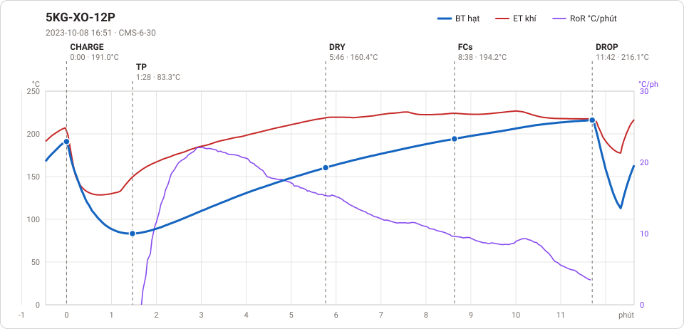

# Giản đồ rang — `40_OTL-06-AUS-CYLINDER`

1 profile. Bấm tên để mở tệp `.alog` (tải về, mở bằng Artisan: `File → Open`). Giản đồ sinh tự động bằng [`tools/ve_gian_do_alog.py`](../../../tools/ve_gian_do_alog.py) — [về bảng tổng](../README.md).

### [5KG-XO-12P](5KG-XO-12P.alog)

**TP** 1:28 · 83.3°C · **DRY** 5:46 · 160.4°C · **FCs** 8:38 · 194.2°C · **DROP** 11:42 · 216.1°C  —  tổng **11:42** · DTR **26.2 %**

