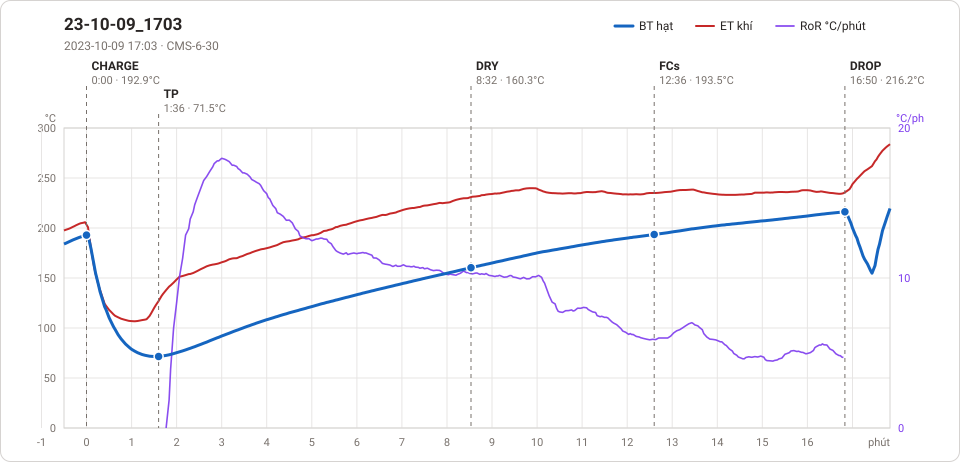

# Giản đồ rang — `41_OTL-30-AUS-CYLINDER`

1 profile. Bấm tên để mở tệp `.alog` (tải về, mở bằng Artisan: `File → Open`). Giản đồ sinh tự động bằng [`tools/ve_gian_do_alog.py`](../../../tools/ve_gian_do_alog.py) — [về bảng tổng](../README.md).

### [23-10-09_1703](23-10-09_1703.alog)

**TP** 1:36 · 71.5°C · **DRY** 8:32 · 160.3°C · **FCs** 12:36 · 193.5°C · **DROP** 16:50 · 216.2°C  —  tổng **16:50** · DTR **25.1 %**

