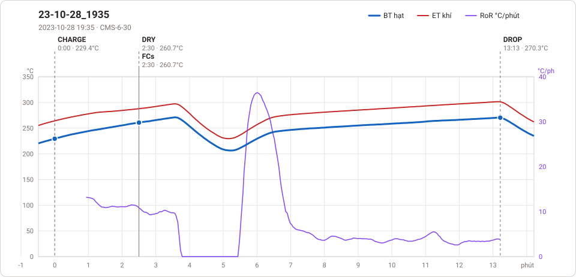
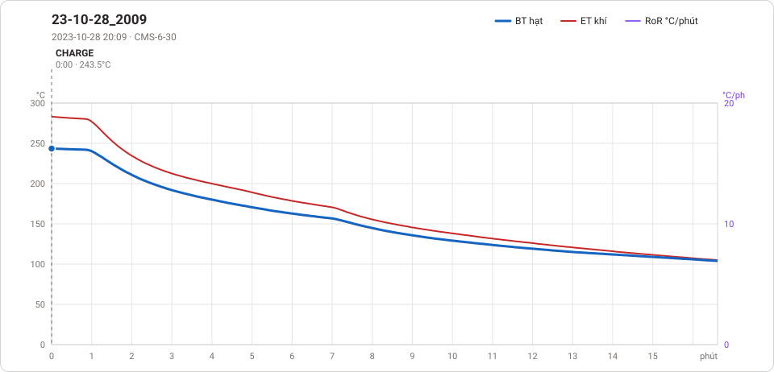

# Giản đồ rang — `44_120KG_Manual`

2 profile. Bấm tên để mở tệp `.alog` (tải về, mở bằng Artisan: `File → Open`). Giản đồ sinh tự động bằng [`tools/ve_gian_do_alog.py`](../../../tools/ve_gian_do_alog.py) — [về bảng tổng](../README.md).

### [23-10-28_1935](23-10-28_1935.alog)

**DRY** 2:30 · 260.7°C · **FCs** 2:30 · 260.7°C · **DROP** 13:13 · 270.3°C  —  tổng **13:13** · DTR **81.1 %**

### [23-10-28_2009](23-10-28_2009.alog)

**TP** 16:39 · 103.9°C

