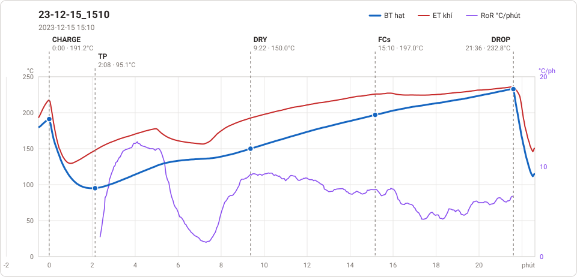

# Giản đồ rang — `45_120_Auto`

11 profile. Bấm tên để mở tệp `.alog` (tải về, mở bằng Artisan: `File → Open`). Giản đồ sinh tự động bằng [`tools/ve_gian_do_alog.py`](../../../tools/ve_gian_do_alog.py) — [về bảng tổng](../README.md).

### [23-12-15_1510](23-12-15_1510.alog)

**TP** 2:08 · 95.1°C · **DRY** 9:22 · 150.0°C · **FCs** 15:10 · 197.0°C · **DROP** 21:36 · 232.8°C  —  tổng **21:36** · DTR **29.8 %**

### [23-12-15_1647 auto](23-12-15_1647%20auto.alog)

**TP** 2:08 · 95.3°C · **DRY** 7:32 · 150.0°C · **FCs** 13:08 · 200.2°C · **DROP** 17:28 · 234.6°C  —  tổng **17:28** · DTR **24.8 %**

### [23-12-15_1731 auto 90kg](23-12-15_1731%20auto%2090kg.alog)

**TP** 1:56 · 101.0°C · **DRY** 5:52 · 150.0°C · **FCs** 11:18 · 200.0°C · **DROP** 16:54 · 235.1°C  —  tổng **16:54** · DTR **33.1 %**

### [ro 15-12-2023](ro%2015-12-2023.alog)

**TP** 2:06 · 95.4°C · **DRY** 7:40 · 150.0°C · **FCs** 13:16 · 200.0°C · **DROP** 17:42 · 235.0°C  —  tổng **17:42** · DTR **25.0 %**

### [slot 1](slot%201.alog)

**TP** 1:32 · 83.5°C · **DRY** 5:04 · 150.2°C · **FCs** 8:58 · 197.2°C · **DROP** 11:20 · 216.2°C  —  tổng **11:20** · DTR **20.9 %**

### [slot 9](slot%209.alog)

**TP** 1:34 · 82.9°C · **DRY** 5:48 · 150.5°C · **FCs** 9:24 · 197.0°C · **DROP** 12:14 · 224.3°C  —  tổng **12:14** · DTR **23.2 %**

### [Test 2012](171223/Test%202012.alog)

**TP** 1:26 · 83.2°C · **DRY** 5:08 · 150.5°C · **FCs** 8:54 · 197.0°C · **DROP** 10:46 · 209.1°C  —  tổng **10:46** · DTR **17.3 %**

### [test 11](171223/test%2011.alog)

**TP** 1:16 · 82.5°C · **DRY** 5:08 · 150.1°C · **FCs** 8:44 · 197.2°C · **DROP** 12:22 · 223.3°C  —  tổng **12:22** · DTR **29.4 %**

### [test 12](171223/test%2012.alog)

**TP** 1:28 · 75.2°C · **DRY** 5:42 · 150.3°C · **FCs** 8:58 · 197.1°C · **DROP** 12:06 · 223.3°C  —  tổng **12:06** · DTR **25.9 %**

### [test 13](171223/test%2013.alog)

**TP** 1:28 · 83.0°C · **DRY** 5:08 · 150.0°C · **FCs** 8:52 · 197.2°C · **DROP** 13:22 · 223.2°C  —  tổng **13:22** · DTR **33.7 %**

### [test 2-1](171223/test%202-1.alog)

**TP** 1:28 · 82.8°C · **DRY** 5:10 · 150.2°C · **DROP** 8:24 · 194.3°C  —  tổng **8:24**

