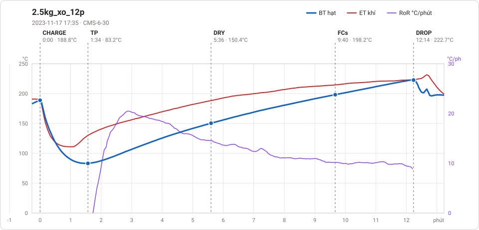
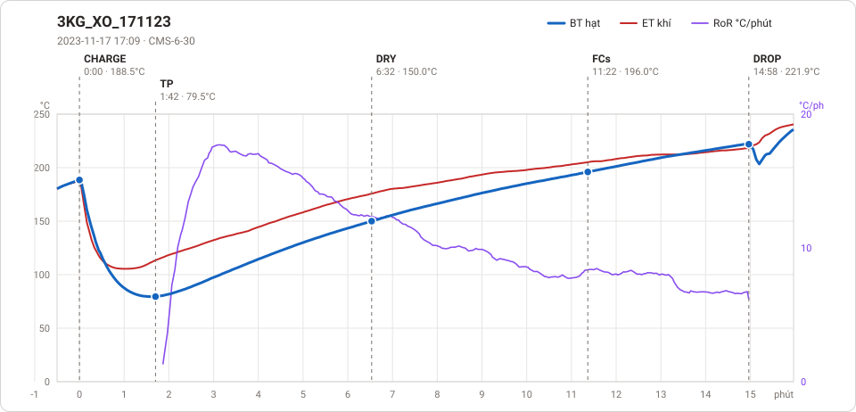

# Giản đồ rang — `46_3KG_EU_171123`

2 profile. Bấm tên để mở tệp `.alog` (tải về, mở bằng Artisan: `File → Open`). Giản đồ sinh tự động bằng [`tools/ve_gian_do_alog.py`](../../../tools/ve_gian_do_alog.py) — [về bảng tổng](../README.md).

### [2.5kg_xo_12p](2.5kg_xo_12p.alog)

**TP** 1:34 · 83.2°C · **DRY** 5:36 · 150.4°C · **FCs** 9:40 · 198.2°C · **DROP** 12:14 · 222.7°C  —  tổng **12:14** · DTR **21.0 %**

### [3KG_XO_171123](3KG_XO_171123.alog)

**TP** 1:42 · 79.5°C · **DRY** 6:32 · 150.0°C · **FCs** 11:22 · 196.0°C · **DROP** 14:58 · 221.9°C  —  tổng **14:58** · DTR **24.1 %**

