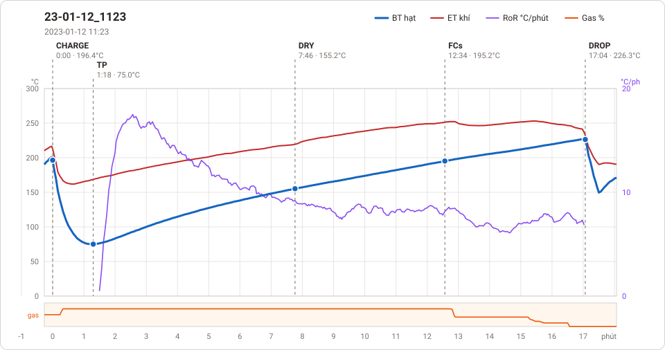
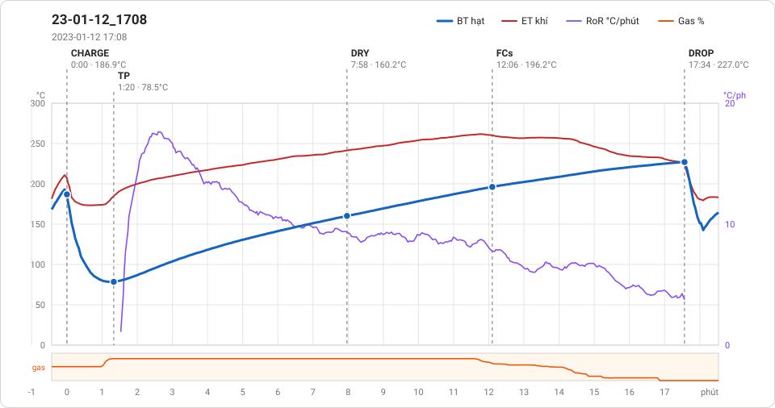
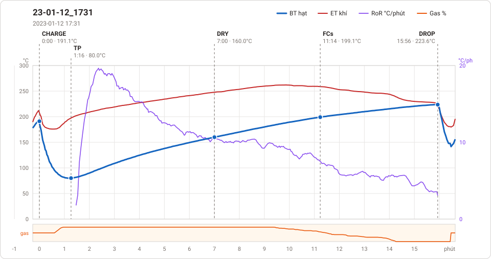
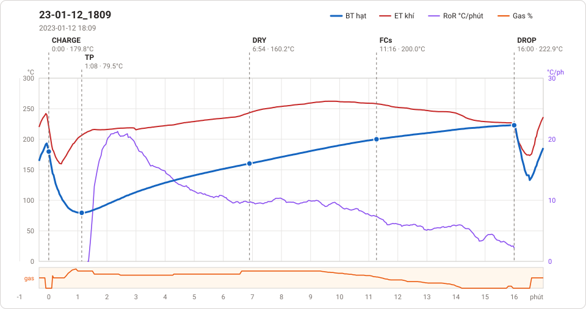
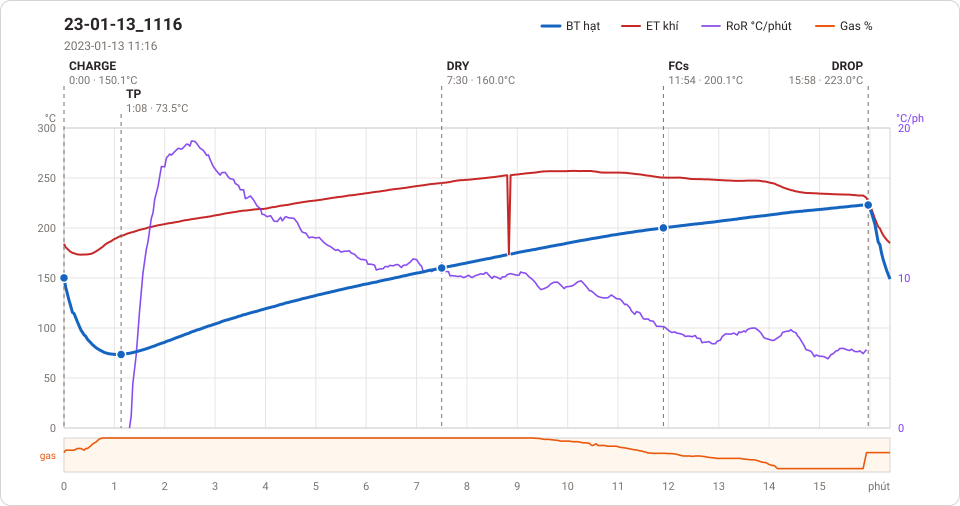
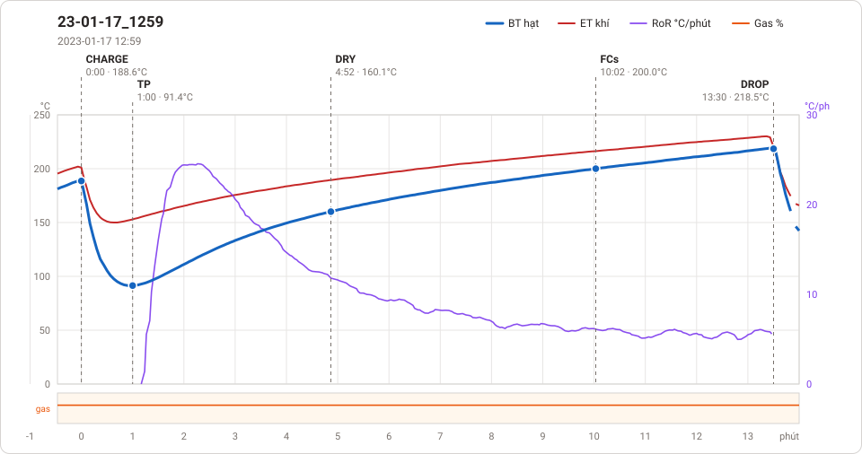
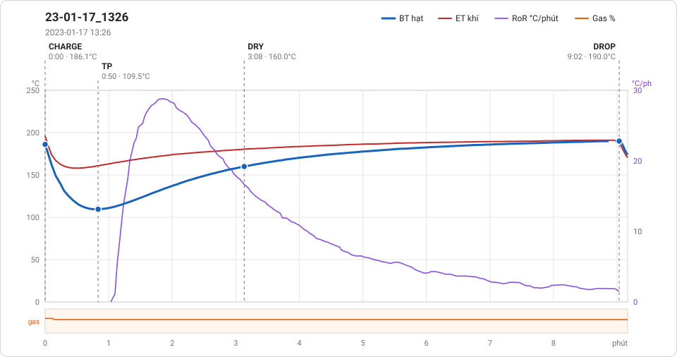
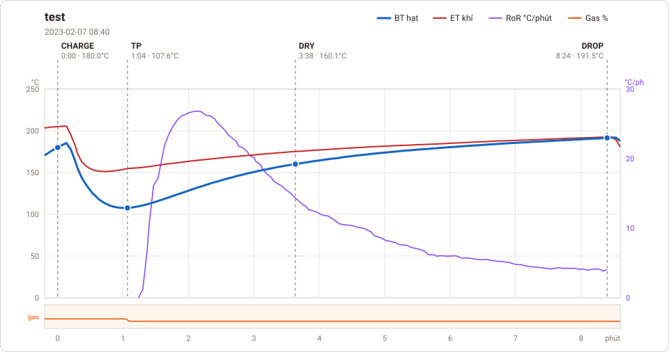

# Giản đồ rang — `5-3kg-eu-auto`

8 profile. Bấm tên để mở tệp `.alog` (tải về, mở bằng Artisan: `File → Open`). Giản đồ sinh tự động bằng [`tools/ve_gian_do_alog.py`](../../../tools/ve_gian_do_alog.py) — [về bảng tổng](../README.md).

### [23-01-12_1123](23-01-12_1123.alog)

**TP** 1:18 · 75.0°C · **DRY** 7:46 · 155.2°C · **FCs** 12:34 · 195.2°C · **DROP** 17:04 · 226.3°C  —  tổng **17:04** · DTR **26.4 %**

### [23-01-12_1708](23-01-12_1708.alog)

**TP** 1:20 · 78.5°C · **DRY** 7:58 · 160.2°C · **FCs** 12:06 · 196.2°C · **DROP** 17:34 · 227.0°C  —  tổng **17:34** · DTR **31.1 %**

### [23-01-12_1731](23-01-12_1731.alog)

**TP** 1:16 · 80.0°C · **DRY** 7:00 · 160.0°C · **FCs** 11:14 · 199.1°C · **DROP** 15:56 · 223.6°C  —  tổng **15:56** · DTR **29.5 %**

### [23-01-12_1809](23-01-12_1809.alog)

**TP** 1:08 · 79.5°C · **DRY** 6:54 · 160.2°C · **FCs** 11:16 · 200.0°C · **DROP** 16:00 · 222.9°C  —  tổng **16:00** · DTR **29.6 %**

### [23-01-13_1116](23-01-13_1116.alog)

**TP** 1:08 · 73.5°C · **DRY** 7:30 · 160.0°C · **FCs** 11:54 · 200.1°C · **DROP** 15:58 · 223.0°C  —  tổng **15:58** · DTR **25.5 %**

### [23-01-17_1259](23-01-17_1259.alog)

**TP** 1:00 · 91.4°C · **DRY** 4:52 · 160.1°C · **FCs** 10:02 · 200.0°C · **DROP** 13:30 · 218.5°C  —  tổng **13:30** · DTR **25.7 %**

### [23-01-17_1326](23-01-17_1326.alog)

**TP** 0:50 · 109.5°C · **DRY** 3:08 · 160.0°C · **DROP** 9:02 · 190.0°C  —  tổng **9:02**

### [test](test.alog)

**TP** 1:04 · 107.6°C · **DRY** 3:38 · 160.1°C · **DROP** 8:24 · 191.5°C  —  tổng **8:24**

