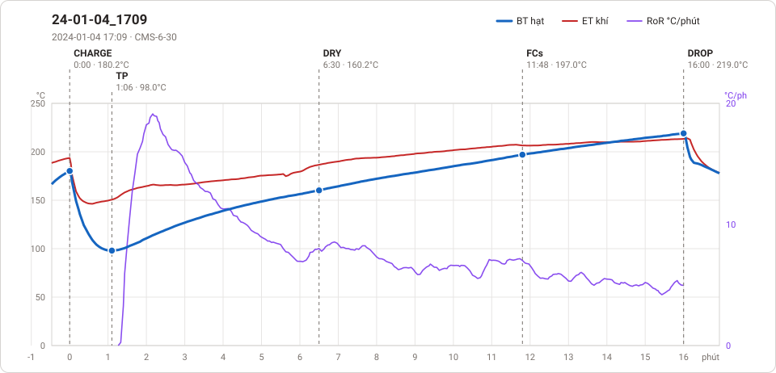
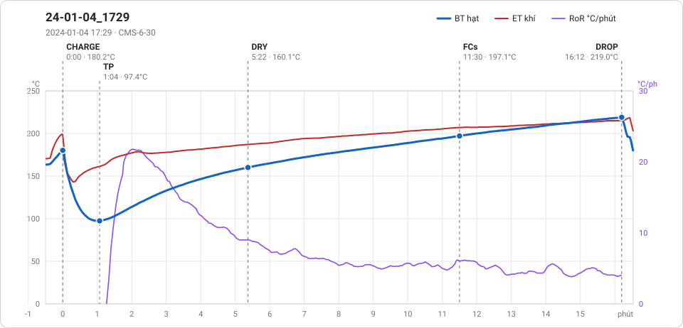

# Giản đồ rang — `52_OTL_01_AROVIN`

2 profile. Bấm tên để mở tệp `.alog` (tải về, mở bằng Artisan: `File → Open`). Giản đồ sinh tự động bằng [`tools/ve_gian_do_alog.py`](../../../tools/ve_gian_do_alog.py) — [về bảng tổng](../README.md).

### [24-01-04_1709](24-01-04_1709.alog)

**TP** 1:06 · 98.0°C · **DRY** 6:30 · 160.2°C · **FCs** 11:48 · 197.0°C · **DROP** 16:00 · 219.0°C  —  tổng **16:00** · DTR **26.2 %**

### [24-01-04_1729](24-01-04_1729.alog)

**TP** 1:04 · 97.4°C · **DRY** 5:22 · 160.1°C · **FCs** 11:30 · 197.1°C · **DROP** 16:12 · 219.0°C  —  tổng **16:12** · DTR **29.0 %**

