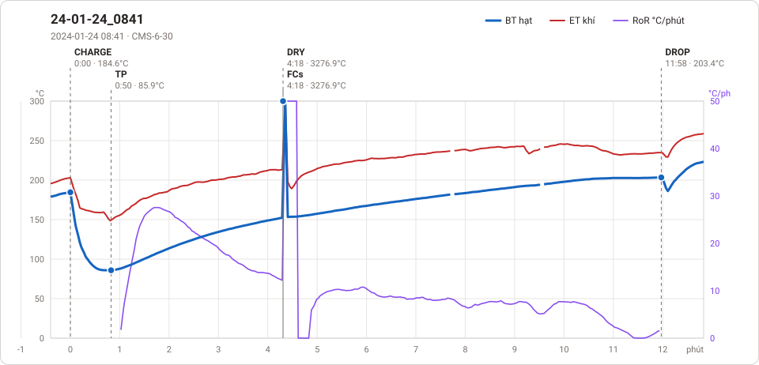

# Giản đồ rang — `55_1KG_VU_DAO`

1 profile. Bấm tên để mở tệp `.alog` (tải về, mở bằng Artisan: `File → Open`). Giản đồ sinh tự động bằng [`tools/ve_gian_do_alog.py`](../../../tools/ve_gian_do_alog.py) — [về bảng tổng](../README.md).

### [24-01-24_0841](24-01-24_0841.alog)

**TP** 0:50 · 85.9°C · **DRY** 4:18 · 3276.9°C · **FCs** 4:18 · 3276.9°C · **DROP** 11:58 · 203.4°C  —  tổng **11:58** · DTR **64.0 %**

