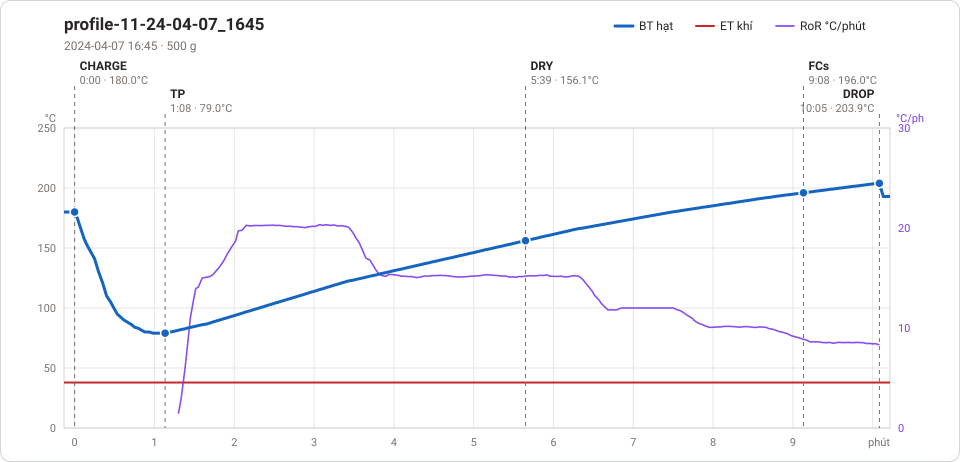
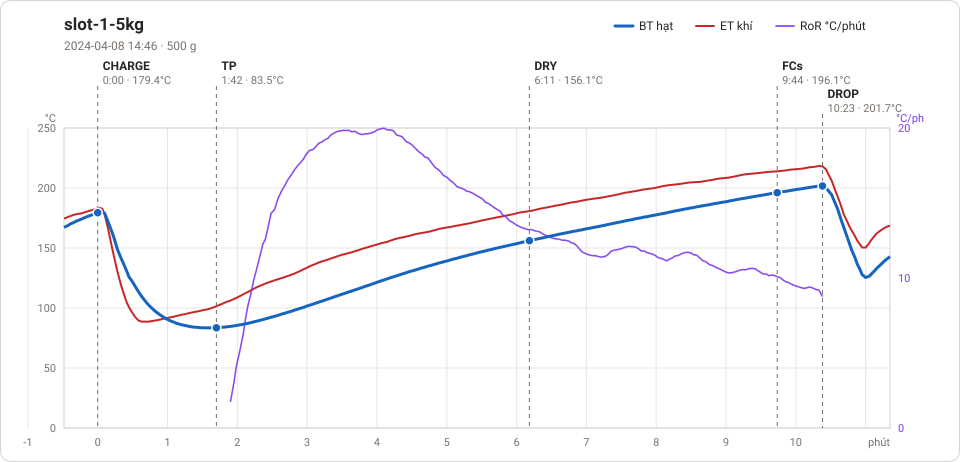

# Giản đồ rang — `57_OTL_AUTO`

5 profile. Bấm tên để mở tệp `.alog` (tải về, mở bằng Artisan: `File → Open`). Giản đồ sinh tự động bằng [`tools/ve_gian_do_alog.py`](../../../tools/ve_gian_do_alog.py) — [về bảng tổng](../README.md).

### [0 00_03 Roaster Scope 2025-03-22](0%2000_03%20Roaster%20Scope%202025-03-22.alog)

_Bản ghi quá ngắn, không vẽ._

### [profile 1 24-04-07_1716](profile%201%2024-04-07_1716.alog)

**TP** 1:10 · 78.0°C · **DRY** 5:28 · 156.1°C · **FCs** 9:23 · 196.0°C · **DROP** 10:28 · 205.0°C  —  tổng **10:28** · DTR **10.4 %**

### [profile 224-04-08_0841](profile%20224-04-08_0841.alog)

**TP** 1:12 · 77.0°C · **DRY** 5:42 · 156.2°C · **FCs** 8:21 · 196.1°C · **DROP** 10:13 · 221.6°C  —  tổng **10:13** · DTR **18.3 %**

### [profile-11-24-04-07_1645](profile-11-24-04-07_1645.alog)

**TP** 1:08 · 79.0°C · **DRY** 5:39 · 156.1°C · **FCs** 9:08 · 196.0°C · **DROP** 10:05 · 203.9°C  —  tổng **10:05** · DTR **9.4 %**

### [slot-1-5kg](15kg-phil/slot-1-5kg.alog)

**TP** 1:42 · 83.5°C · **DRY** 6:11 · 156.1°C · **FCs** 9:44 · 196.1°C · **DROP** 10:23 · 201.7°C  —  tổng **10:23** · DTR **6.3 %**

