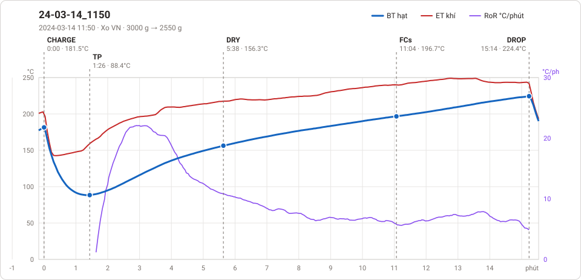

# Giản đồ rang — `58_OTL_6KG_AUTO`

1 profile. Bấm tên để mở tệp `.alog` (tải về, mở bằng Artisan: `File → Open`). Giản đồ sinh tự động bằng [`tools/ve_gian_do_alog.py`](../../../tools/ve_gian_do_alog.py) — [về bảng tổng](../README.md).

### [24-03-14_1150](24-03-14_1150.alog)

**TP** 1:26 · 88.4°C · **DRY** 5:38 · 156.3°C · **FCs** 11:04 · 196.7°C · **DROP** 15:14 · 224.4°C  —  tổng **15:14** · DTR **27.4 %**

