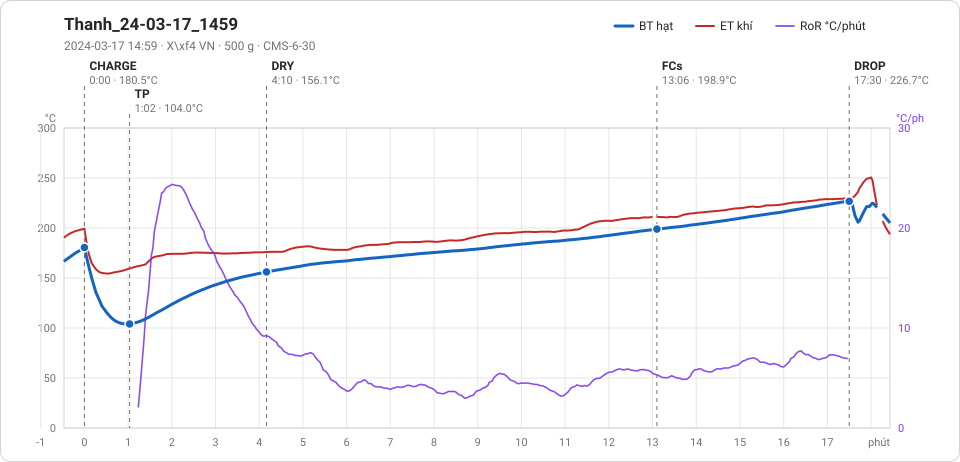
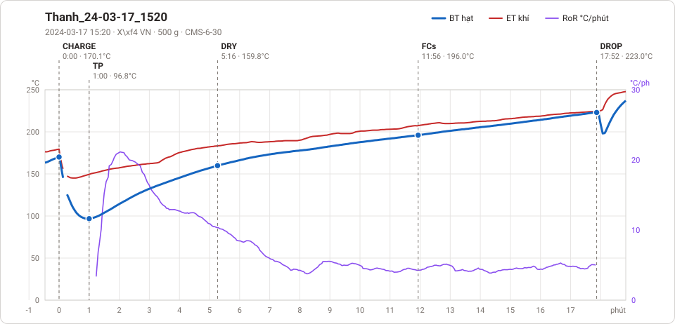
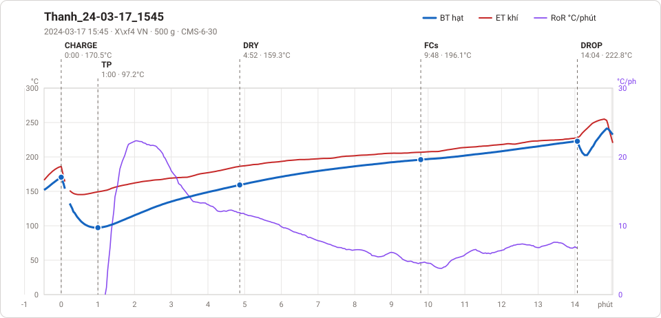
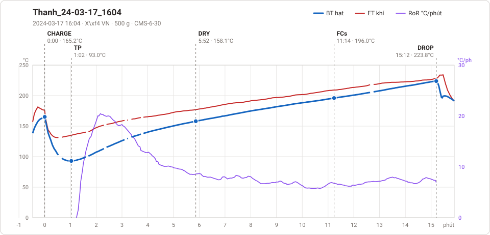
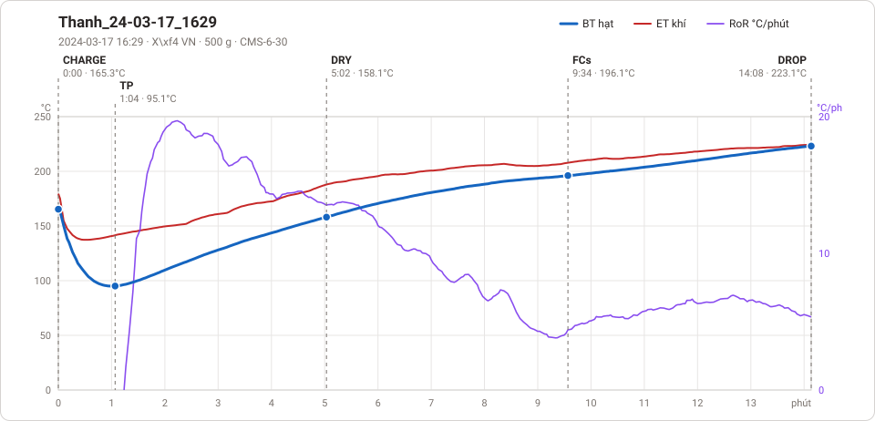

# Giản đồ rang — `60_1kg_aTrung`

5 profile. Bấm tên để mở tệp `.alog` (tải về, mở bằng Artisan: `File → Open`). Giản đồ sinh tự động bằng [`tools/ve_gian_do_alog.py`](../../../tools/ve_gian_do_alog.py) — [về bảng tổng](../README.md).

### [Thanh_24-03-17_1459](Thanh_24-03-17_1459.alog)

**TP** 1:02 · 104.0°C · **DRY** 4:10 · 156.1°C · **FCs** 13:06 · 198.9°C · **DROP** 17:30 · 226.7°C  —  tổng **17:30** · DTR **25.1 %**

### [Thanh_24-03-17_1520](Thanh_24-03-17_1520.alog)

**TP** 1:00 · 96.8°C · **DRY** 5:16 · 159.8°C · **FCs** 11:56 · 196.0°C · **DROP** 17:52 · 223.0°C  —  tổng **17:52** · DTR **33.2 %**

### [Thanh_24-03-17_1545](Thanh_24-03-17_1545.alog)

**TP** 1:00 · 97.2°C · **DRY** 4:52 · 159.3°C · **FCs** 9:48 · 196.1°C · **DROP** 14:04 · 222.8°C  —  tổng **14:04** · DTR **30.3 %**

### [Thanh_24-03-17_1604](Thanh_24-03-17_1604.alog)

**TP** 1:02 · 93.0°C · **DRY** 5:52 · 158.1°C · **FCs** 11:14 · 196.0°C · **DROP** 15:12 · 223.8°C  —  tổng **15:12** · DTR **26.1 %**

### [Thanh_24-03-17_1629](Thanh_24-03-17_1629.alog)

**TP** 1:04 · 95.1°C · **DRY** 5:02 · 158.1°C · **FCs** 9:34 · 196.1°C · **DROP** 14:08 · 223.1°C  —  tổng **14:08** · DTR **32.3 %**

