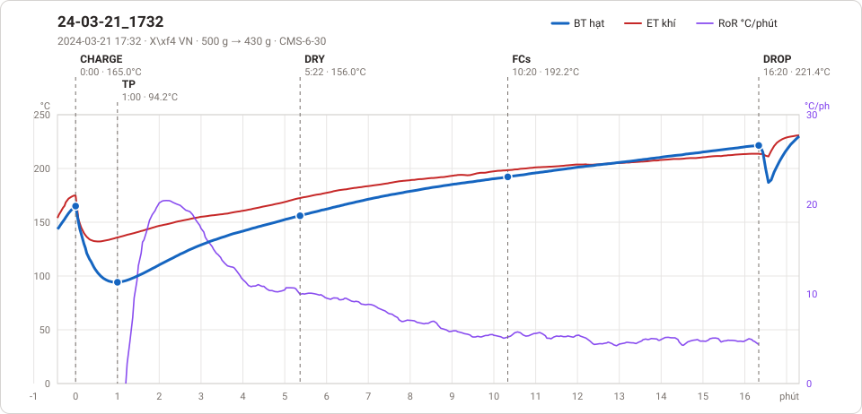
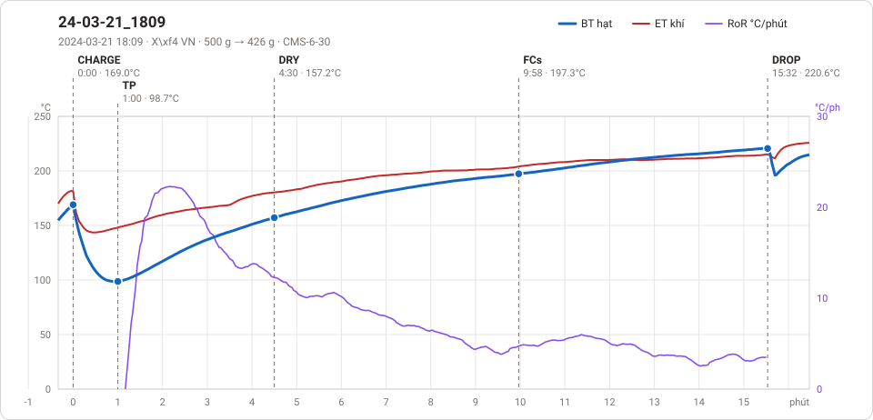

# Giản đồ rang — `61_1kg_LongXuyen`

2 profile. Bấm tên để mở tệp `.alog` (tải về, mở bằng Artisan: `File → Open`). Giản đồ sinh tự động bằng [`tools/ve_gian_do_alog.py`](../../../tools/ve_gian_do_alog.py) — [về bảng tổng](../README.md).

### [24-03-21_1732](24-03-21_1732.alog)

**TP** 1:00 · 94.2°C · **DRY** 5:22 · 156.0°C · **FCs** 10:20 · 192.2°C · **DROP** 16:20 · 221.4°C  —  tổng **16:20** · DTR **36.7 %**

### [24-03-21_1809](24-03-21_1809.alog)

**TP** 1:00 · 98.7°C · **DRY** 4:30 · 157.2°C · **FCs** 9:58 · 197.3°C · **DROP** 15:32 · 220.6°C  —  tổng **15:32** · DTR **35.8 %**

