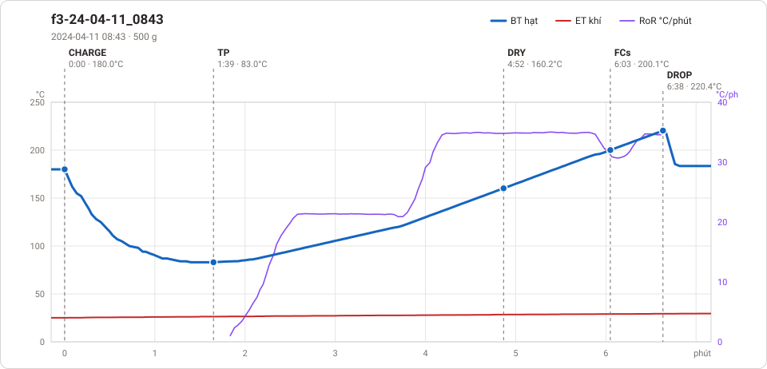

# Giản đồ rang — `62_Auto_test`

3 profile. Bấm tên để mở tệp `.alog` (tải về, mở bằng Artisan: `File → Open`). Giản đồ sinh tự động bằng [`tools/ve_gian_do_alog.py`](../../../tools/ve_gian_do_alog.py) — [về bảng tổng](../README.md).

### [f3-24-04-11_0843](f3-24-04-11_0843.alog)

**TP** 1:39 · 83.0°C · **DRY** 4:52 · 160.2°C · **FCs** 6:03 · 200.1°C · **DROP** 6:38 · 220.4°C  —  tổng **6:38** · DTR **8.8 %**

### [profile 1](profile%201.alog)

**TP** 1:01 · 94.0°C · **DRY** 5:07 · 156.0°C · **DROP** 9:20 · 195.5°C  —  tổng **9:20**

### [profile 5](profile%205.alog)

**TP** 1:05 · 93.6°C · **DRY** 5:25 · 156.0°C · **FCs** 9:41 · 196.0°C · **DROP** 10:06 · 199.9°C  —  tổng **10:06** · DTR **4.1 %**

