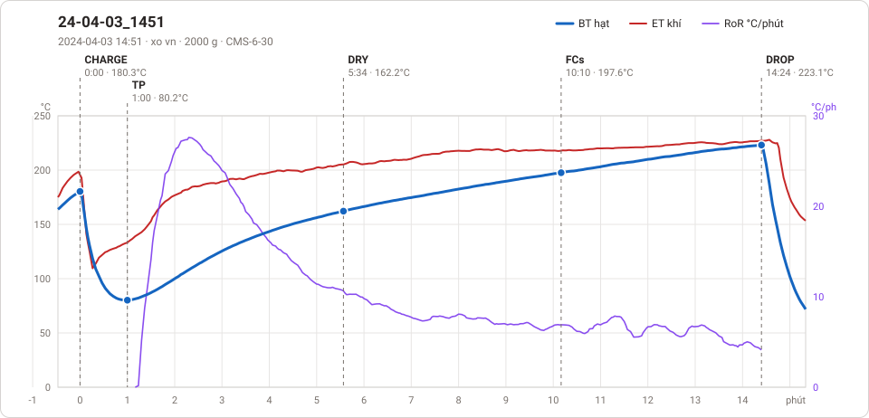

# Giản đồ rang — `63_3KG_EU`

1 profile. Bấm tên để mở tệp `.alog` (tải về, mở bằng Artisan: `File → Open`). Giản đồ sinh tự động bằng [`tools/ve_gian_do_alog.py`](../../../tools/ve_gian_do_alog.py) — [về bảng tổng](../README.md).

### [24-04-03_1451](24-04-03_1451.alog)

**TP** 1:00 · 80.2°C · **DRY** 5:34 · 162.2°C · **FCs** 10:10 · 197.6°C · **DROP** 14:24 · 223.1°C  —  tổng **14:24** · DTR **29.4 %**

