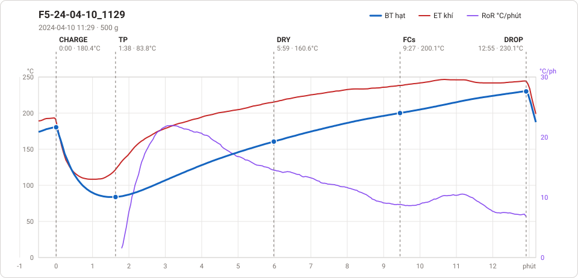
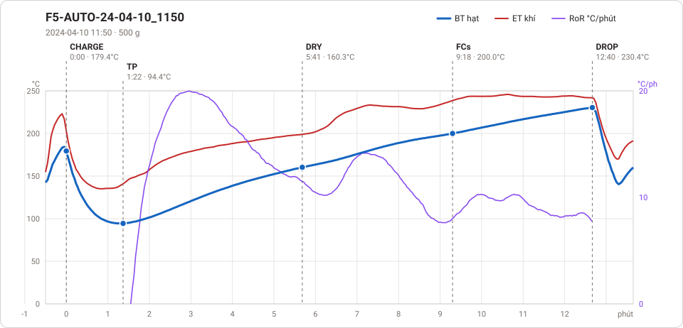
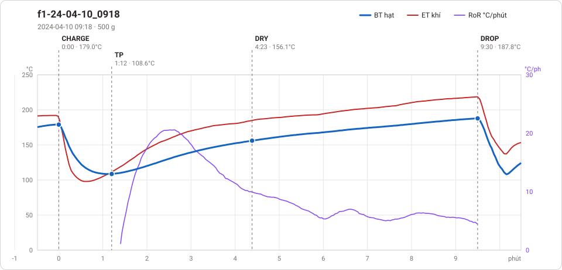

# Giản đồ rang — `64_15kg_Phil`

3 profile. Bấm tên để mở tệp `.alog` (tải về, mở bằng Artisan: `File → Open`). Giản đồ sinh tự động bằng [`tools/ve_gian_do_alog.py`](../../../tools/ve_gian_do_alog.py) — [về bảng tổng](../README.md).

### [F5-24-04-10_1129](F5-24-04-10_1129.alog)

**TP** 1:38 · 83.8°C · **DRY** 5:59 · 160.6°C · **FCs** 9:27 · 200.1°C · **DROP** 12:55 · 230.1°C  —  tổng **12:55** · DTR **26.8 %**

### [F5-AUTO-24-04-10_1150](F5-AUTO-24-04-10_1150.alog)

**TP** 1:22 · 94.4°C · **DRY** 5:41 · 160.3°C · **FCs** 9:18 · 200.0°C · **DROP** 12:40 · 230.4°C  —  tổng **12:40** · DTR **26.6 %**

### [f1-24-04-10_0918](f1-24-04-10_0918.alog)

**TP** 1:12 · 108.6°C · **DRY** 4:23 · 156.1°C · **DROP** 9:30 · 187.8°C  —  tổng **9:30**

