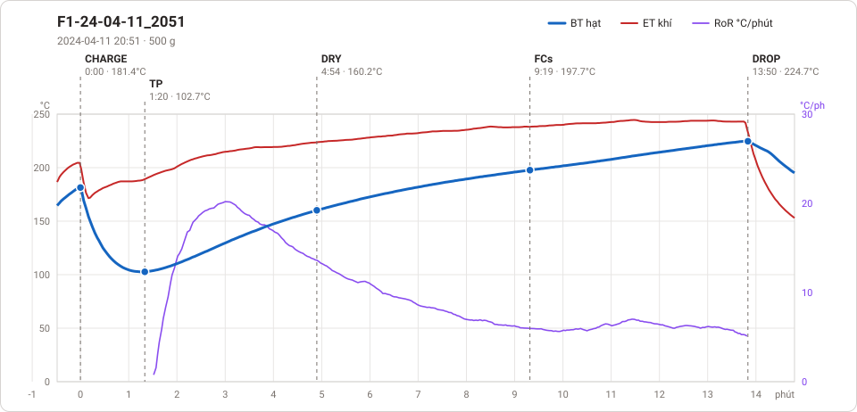
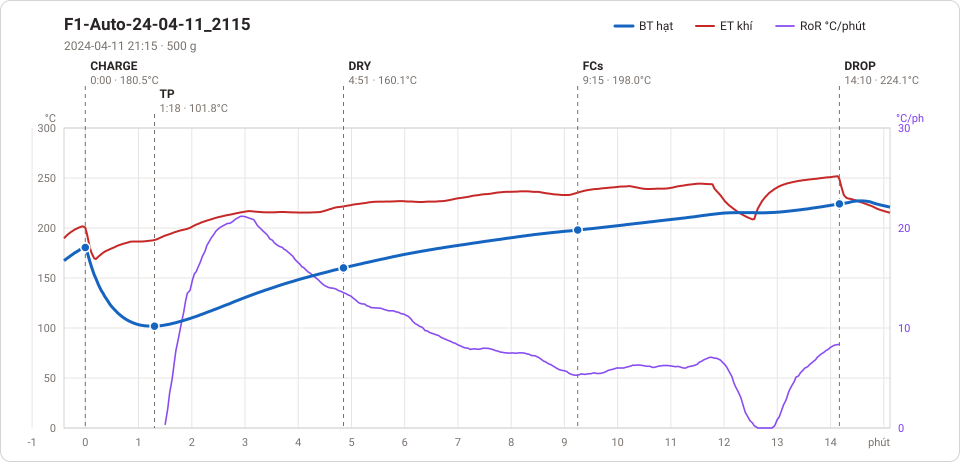

# Giản đồ rang — `65_OTL_06_Auto_Mr_Park`

2 profile. Bấm tên để mở tệp `.alog` (tải về, mở bằng Artisan: `File → Open`). Giản đồ sinh tự động bằng [`tools/ve_gian_do_alog.py`](../../../tools/ve_gian_do_alog.py) — [về bảng tổng](../README.md).

### [F1-24-04-11_2051](F1-24-04-11_2051.alog)

**TP** 1:20 · 102.7°C · **DRY** 4:54 · 160.2°C · **FCs** 9:19 · 197.7°C · **DROP** 13:50 · 224.7°C  —  tổng **13:50** · DTR **32.7 %**

### [F1-Auto-24-04-11_2115](F1-Auto-24-04-11_2115.alog)

**TP** 1:18 · 101.8°C · **DRY** 4:51 · 160.1°C · **FCs** 9:15 · 198.0°C · **DROP** 14:10 · 224.1°C  —  tổng **14:10** · DTR **34.7 %**

