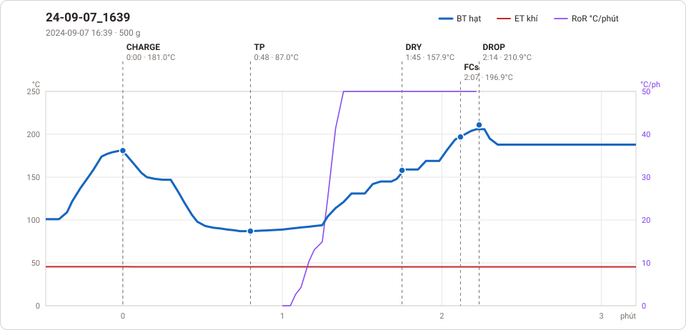
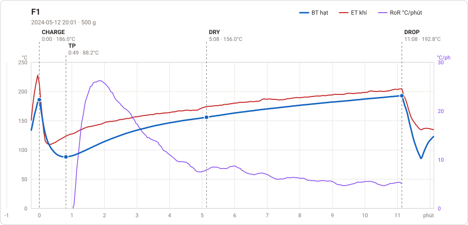

# Giản đồ rang — `68_OTL_03_Auto`

2 profile. Bấm tên để mở tệp `.alog` (tải về, mở bằng Artisan: `File → Open`). Giản đồ sinh tự động bằng [`tools/ve_gian_do_alog.py`](../../../tools/ve_gian_do_alog.py) — [về bảng tổng](../README.md).

### [24-09-07_1639](24-09-07_1639.alog)

**TP** 0:48 · 87.0°C · **DRY** 1:45 · 157.9°C · **FCs** 2:07 · 196.9°C · **DROP** 2:14 · 210.9°C  —  tổng **2:14** · DTR **5.2 %**

### [F1](F1.alog)

**TP** 0:49 · 88.2°C · **DRY** 5:08 · 156.0°C · **DROP** 11:08 · 192.8°C  —  tổng **11:08**

