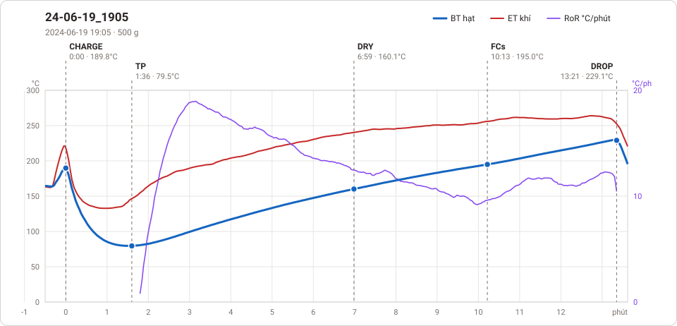

# Giản đồ rang — `69_OTL_AUTO_15`

1 profile. Bấm tên để mở tệp `.alog` (tải về, mở bằng Artisan: `File → Open`). Giản đồ sinh tự động bằng [`tools/ve_gian_do_alog.py`](../../../tools/ve_gian_do_alog.py) — [về bảng tổng](../README.md).

### [24-06-19_1905](24-06-19_1905.alog)

**TP** 1:36 · 79.5°C · **DRY** 6:59 · 160.1°C · **FCs** 10:13 · 195.0°C · **DROP** 13:21 · 229.1°C  —  tổng **13:21** · DTR **23.5 %**

