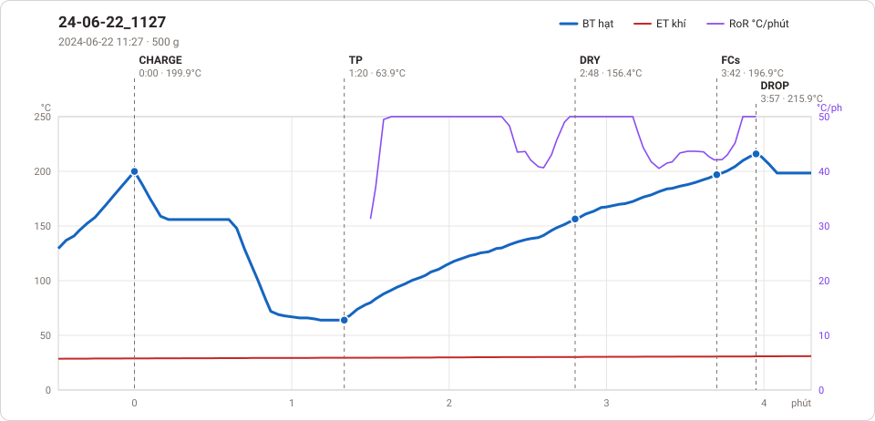
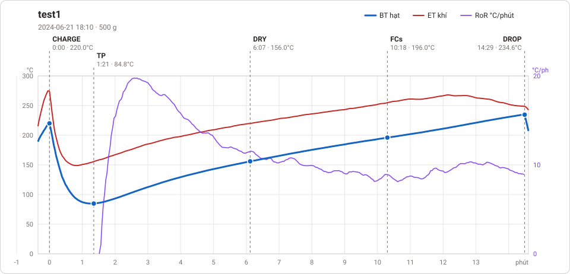
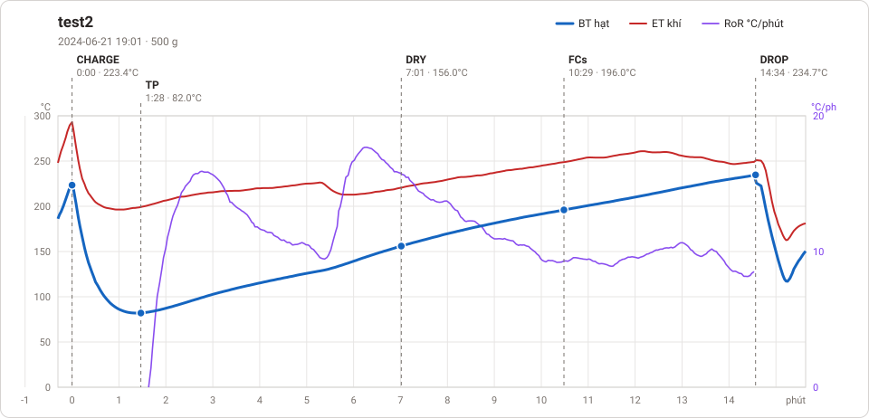
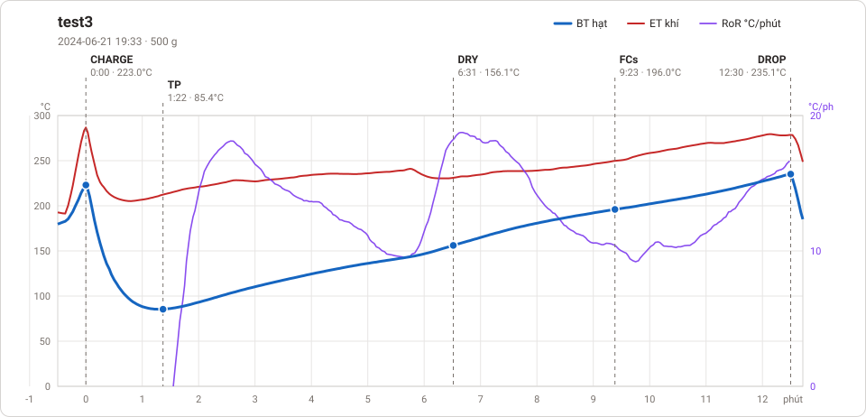

# Giản đồ rang — `70_OTL_VIXI`

4 profile. Bấm tên để mở tệp `.alog` (tải về, mở bằng Artisan: `File → Open`). Giản đồ sinh tự động bằng [`tools/ve_gian_do_alog.py`](../../../tools/ve_gian_do_alog.py) — [về bảng tổng](../README.md).

### [24-06-22_1127](24-06-22_1127.alog)

**TP** 1:20 · 63.9°C · **DRY** 2:48 · 156.4°C · **FCs** 3:42 · 196.9°C · **DROP** 3:57 · 215.9°C  —  tổng **3:57** · DTR **6.3 %**

### [test1](test1.alog)

**TP** 1:21 · 84.8°C · **DRY** 6:07 · 156.0°C · **FCs** 10:18 · 196.0°C · **DROP** 14:29 · 234.6°C  —  tổng **14:29** · DTR **28.9 %**

### [test2](test2.alog)

**TP** 1:28 · 82.0°C · **DRY** 7:01 · 156.0°C · **FCs** 10:29 · 196.0°C · **DROP** 14:34 · 234.7°C  —  tổng **14:34** · DTR **28.0 %**

### [test3](test3.alog)

**TP** 1:22 · 85.4°C · **DRY** 6:31 · 156.1°C · **FCs** 9:23 · 196.0°C · **DROP** 12:30 · 235.1°C  —  tổng **12:30** · DTR **24.9 %**

