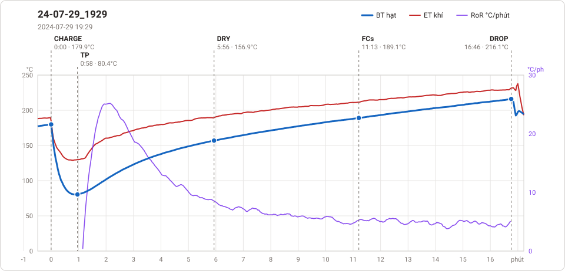
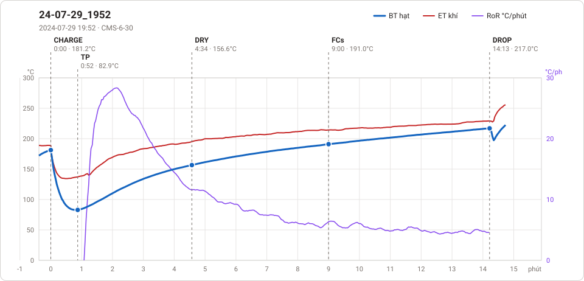
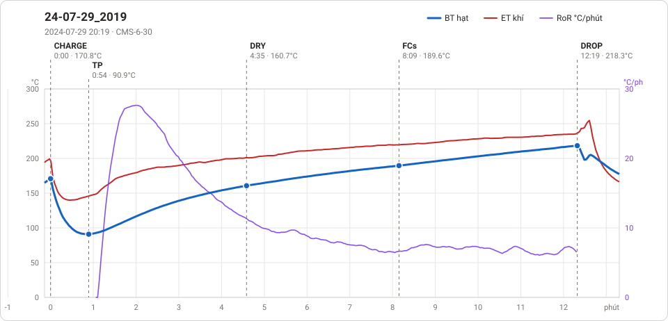
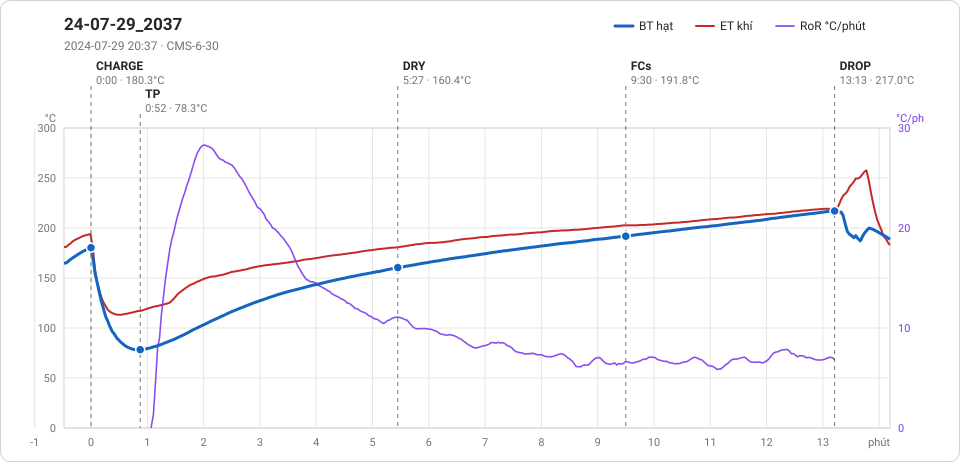

# Giản đồ rang — `72_VCC_1KG`

4 profile. Bấm tên để mở tệp `.alog` (tải về, mở bằng Artisan: `File → Open`). Giản đồ sinh tự động bằng [`tools/ve_gian_do_alog.py`](../../../tools/ve_gian_do_alog.py) — [về bảng tổng](../README.md).

### [24-07-29_1929](24-07-29_1929.alog)

**TP** 0:58 · 80.4°C · **DRY** 5:56 · 156.9°C · **FCs** 11:13 · 189.1°C · **DROP** 16:46 · 216.1°C  —  tổng **16:46** · DTR **33.1 %**

### [24-07-29_1952](24-07-29_1952.alog)

**TP** 0:52 · 82.9°C · **DRY** 4:34 · 156.6°C · **FCs** 9:00 · 191.0°C · **DROP** 14:13 · 217.0°C  —  tổng **14:13** · DTR **36.7 %**

### [24-07-29_2019](24-07-29_2019.alog)

**TP** 0:54 · 90.9°C · **DRY** 4:35 · 160.7°C · **FCs** 8:09 · 189.6°C · **DROP** 12:19 · 218.3°C  —  tổng **12:19** · DTR **33.9 %**

### [24-07-29_2037](24-07-29_2037.alog)

**TP** 0:52 · 78.3°C · **DRY** 5:27 · 160.4°C · **FCs** 9:30 · 191.8°C · **DROP** 13:13 · 217.0°C  —  tổng **13:13** · DTR **28.1 %**

