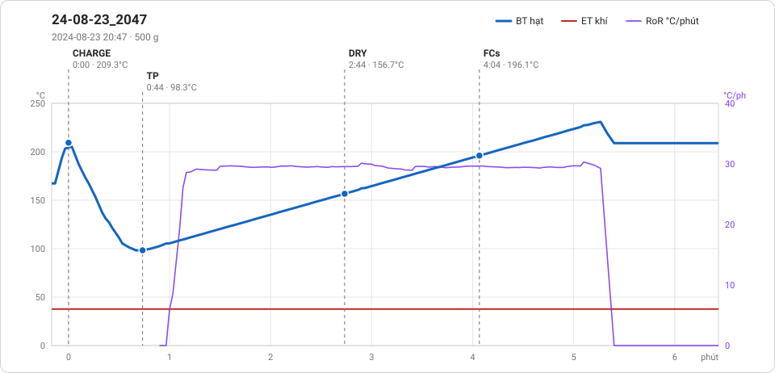
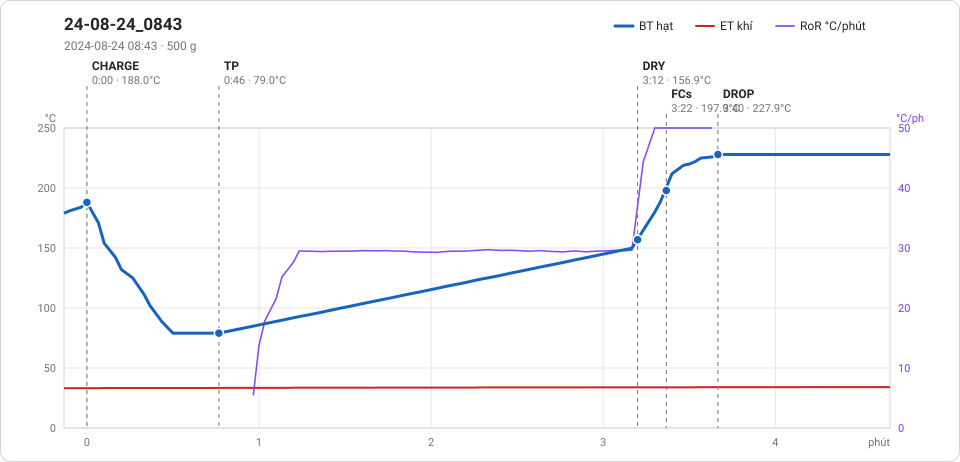
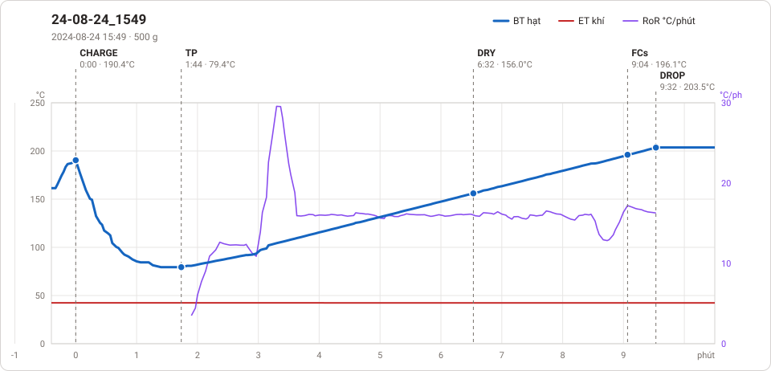
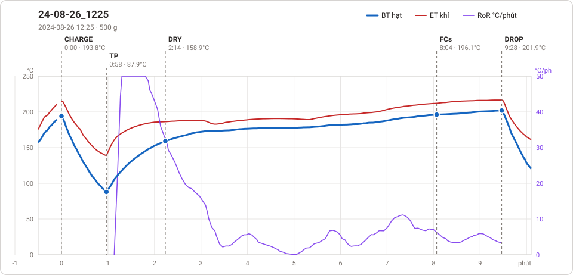
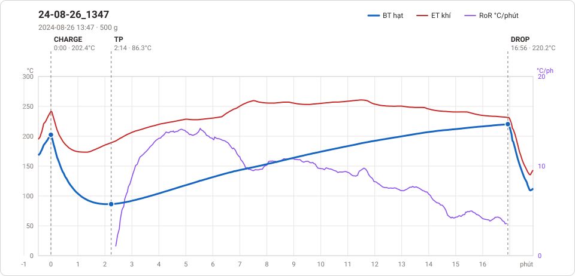
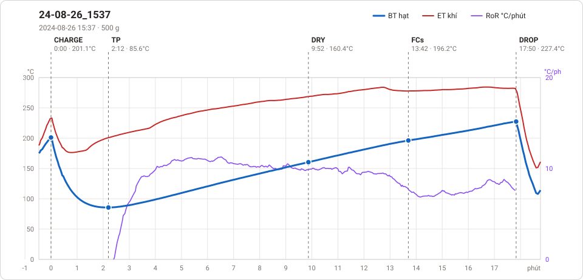
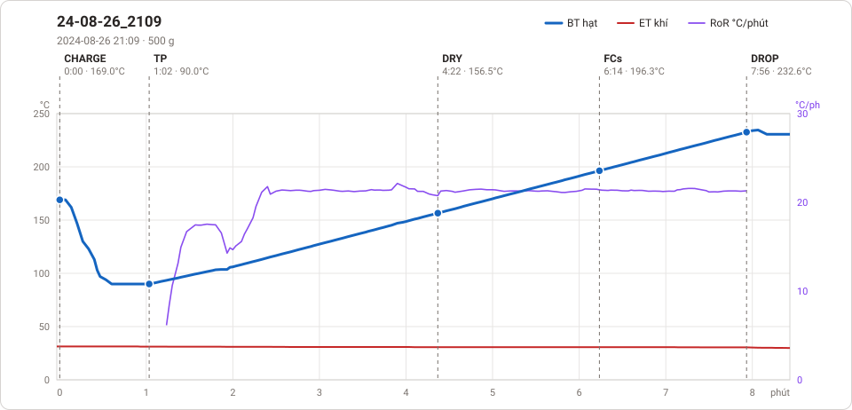

# Giản đồ rang — `74_CMS_60`

7 profile. Bấm tên để mở tệp `.alog` (tải về, mở bằng Artisan: `File → Open`). Giản đồ sinh tự động bằng [`tools/ve_gian_do_alog.py`](../../../tools/ve_gian_do_alog.py) — [về bảng tổng](../README.md).

### [24-08-23_2047](24-08-23_2047.alog)

**TP** 0:44 · 98.3°C · **DRY** 2:44 · 156.7°C · **FCs** 4:04 · 196.1°C

### [24-08-24_0843](24-08-24_0843.alog)

**TP** 0:46 · 79.0°C · **DRY** 3:12 · 156.9°C · **FCs** 3:22 · 197.9°C · **DROP** 3:40 · 227.9°C  —  tổng **3:40** · DTR **8.2 %**

### [24-08-24_1549](24-08-24_1549.alog)

**TP** 1:44 · 79.4°C · **DRY** 6:32 · 156.0°C · **FCs** 9:04 · 196.1°C · **DROP** 9:32 · 203.5°C  —  tổng **9:32** · DTR **4.9 %**

### [24-08-26_1225](24-08-26_1225.alog)

**TP** 0:58 · 87.9°C · **DRY** 2:14 · 158.9°C · **FCs** 8:04 · 196.1°C · **DROP** 9:28 · 201.9°C  —  tổng **9:28** · DTR **14.8 %**

### [24-08-26_1347](24-08-26_1347.alog)

**TP** 2:14 · 86.3°C · **DROP** 16:56 · 220.2°C  —  tổng **16:56**

### [24-08-26_1537](24-08-26_1537.alog)

**TP** 2:12 · 85.6°C · **DRY** 9:52 · 160.4°C · **FCs** 13:42 · 196.2°C · **DROP** 17:50 · 227.4°C  —  tổng **17:50** · DTR **23.2 %**

### [24-08-26_2109](24-08-26_2109.alog)

**TP** 1:02 · 90.0°C · **DRY** 4:22 · 156.5°C · **FCs** 6:14 · 196.3°C · **DROP** 7:56 · 232.6°C  —  tổng **7:56** · DTR **21.4 %**

