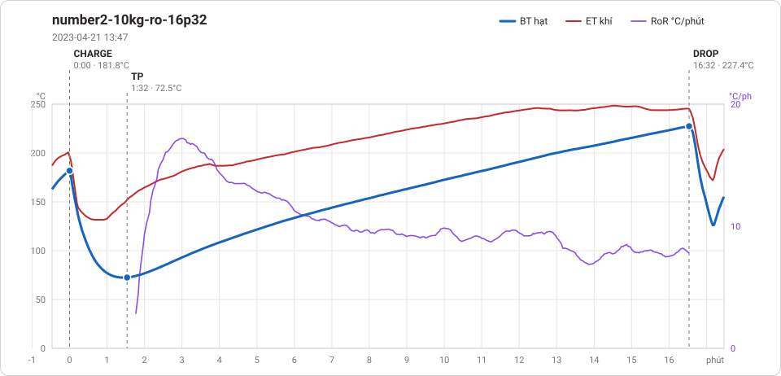
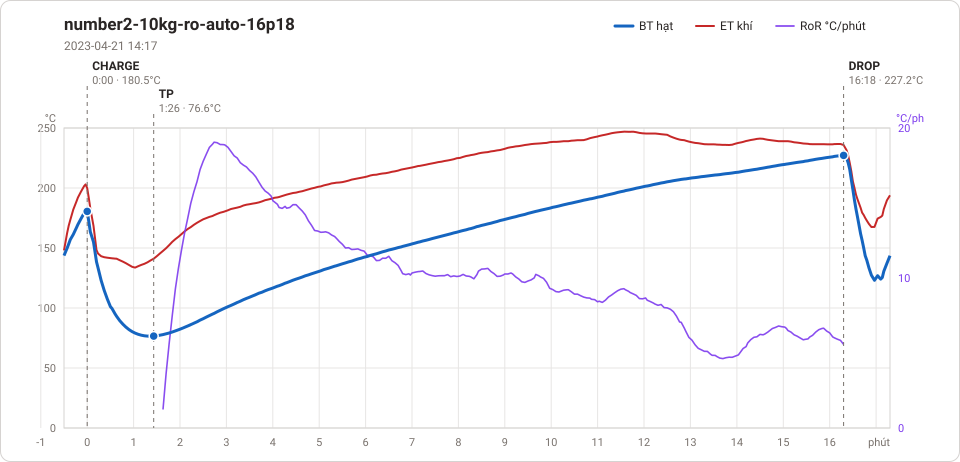
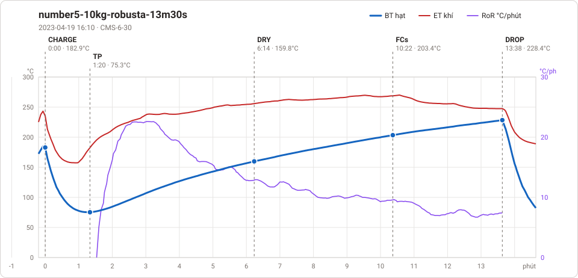

# Giản đồ rang — `8-Artisan-CMS`

3 profile. Bấm tên để mở tệp `.alog` (tải về, mở bằng Artisan: `File → Open`). Giản đồ sinh tự động bằng [`tools/ve_gian_do_alog.py`](../../../tools/ve_gian_do_alog.py) — [về bảng tổng](../README.md).

### [number2-10kg-ro-16p32](number2-10kg-ro-16p32.alog)

**TP** 1:32 · 72.5°C · **DROP** 16:32 · 227.4°C  —  tổng **16:32**

### [number2-10kg-ro-auto-16p18](number2-10kg-ro-auto-16p18.alog)

**TP** 1:26 · 76.6°C · **DROP** 16:18 · 227.2°C  —  tổng **16:18**

### [number5-10kg-robusta-13m30s](number5-10kg-robusta-13m30s.alog)

**TP** 1:20 · 75.3°C · **DRY** 6:14 · 159.8°C · **FCs** 10:22 · 203.4°C · **DROP** 13:38 · 228.4°C  —  tổng **13:38** · DTR **24.0 %**

