# Giản đồ rang — `Linh-tinh`

45 profile. Bấm tên để mở tệp `.alog` (tải về, mở bằng Artisan: `File → Open`). Giản đồ sinh tự động bằng [`tools/ve_gian_do_alog.py`](../../../tools/ve_gian_do_alog.py) — [về bảng tổng](../README.md).

### [06_cam_auto_Q7_300822](06_cam_auto_Q7_300822.alog)

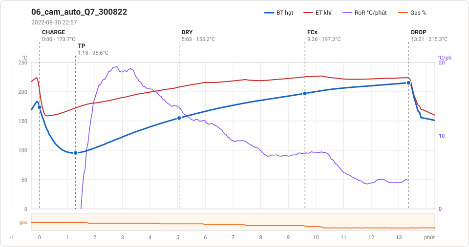

**TP** 1:18 · 95.6°C · **DRY** 5:03 · 155.2°C · **FCs** 9:36 · 197.2°C · **DROP** 13:21 · 215.3°C  —  tổng **13:21** · DTR **28.1 %**

### [11111111111111](11111111111111.alog)

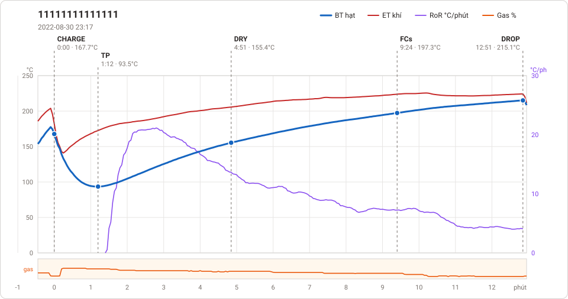

**TP** 1:12 · 93.5°C · **DRY** 4:51 · 155.4°C · **FCs** 9:24 · 197.3°C · **DROP** 12:51 · 215.1°C  —  tổng **12:51** · DTR **26.8 %**

### [2.5kg-daklag-otl03](2.5kg-daklag-otl03.alog)

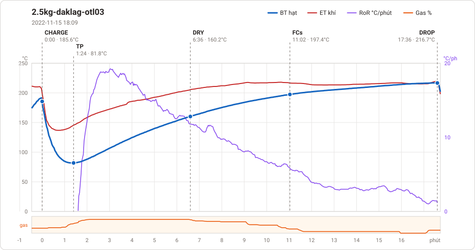

**TP** 1:24 · 81.8°C · **DRY** 6:36 · 160.2°C · **FCs** 11:02 · 197.4°C · **DROP** 17:36 · 216.7°C  —  tổng **17:36** · DTR **37.3 %**

### [2.5kg-phin-otl03](2.5kg-phin-otl03.alog)

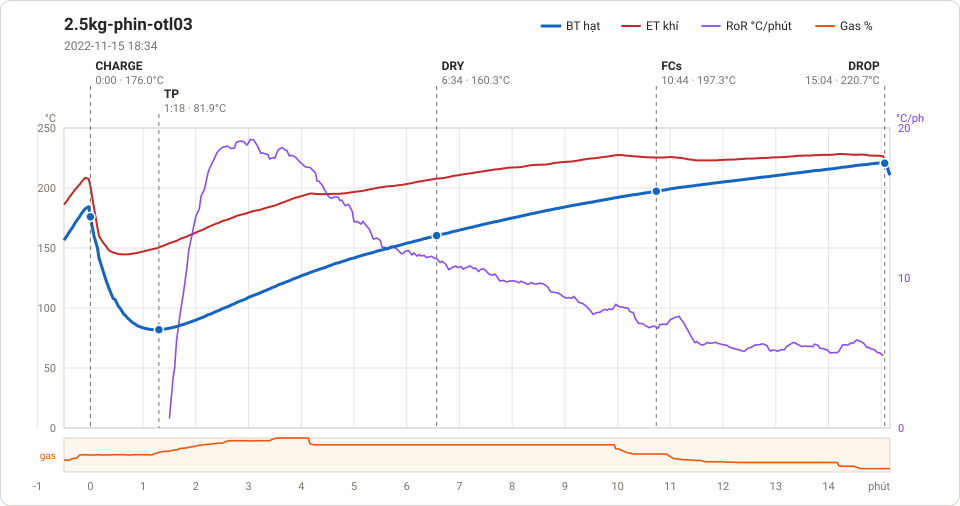

**TP** 1:18 · 81.9°C · **DRY** 6:34 · 160.3°C · **FCs** 10:44 · 197.3°C · **DROP** 15:04 · 220.7°C  —  tổng **15:04** · DTR **28.8 %**

### [20-08-25_1402](20-08-25_1402.alog)

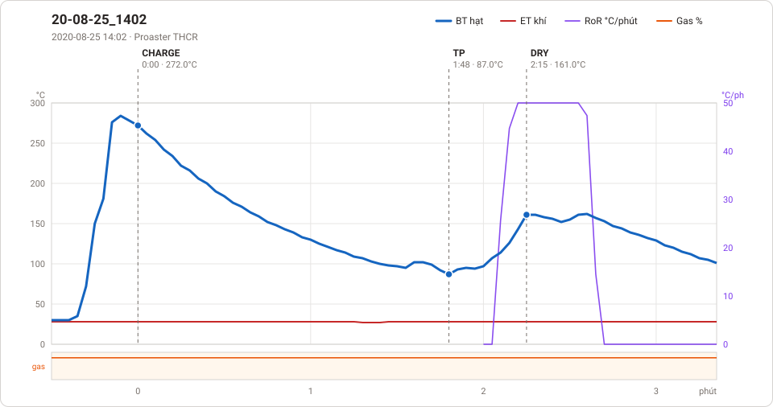

**TP** 1:48 · 87.0°C · **DRY** 2:15 · 161.0°C

### [20-10-12_1402](20-10-12_1402.alog)

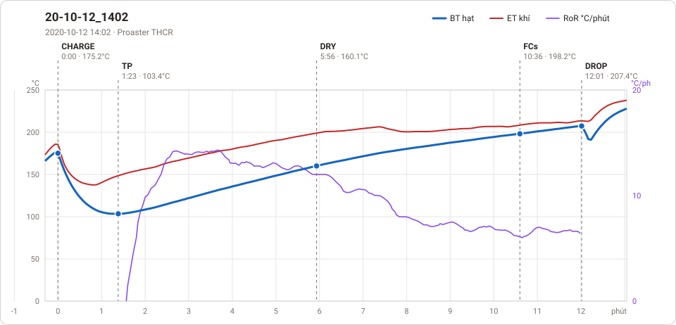

**TP** 1:23 · 103.4°C · **DRY** 5:56 · 160.1°C · **FCs** 10:36 · 198.2°C · **DROP** 12:01 · 207.4°C  —  tổng **12:01** · DTR **11.8 %**

### [20-10-13_1459](20-10-13_1459.alog)

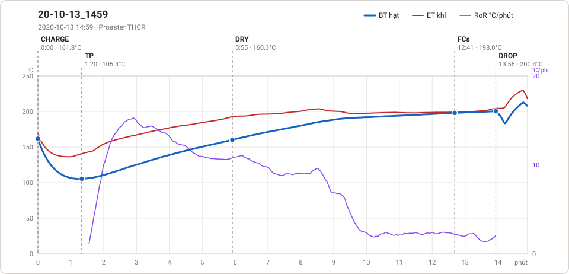

**TP** 1:20 · 105.4°C · **DRY** 5:55 · 160.3°C · **FCs** 12:41 · 198.0°C · **DROP** 13:56 · 200.4°C  —  tổng **13:56** · DTR **9.0 %**

### [20-10-14_1411](20-10-14_1411.alog)

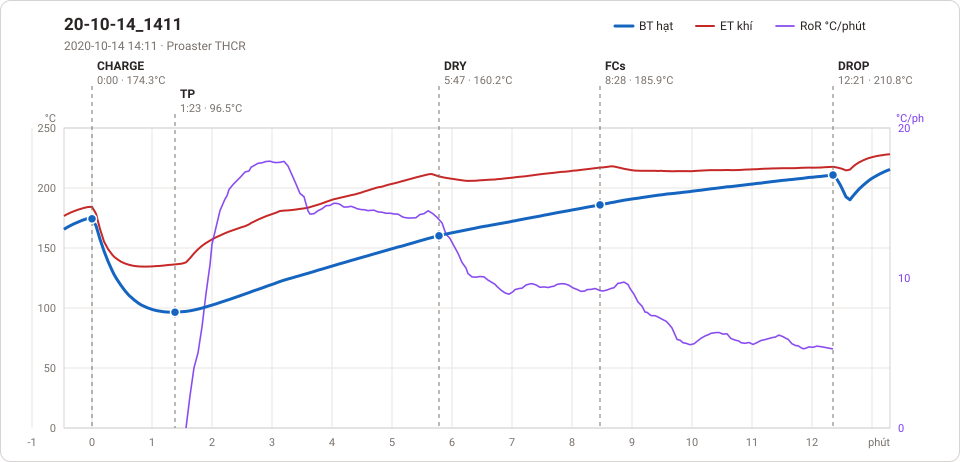

**TP** 1:23 · 96.5°C · **DRY** 5:47 · 160.2°C · **FCs** 8:28 · 185.9°C · **DROP** 12:21 · 210.8°C  —  tổng **12:21** · DTR **31.4 %**

### [20-12-21_0845](20-12-21_0845.alog)

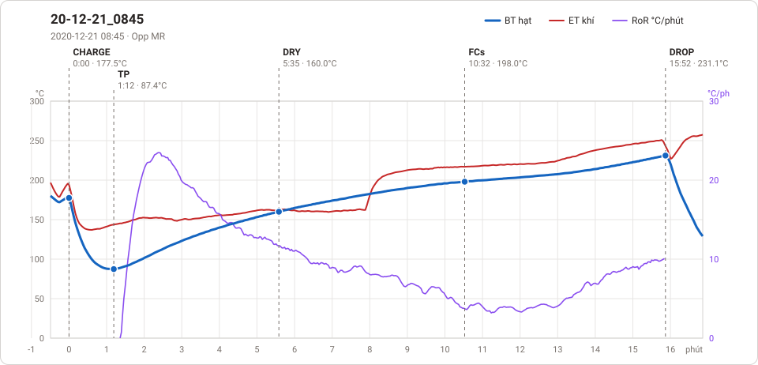

**TP** 1:12 · 87.4°C · **DRY** 5:35 · 160.0°C · **FCs** 10:32 · 198.0°C · **DROP** 15:52 · 231.1°C  —  tổng **15:52** · DTR **33.7 %**

### [20-12-21_1047](20-12-21_1047.alog)

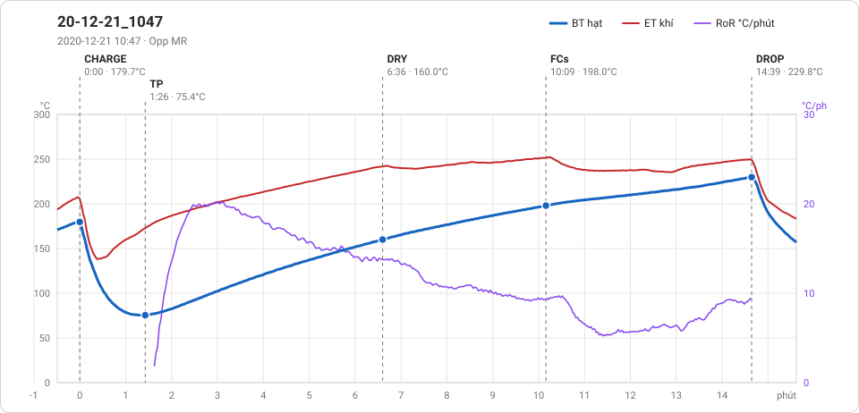

**TP** 1:26 · 75.4°C · **DRY** 6:36 · 160.0°C · **FCs** 10:09 · 198.0°C · **DROP** 14:39 · 229.8°C  —  tổng **14:39** · DTR **30.6 %**

### [20-12-21_1118](20-12-21_1118.alog)

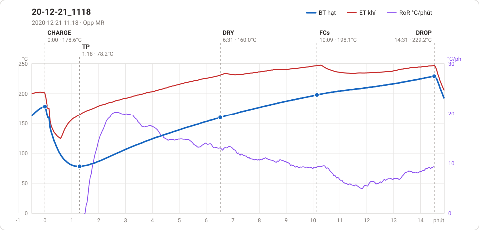

**TP** 1:18 · 78.2°C · **DRY** 6:31 · 160.0°C · **FCs** 10:09 · 198.1°C · **DROP** 14:31 · 229.2°C  —  tổng **14:31** · DTR **30.1 %**

### [22-11-15_1419](22-11-15_1419.alog)

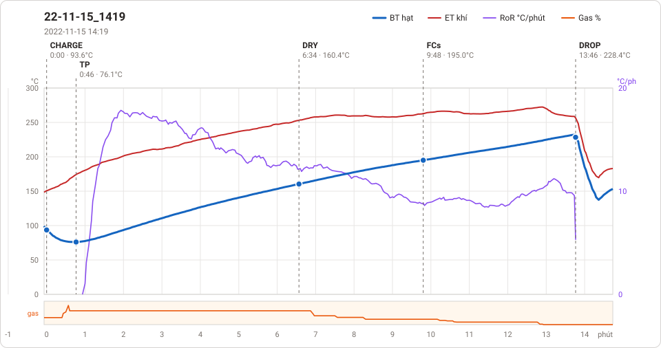

**TP** 0:46 · 76.1°C · **DRY** 6:34 · 160.4°C · **FCs** 9:48 · 195.0°C · **DROP** 13:46 · 228.4°C  —  tổng **13:46** · DTR **28.8 %**

### [22-11-21_1823](22-11-21_1823.alog)

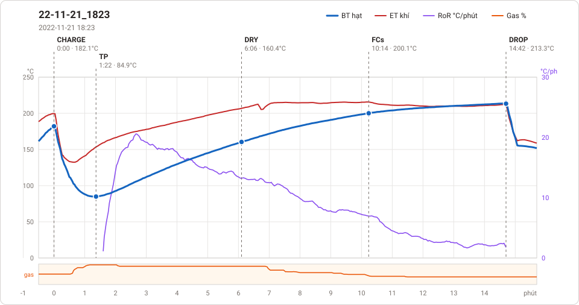

**TP** 1:22 · 84.9°C · **DRY** 6:06 · 160.4°C · **FCs** 10:14 · 200.1°C · **DROP** 14:42 · 213.3°C  —  tổng **14:42** · DTR **30.4 %**

### [22222](22222.alog)

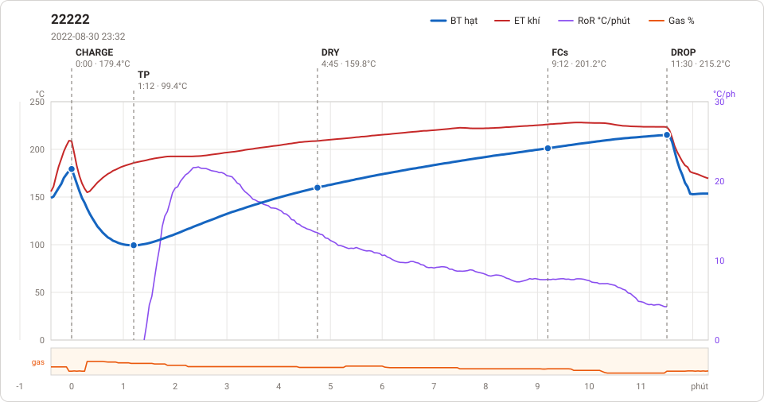

**TP** 1:12 · 99.4°C · **DRY** 4:45 · 159.8°C · **FCs** 9:12 · 201.2°C · **DROP** 11:30 · 215.2°C  —  tổng **11:30** · DTR **20.0 %**

### [auto-artisan-test-1](auto-artisan-test-1.alog)

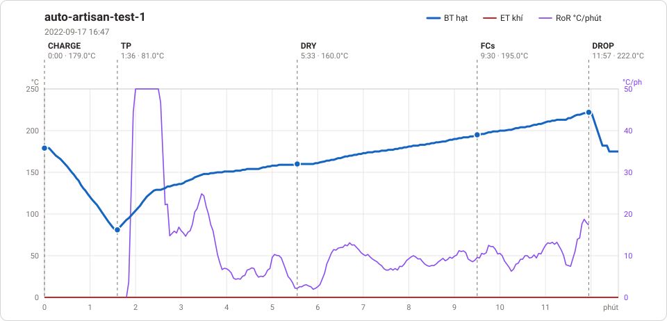

**TP** 1:36 · 81.0°C · **DRY** 5:33 · 160.0°C · **FCs** 9:30 · 195.0°C · **DROP** 11:57 · 222.0°C  —  tổng **11:57** · DTR **20.5 %**

### [auto-artisan-test-2-2](auto-artisan-test-2-2.alog)

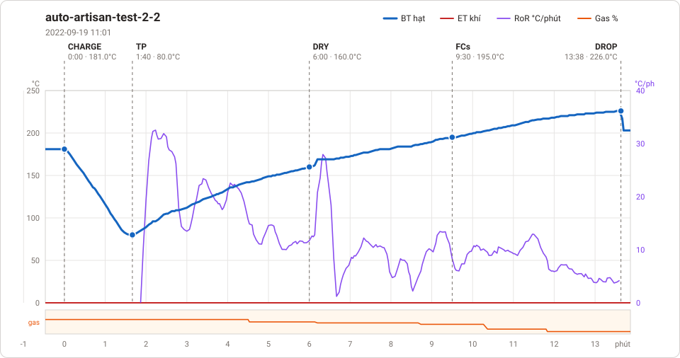

**TP** 1:40 · 80.0°C · **DRY** 6:00 · 160.0°C · **FCs** 9:30 · 195.0°C · **DROP** 13:38 · 226.0°C  —  tổng **13:38** · DTR **30.3 %**

### [auto-artisan-test-3](auto-artisan-test-3.alog)

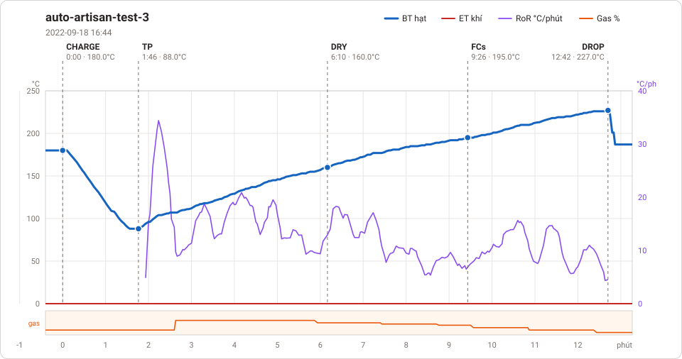

**TP** 1:46 · 88.0°C · **DRY** 6:10 · 160.0°C · **FCs** 9:26 · 195.0°C · **DROP** 12:42 · 227.0°C  —  tổng **12:42** · DTR **25.7 %**

### [auto-artisan-test-4](auto-artisan-test-4.alog)

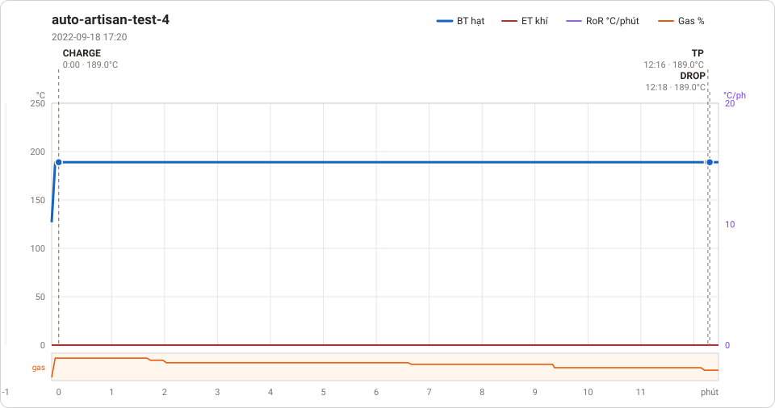

**TP** 12:16 · 189.0°C · **DROP** 12:18 · 189.0°C  —  tổng **12:18**

### [auto-artisan-test-5](auto-artisan-test-5.alog)

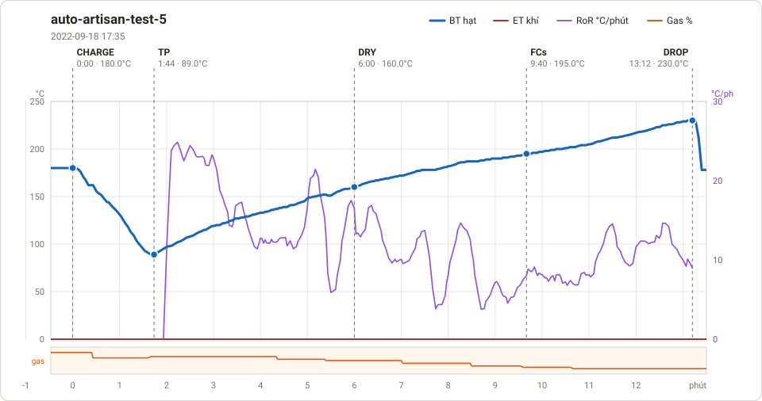

**TP** 1:44 · 89.0°C · **DRY** 6:00 · 160.0°C · **FCs** 9:40 · 195.0°C · **DROP** 13:12 · 230.0°C  —  tổng **13:12** · DTR **26.8 %**

### [auto_15kg_simu_0510](auto_15kg_simu_0510.alog)

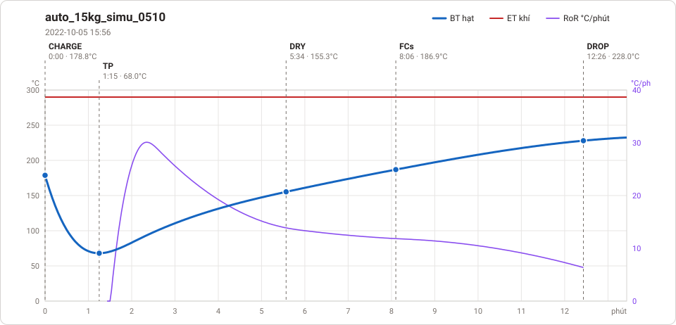

**TP** 1:15 · 68.0°C · **DRY** 5:34 · 155.3°C · **FCs** 8:06 · 186.9°C · **DROP** 12:26 · 228.0°C  —  tổng **12:26** · DTR **34.9 %**

### [auto_5kg_ro_8_12_v1](auto_5kg_ro_8_12_v1.alog)

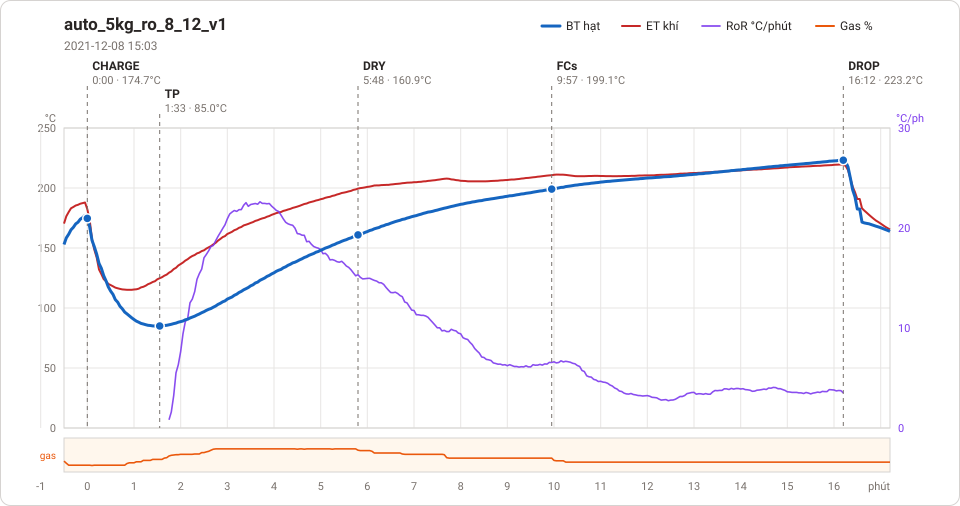

**TP** 1:33 · 85.0°C · **DRY** 5:48 · 160.9°C · **FCs** 9:57 · 199.1°C · **DROP** 16:12 · 223.2°C  —  tổng **16:12** · DTR **38.6 %**

### [auto_5kg_ro_8_12_v2](auto_5kg_ro_8_12_v2.alog)

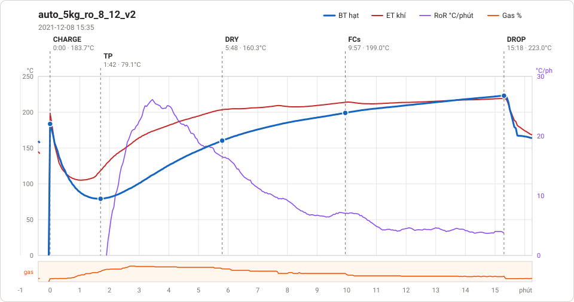

**TP** 1:42 · 79.1°C · **DRY** 5:48 · 160.3°C · **FCs** 9:57 · 199.0°C · **DROP** 15:18 · 223.0°C  —  tổng **15:18** · DTR **35.0 %**

### [profile_mau_a_Tung_v1](profile_mau_a_Tung_v1.alog)

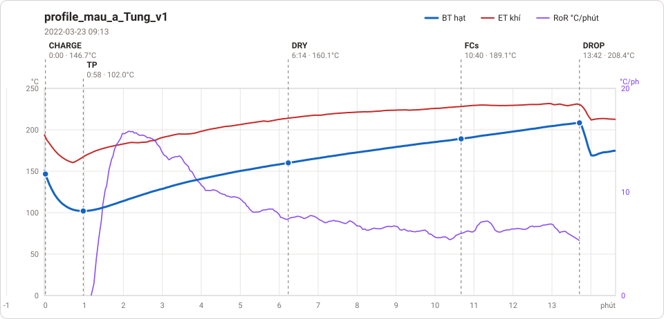

**TP** 0:58 · 102.0°C · **DRY** 6:14 · 160.1°C · **FCs** 10:40 · 189.1°C · **DROP** 13:42 · 208.4°C  —  tổng **13:42** · DTR **22.2 %**

### [test 171122](test%20171122.alog)

**TP** 1:06 · 69.0°C · **DRY** 6:46 · 160.2°C · **FCs** 9:56 · 200.5°C · **DROP** 10:56 · 207.8°C  —  tổng **10:56** · DTR **9.1 %**

### [test](test.alog)

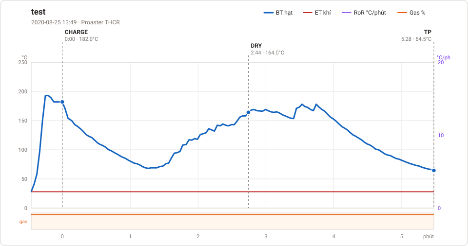

**TP** 5:28 · 64.5°C · **DRY** 2:44 · 164.0°C

### [test_pid_a_Tung](test_pid_a_Tung.alog)

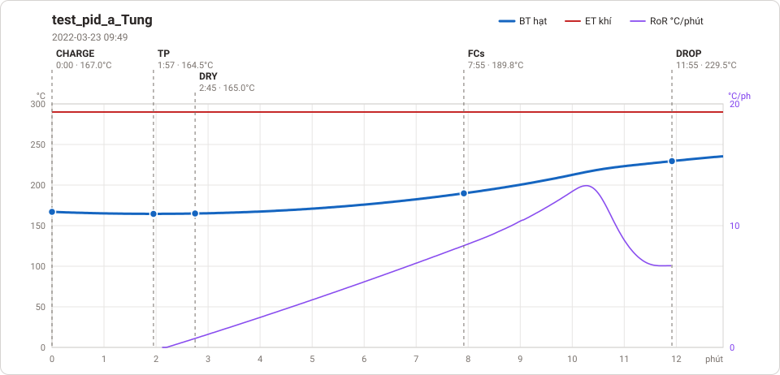

**TP** 1:57 · 164.5°C · **DRY** 2:45 · 165.0°C · **FCs** 7:55 · 189.8°C · **DROP** 11:55 · 229.5°C  —  tổng **11:55** · DTR **33.6 %**

### [21-07-09_1726](30kg_auto_ThaiLan/21-07-09_1726.alog)

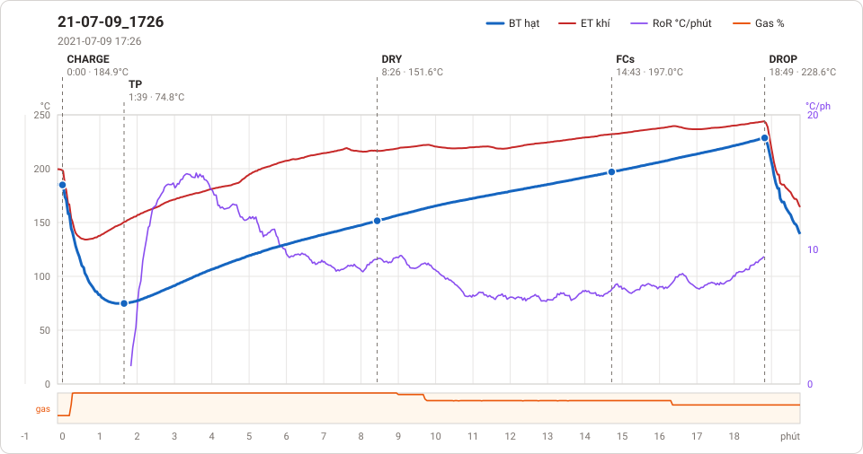

**TP** 1:39 · 74.8°C · **DRY** 8:26 · 151.6°C · **FCs** 14:43 · 197.0°C · **DROP** 18:49 · 228.6°C  —  tổng **18:49** · DTR **21.8 %**

### [21-01-08_1156](Auto%20step/21-01-08_1156.alog)

**TP** 2:48 · 75.4°C

### [21-01-08_1308](Auto%20step/21-01-08_1308.alog)

**TP** 1:44 · 66.3°C · **DRY** 8:01 · 160.0°C · **FCs** 13:01 · 198.0°C · **DROP** 15:38 · 218.3°C  —  tổng **15:38** · DTR **16.7 %**

### [Guji-Shakisso-Na-G1 040324 - Design](MyProfile/Guji-Shakisso-Na-G1%20040324%20-%20Design.alog)

**TP** 1:43 · 104.7°C · **DRY** 4:00 · 155.2°C · **FCs** 7:45 · 197.1°C · **DROP** 9:20 · 201.7°C  —  tổng **9:20** · DTR **17.0 %**

### [Guji-Shakisso-Na-G1 040324 10p34](MyProfile/Guji-Shakisso-Na-G1%20040324%2010p34.alog)

**TP** 0:58 · 98.7°C · **DRY** 4:04 · 156.0°C · **FCs** 9:32 · 196.1°C · **DROP** 10:34 · 200.4°C  —  tổng **10:34** · DTR **9.8 %**

### [Guji-Shakisso-Na-G1 280224 9p](MyProfile/Guji-Shakisso-Na-G1%20280224%209p.alog)

**TP** 0:52 · 110.6°C · **DRY** 2:44 · 156.4°C · **FCs** 7:10 · 198.3°C · **DROP** 9:00 · 206.1°C  —  tổng **9:00** · DTR **20.4 %**

### [Guji-Shakisso-Na-G1 280224 9p6](MyProfile/Guji-Shakisso-Na-G1%20280224%209p6.alog)

**TP** 0:56 · 101.0°C · **DRY** 3:30 · 156.2°C · **FCs** 7:50 · 196.1°C · **DROP** 9:06 · 202.2°C  —  tổng **9:06** · DTR **13.9 %**

### [22-09-20_1836](Profile-artisan/1kg_auto_wired/22-09-20_1836.alog)

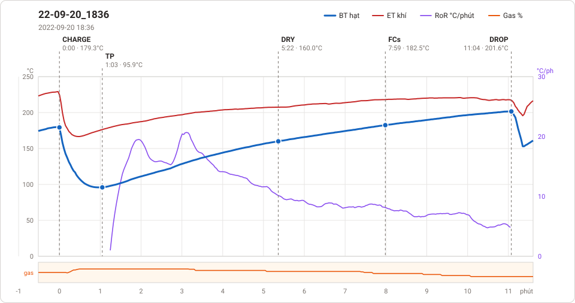

**TP** 1:03 · 95.9°C · **DRY** 5:22 · 160.0°C · **FCs** 7:59 · 182.5°C · **DROP** 11:04 · 201.6°C  —  tổng **11:04** · DTR **27.9 %**

### [M2](Profile-artisan/1kg_auto_wired/M2.alog)

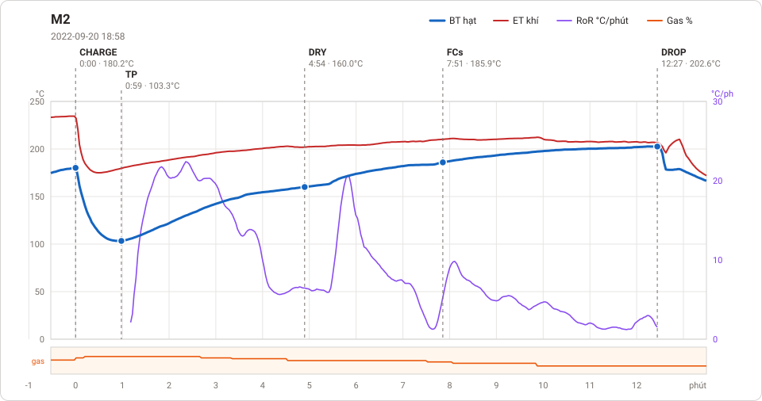

**TP** 0:59 · 103.3°C · **DRY** 4:54 · 160.0°C · **FCs** 7:51 · 185.9°C · **DROP** 12:27 · 202.6°C  —  tổng **12:27** · DTR **36.9 %**

### [M2_2](Profile-artisan/1kg_auto_wired/M2_2.alog)

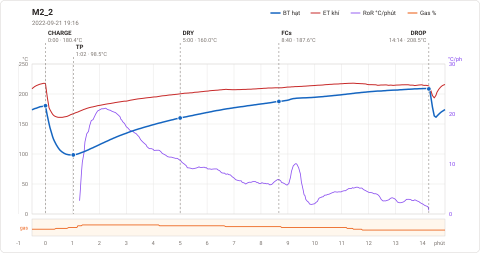

**TP** 1:02 · 98.5°C · **DRY** 5:00 · 160.0°C · **FCs** 8:40 · 187.6°C · **DROP** 14:14 · 208.5°C  —  tổng **14:14** · DTR **39.1 %**

### [M2_3](Profile-artisan/1kg_auto_wired/M2_3.alog)

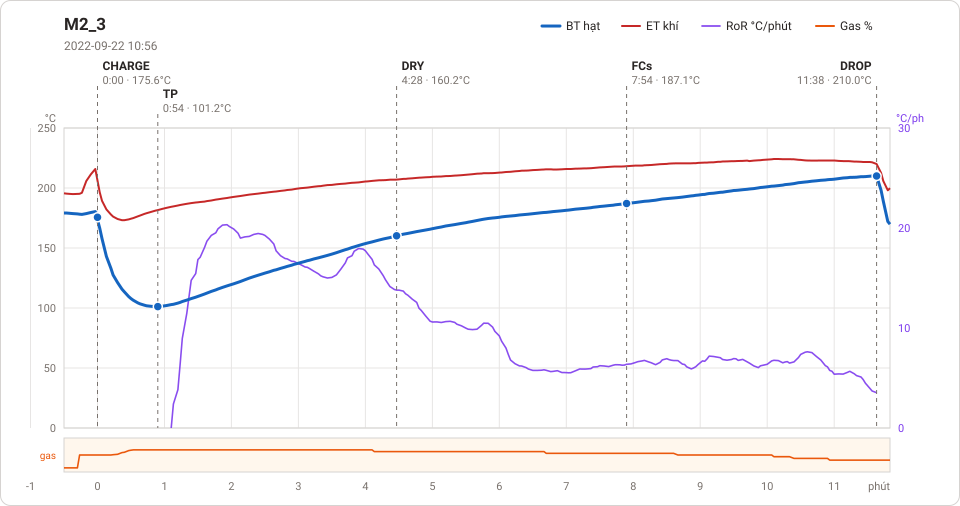

**TP** 0:54 · 101.2°C · **DRY** 4:28 · 160.2°C · **FCs** 7:54 · 187.1°C · **DROP** 11:38 · 210.0°C  —  tổng **11:38** · DTR **32.1 %**

### [M3](Profile-artisan/1kg_auto_wired/M3.alog)

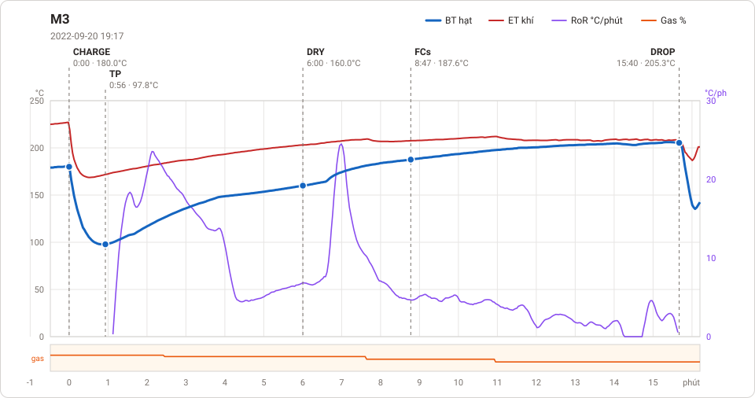

**TP** 0:56 · 97.8°C · **DRY** 6:00 · 160.0°C · **FCs** 8:47 · 187.6°C · **DROP** 15:40 · 205.3°C  —  tổng **15:40** · DTR **44.0 %**

### [M4](Profile-artisan/1kg_auto_wired/M4.alog)

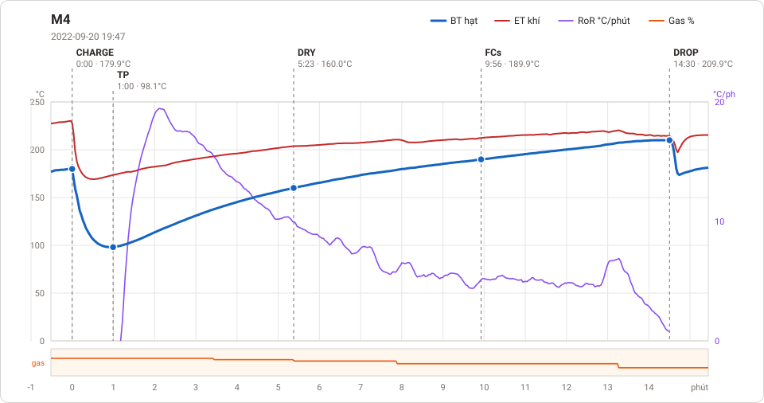

**TP** 1:00 · 98.1°C · **DRY** 5:23 · 160.0°C · **FCs** 9:56 · 189.9°C · **DROP** 14:30 · 209.9°C  —  tổng **14:30** · DTR **31.6 %**

### [autoM1](Profile-artisan/1kg_auto_wired/autoM1.alog)

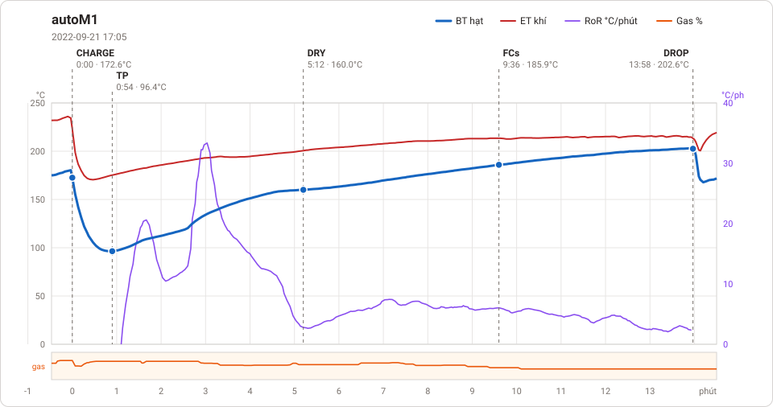

**TP** 0:54 · 96.4°C · **DRY** 5:12 · 160.0°C · **FCs** 9:36 · 185.9°C · **DROP** 13:58 · 202.6°C  —  tổng **13:58** · DTR **31.3 %**

### [autoM1_2](Profile-artisan/1kg_auto_wired/autoM1_2.alog)

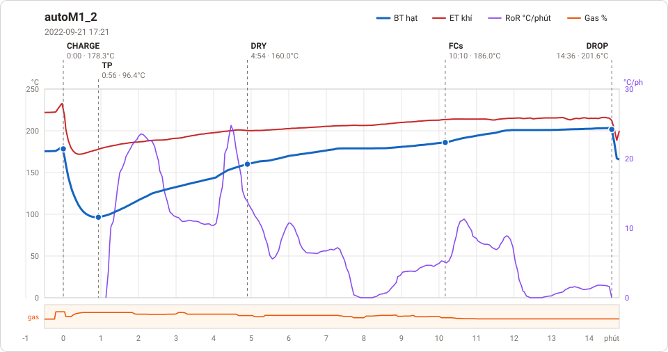

**TP** 0:56 · 96.4°C · **DRY** 4:54 · 160.0°C · **FCs** 10:10 · 186.0°C · **DROP** 14:36 · 201.6°C  —  tổng **14:36** · DTR **30.4 %**

### [autoM1_3](Profile-artisan/1kg_auto_wired/autoM1_3.alog)

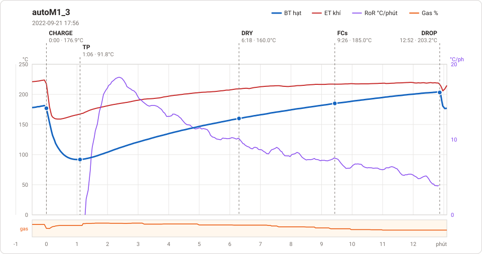

**TP** 1:06 · 91.8°C · **DRY** 6:18 · 160.0°C · **FCs** 9:26 · 185.0°C · **DROP** 12:52 · 203.2°C  —  tổng **12:52** · DTR **26.7 %**

### [autoM1_4](Profile-artisan/1kg_auto_wired/autoM1_4.alog)

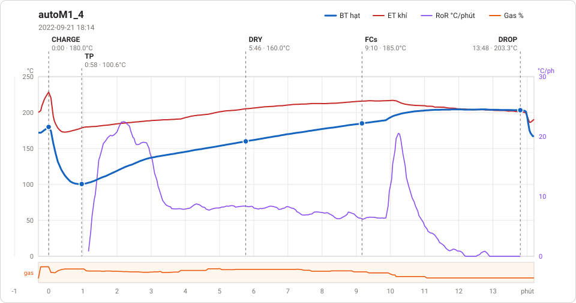

**TP** 0:58 · 100.6°C · **DRY** 5:46 · 160.0°C · **FCs** 9:10 · 185.0°C · **DROP** 13:48 · 203.3°C  —  tổng **13:48** · DTR **33.6 %**

### [autoM2_3_1](Profile-artisan/1kg_auto_wired/autoM2_3_1.alog)

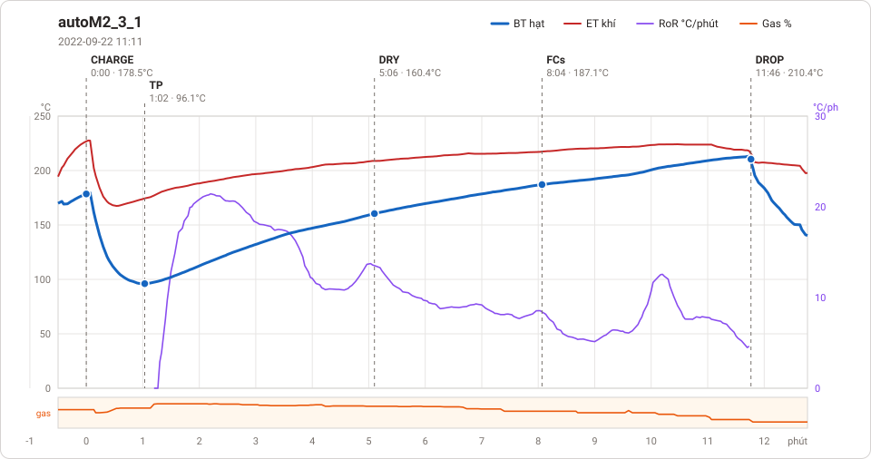

**TP** 1:02 · 96.1°C · **DRY** 5:06 · 160.4°C · **FCs** 8:04 · 187.1°C · **DROP** 11:46 · 210.4°C  —  tổng **11:46** · DTR **31.4 %**

### [Sample2_Ara Natural DB French Press Capella_20-07-15_1902](Roasting%20Profile/Sample2_Ara%20Natural%20DB%20French%20Press%20Capella_20-07-15_1902.alog)

**TP** 1:24 · 96.3°C · **DRY** 5:24 · 150.1°C · **FCs** 8:57 · 187.4°C · **DROP** 11:03 · 199.8°C  —  tổng **11:03** · DTR **19.0 %**

