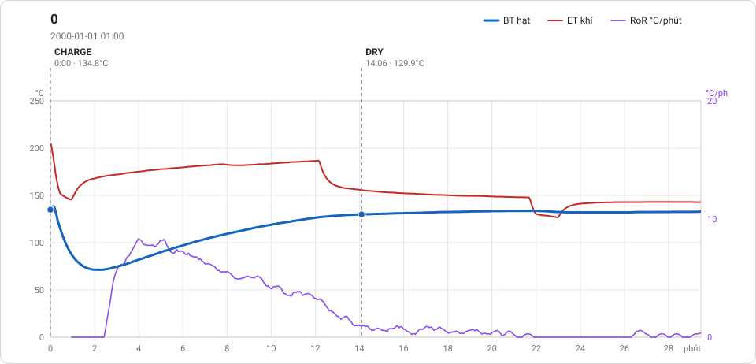
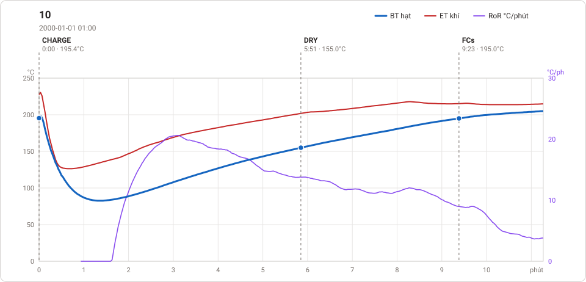
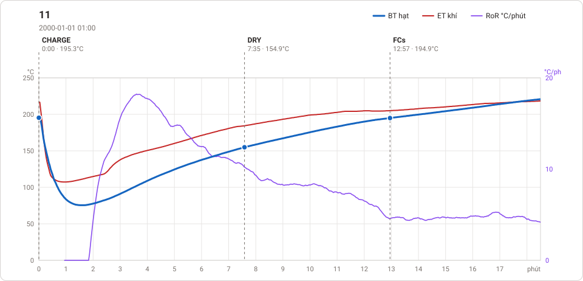
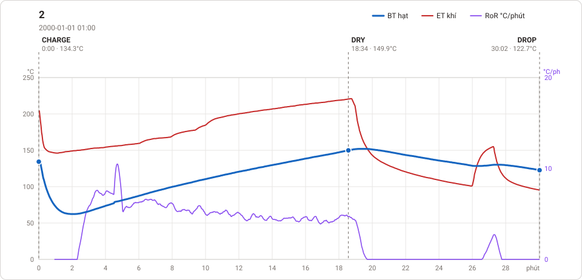
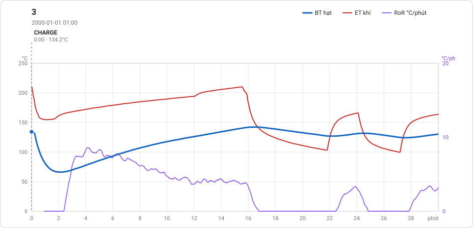
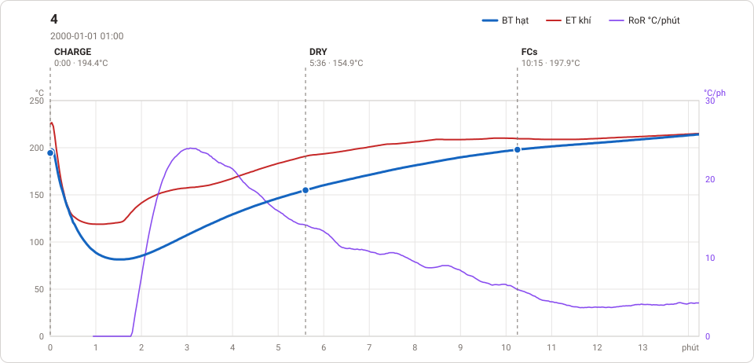
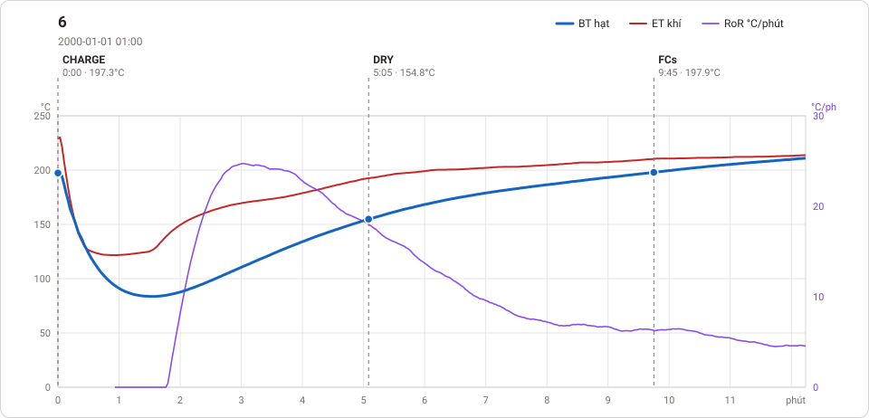
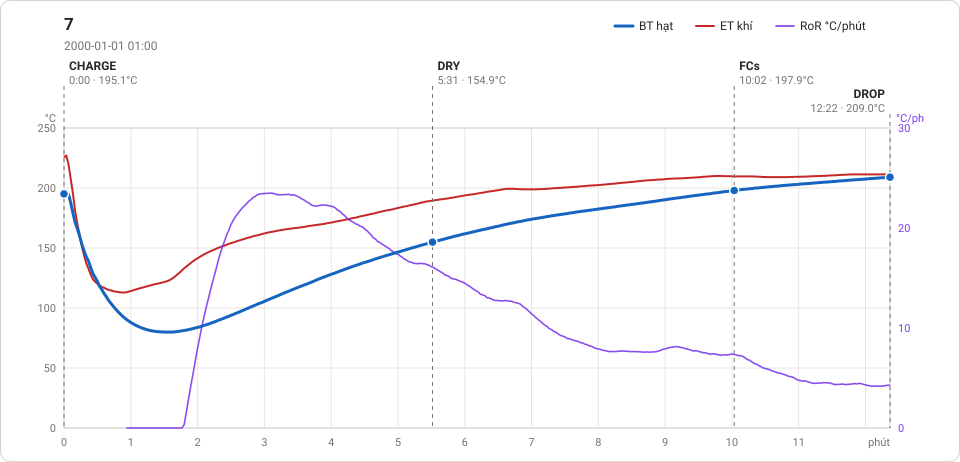
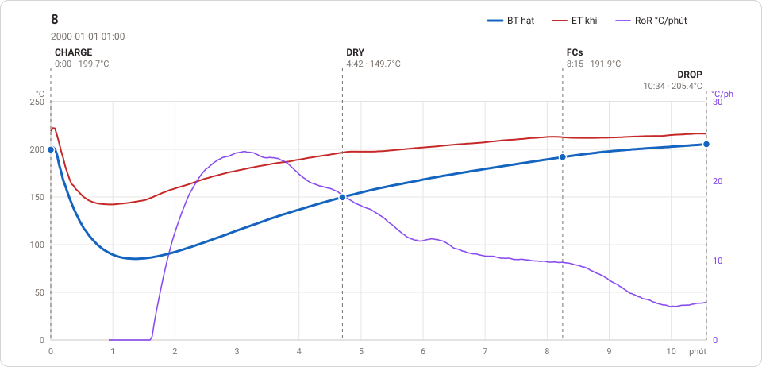
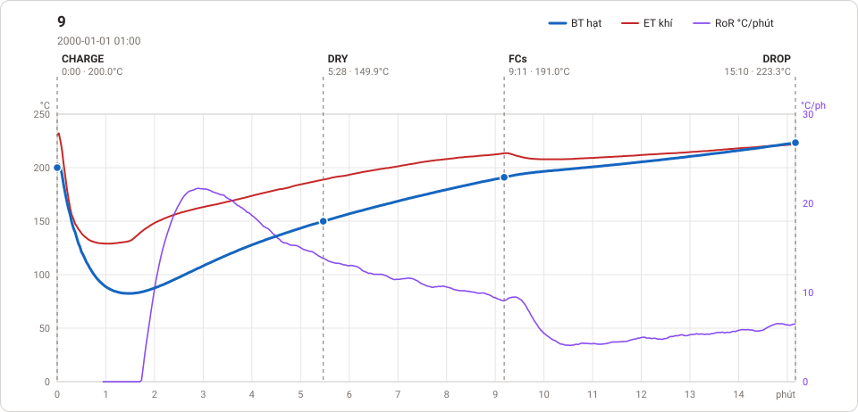

# Giản đồ rang — `Profile-aDanh`

11 profile. Bấm tên để mở tệp `.alog` (tải về, mở bằng Artisan: `File → Open`). Giản đồ sinh tự động bằng [`tools/ve_gian_do_alog.py`](../../../tools/ve_gian_do_alog.py) — [về bảng tổng](../README.md).

### [0](converted/0.alog)

**DRY** 14:06 · 129.9°C · **DROP** 29:29 · 132.8°C  —  tổng **29:29**

### [10](converted/10.alog)

**DRY** 5:51 · 155.0°C · **FCs** 9:23 · 195.0°C · **DROP** 11:17 · 205.1°C  —  tổng **11:17** · DTR **16.8 %**

### [11](converted/11.alog)

**DRY** 7:35 · 154.9°C · **FCs** 12:57 · 194.9°C · **DROP** 18:31 · 220.9°C  —  tổng **18:31** · DTR **30.1 %**

### [2 - Copy](converted/2%20-%20Copy.alog)

**DRY** 18:34 · 149.9°C · **DROP** 30:02 · 122.7°C  —  tổng **30:02**

### [2](converted/2.alog)

**DRY** 18:34 · 149.9°C · **DROP** 30:02 · 122.7°C  —  tổng **30:02**

### [3](converted/3.alog)

**DROP** 30:03 · 130.4°C  —  tổng **30:03**

### [4](converted/4.alog)

**DRY** 5:36 · 154.9°C · **FCs** 10:15 · 197.9°C · **DROP** 14:15 · 214.2°C  —  tổng **14:15** · DTR **28.1 %**

### [6](converted/6.alog)

**DRY** 5:05 · 154.8°C · **FCs** 9:45 · 197.9°C · **DROP** 12:15 · 211.1°C  —  tổng **12:15** · DTR **20.4 %**

### [7](converted/7.alog)

**DRY** 5:31 · 154.9°C · **FCs** 10:02 · 197.9°C · **DROP** 12:22 · 209.0°C  —  tổng **12:22** · DTR **18.9 %**

### [8](converted/8.alog)

**DRY** 4:42 · 149.7°C · **FCs** 8:15 · 191.9°C · **DROP** 10:34 · 205.4°C  —  tổng **10:34** · DTR **21.9 %**

### [9](converted/9.alog)

**DRY** 5:28 · 149.9°C · **FCs** 9:11 · 191.0°C · **DROP** 15:10 · 223.3°C  —  tổng **15:10** · DTR **39.5 %**

