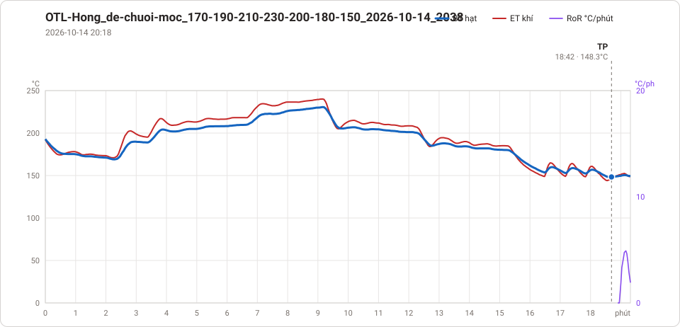
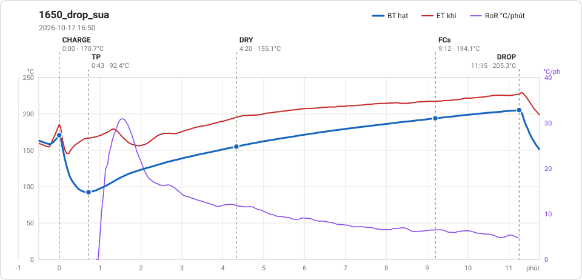
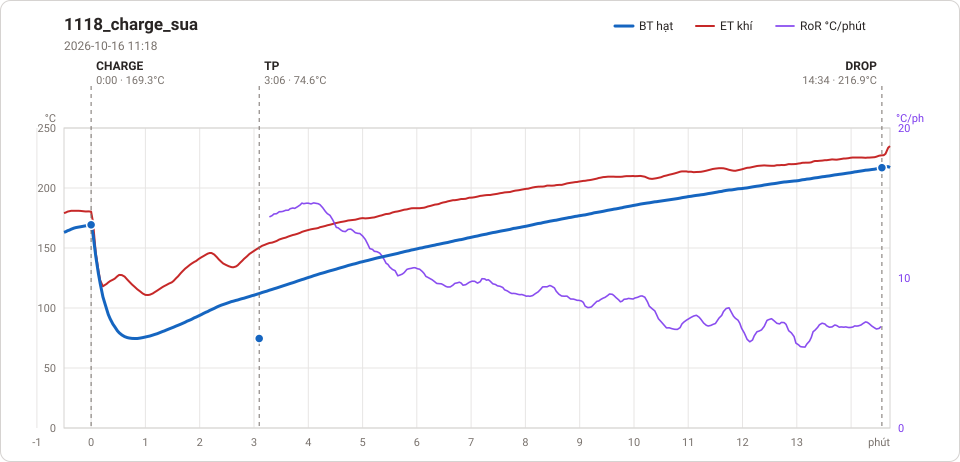
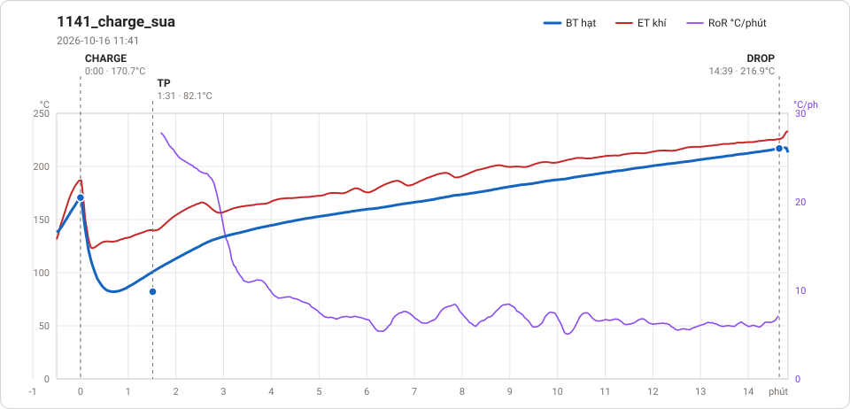
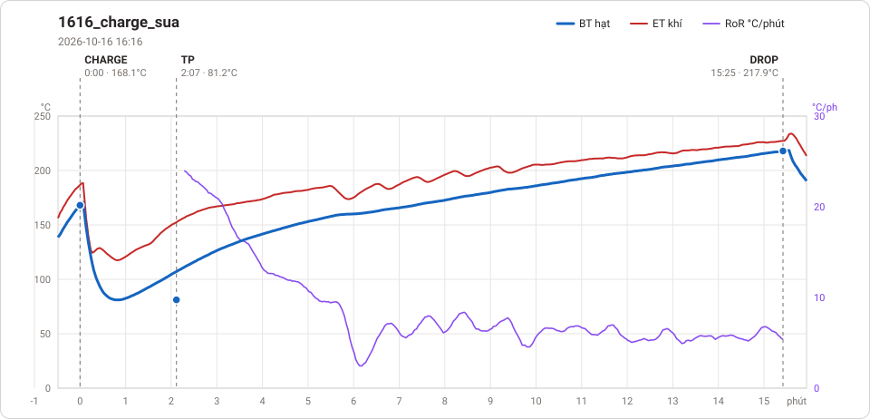
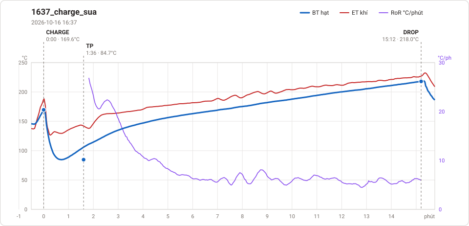
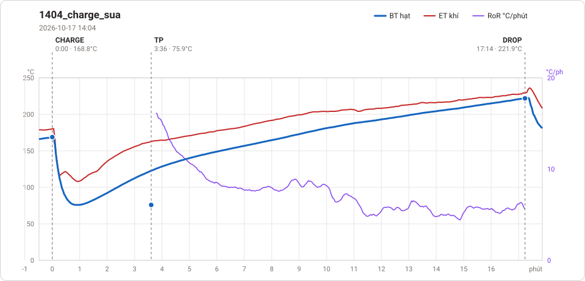
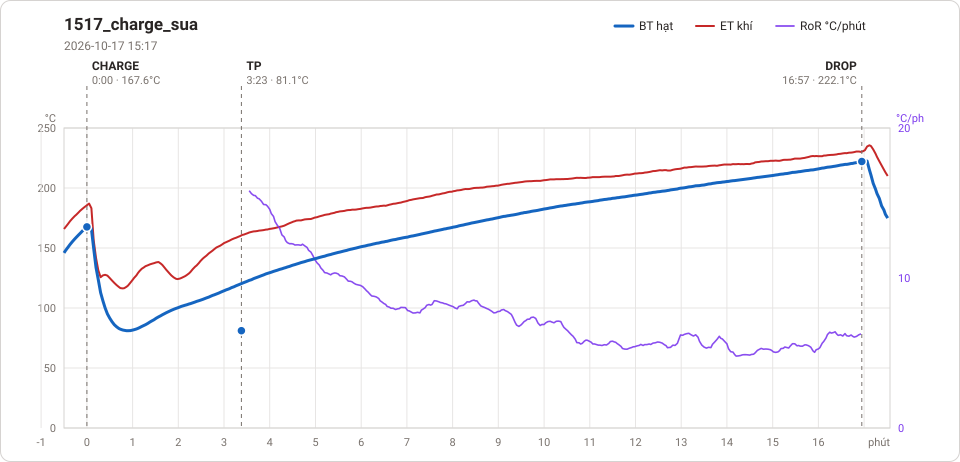

# Giản đồ rang — `Profile`

53 profile. Bấm tên để mở tệp `.alog` (tải về, mở bằng Artisan: `File → Open`). Giản đồ sinh tự động bằng [`tools/ve_gian_do_alog.py`](../../../tools/ve_gian_do_alog.py) — [về bảng tổng](../README.md).

### [OTL-Hong 2026-10-14 2046](OTL-Hong/OTL-Hong%202026-10-14%202046.alog)

_Bản ghi quá ngắn, không vẽ._

### [OTL-Hong 2026-10-15 0902](OTL-Hong/OTL-Hong%202026-10-15%200902.alog)

**TP** 0:47 · 199.6°C

### [OTL-Hong 2026-10-15 0905](OTL-Hong/OTL-Hong%202026-10-15%200905.alog)

**TP** 12:01 · 147.7°C

### [OTL-Hong 2026-10-15 0918](OTL-Hong/OTL-Hong%202026-10-15%200918.alog)

**TP** 0:18 · 141.1°C

### [OTL-Hong 2026-10-15 0932](OTL-Hong/OTL-Hong%202026-10-15%200932.alog)

**TP** 1:18 · 170.7°C

### [OTL-Hong 2026-10-15 0935](OTL-Hong/OTL-Hong%202026-10-15%200935.alog)

**TP** 0:18 · 142.8°C

### [OTL-Hong 2026-10-15 0946](OTL-Hong/OTL-Hong%202026-10-15%200946.alog)

**TP** 12:01 · 150.7°C

### [OTL-Hong 2026-10-15 0959](OTL-Hong/OTL-Hong%202026-10-15%200959.alog)

**TP** 0:18 · 143.4°C

### [OTL-Hong 2026-10-15 1009](OTL-Hong/OTL-Hong%202026-10-15%201009.alog)

**TP** 11:13 · 150.0°C

### [OTL-Hong 2026-10-15 1142](OTL-Hong/OTL-Hong%202026-10-15%201142.alog)

**TP** 0:17 · 42.4°C

### [OTL-Hong 2026-10-15 1319](OTL-Hong/OTL-Hong%202026-10-15%201319.alog)

### [OTL-Hong 2026-10-15 1327](OTL-Hong/OTL-Hong%202026-10-15%201327.alog)

**TP** 1:30 · 43.3°C

### [OTL-Hong 2026-10-15 1328](OTL-Hong/OTL-Hong%202026-10-15%201328.alog)

**TP** 0:14 · 43.2°C

### [OTL-Hong 2026-10-15 1338](OTL-Hong/OTL-Hong%202026-10-15%201338.alog)

**TP** 0:15 · 106.6°C

### [OTL-Hong 2026-10-15 1339](OTL-Hong/OTL-Hong%202026-10-15%201339.alog)

### [OTL-Hong 2026-10-15 1345](OTL-Hong/OTL-Hong%202026-10-15%201345.alog)

**TP** 1:55 · 127.4°C

### [OTL-Hong 2026-10-15 1348](OTL-Hong/OTL-Hong%202026-10-15%201348.alog)

### [OTL-Hong 2026-10-15 1353](OTL-Hong/OTL-Hong%202026-10-15%201353.alog)

**TP** 0:15 · 159.0°C

### [OTL-Hong 2026-10-15 1354](OTL-Hong/OTL-Hong%202026-10-15%201354.alog)

### [OTL-Hong 2026-10-15 1407](OTL-Hong/OTL-Hong%202026-10-15%201407.alog)

**TP** 0:14 · 97.4°C

### [OTL-Hong 2026-10-15 1410](OTL-Hong/OTL-Hong%202026-10-15%201410.alog)

**TP** 0:01 · 190.6°C

### [OTL-Hong 2026-10-15 1416](OTL-Hong/OTL-Hong%202026-10-15%201416.alog)

**TP** 11:05 · 95.9°C

### [OTL-Hong 2026-10-15 1429](OTL-Hong/OTL-Hong%202026-10-15%201429.alog)

**TP** 0:20 · 90.7°C

### [OTL-Hong 2026-10-15 1438](OTL-Hong/OTL-Hong%202026-10-15%201438.alog)

**TP** 0:08 · 183.5°C

### [OTL-Hong 2026-10-15 1440](OTL-Hong/OTL-Hong%202026-10-15%201440.alog)

**TP** 0:12 · 199.0°C

### [OTL-Hong 2026-10-15 1441](OTL-Hong/OTL-Hong%202026-10-15%201441.alog)

### [OTL-Hong 2026-10-15 1443](OTL-Hong/OTL-Hong%202026-10-15%201443.alog)

_Bản ghi quá ngắn, không vẽ._

### [OTL-Hong 2026-10-15 1444](OTL-Hong/OTL-Hong%202026-10-15%201444.alog)

### [OTL-Hong 2026-10-15 1445](OTL-Hong/OTL-Hong%202026-10-15%201445.alog)

**TP** 2:30 · 195.4°C

### [OTL-Hong 2026-10-15 1448](OTL-Hong/OTL-Hong%202026-10-15%201448.alog)

**TP** 0:10 · 194.3°C

### [OTL-Hong 2026-10-15 1502](OTL-Hong/OTL-Hong%202026-10-15%201502.alog)

**TP** 1:28 · 95.6°C

### [OTL-Hong 2026-10-15 1516](OTL-Hong/OTL-Hong%202026-10-15%201516.alog)

_Bản ghi quá ngắn, không vẽ._

### [OTL-Hong 2026-10-15 1517](OTL-Hong/OTL-Hong%202026-10-15%201517.alog)

**TP** 43:06 · 121.5°C · **DRY** 2:01 · 168.8°C

### [OTL-Hong 2026-10-15 1608](OTL-Hong/OTL-Hong%202026-10-15%201608.alog)

**TP** 0:49 · 91.9°C · **DRY** 6:04 · 155.0°C · **FCs** 12:18 · 194.0°C · **DROP** 16:46 · 212.1°C  —  tổng **16:46** · DTR **26.6 %**

### [OTL-Hong 2026-10-15 1633](OTL-Hong/OTL-Hong%202026-10-15%201633.alog)

**TP** 0:44 · 83.6°C · **DRY** 4:05 · 155.1°C · **FCs** 8:38 · 194.0°C · **DROP** 12:04 · 214.6°C  —  tổng **12:04** · DTR **28.5 %**

### [OTL-Hong 2026-10-15 1745](OTL-Hong/OTL-Hong%202026-10-15%201745.alog)

**TP** 0:55 · 68.1°C · **DRY** 6:38 · 155.1°C · **FCs** 11:29 · 194.0°C · **DROP** 15:30 · 217.9°C  —  tổng **15:30** · DTR **25.9 %**

### [OTL-Hong 2026-10-16 1042](OTL-Hong/OTL-Hong%202026-10-16%201042.alog)

**TP** 1:00 · 74.9°C · **DRY** 6:29 · 155.1°C · **FCs** 10:58 · 194.0°C

### [OTL-Hong 2026-10-16 1118](OTL-Hong/OTL-Hong%202026-10-16%201118.alog)

**TP** 3:06 · 74.6°C · **DROP** 16:48 · 216.9°C  —  tổng **16:48**

### [OTL-Hong 2026-10-16 1141](OTL-Hong/OTL-Hong%202026-10-16%201141.alog)

**TP** 1:31 · 82.1°C · **DROP** 15:25 · 216.9°C  —  tổng **15:25**

### [OTL-Hong 2026-10-16 1616](OTL-Hong/OTL-Hong%202026-10-16%201616.alog)

**TP** 2:07 · 81.2°C · **DROP** 16:39 · 217.9°C  —  tổng **16:39**

### [OTL-Hong 2026-10-16 1637](OTL-Hong/OTL-Hong%202026-10-16%201637.alog)

**TP** 1:36 · 84.7°C · **DROP** 16:04 · 218.0°C  —  tổng **16:04**

### [OTL-Hong 2026-10-17 1400](OTL-Hong/OTL-Hong%202026-10-17%201400.alog)

**TP** 0:07 · 81.9°C

### [OTL-Hong 2026-10-17 1404](OTL-Hong/OTL-Hong%202026-10-17%201404.alog)

**TP** 3:36 · 75.9°C · **DROP** 19:51 · 221.9°C  —  tổng **19:51**

### [OTL-Hong 2026-10-17 1517](OTL-Hong/OTL-Hong%202026-10-17%201517.alog)

**TP** 3:23 · 81.1°C · **DROP** 19:23 · 222.1°C  —  tổng **19:23**

### [OTL-Hong 2026-10-17 1650](OTL-Hong/OTL-Hong%202026-10-17%201650.alog)

**TP** 0:43 · 92.4°C · **DRY** 4:20 · 155.1°C · **FCs** 9:12 · 194.1°C

### [OTL-Hong_de-chuoi-moc_170-190-210-230-200-180-150_2026-10-14_2038](OTL-Hong/OTL-Hong_de-chuoi-moc_170-190-210-230-200-180-150_2026-10-14_2038.alog)

**TP** 18:42 · 148.3°C

### [1650_drop_sua](OTL-Hong/ethiopia_yirgacheffe_g2_natural/me1_500g_1710/1650_drop_sua.alog)

**TP** 0:43 · 92.4°C · **DRY** 4:20 · 155.1°C · **FCs** 9:12 · 194.1°C · **DROP** 11:15 · 205.3°C  —  tổng **11:15** · DTR **18.2 %**

### [1118_charge_sua](OTL-Hong/me_ho_so_5_1610/1118_charge_sua.alog)

**TP** 3:06 · 74.6°C · **DROP** 14:34 · 216.9°C  —  tổng **14:34**

### [1141_charge_sua](OTL-Hong/me_ho_so_6_1610/1141_charge_sua.alog)

**TP** 1:31 · 82.1°C · **DROP** 14:39 · 216.9°C  —  tổng **14:39**

### [1616_charge_sua](OTL-Hong/me_ho_so_7_1610/1616_charge_sua.alog)

**TP** 2:07 · 81.2°C · **DROP** 15:25 · 217.9°C  —  tổng **15:25**

### [1637_charge_sua](OTL-Hong/me_ho_so_8_1610/1637_charge_sua.alog)

**TP** 1:36 · 84.7°C · **DROP** 15:12 · 218.0°C  —  tổng **15:12**

### [1404_charge_sua](OTL-Hong/me_ho_so_9_1710/1404_charge_sua.alog)

**TP** 3:36 · 75.9°C · **DROP** 17:14 · 221.9°C  —  tổng **17:14**

### [1517_charge_sua](OTL-Hong/me_robusta_phin_2_1710/1517_charge_sua.alog)

**TP** 3:23 · 81.1°C · **DROP** 16:57 · 222.1°C  —  tổng **16:57**

