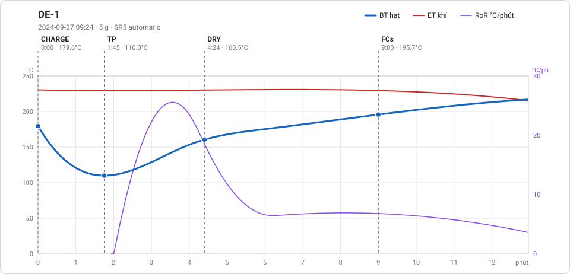
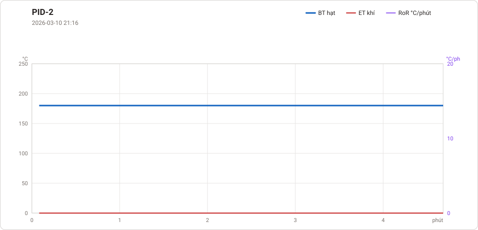
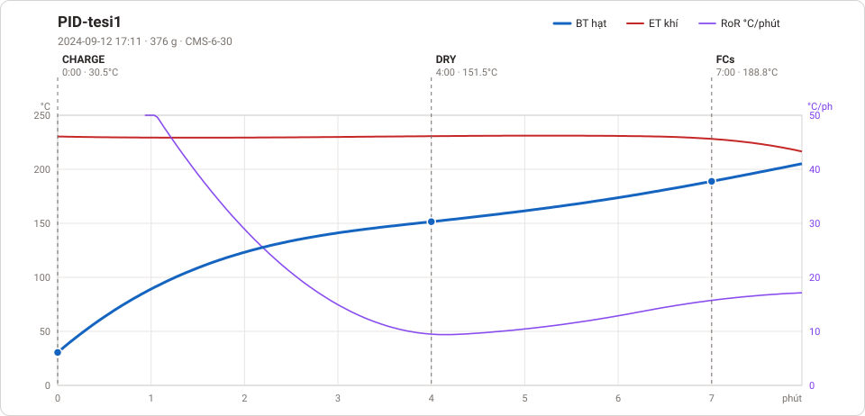
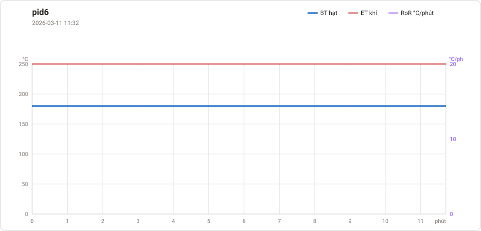
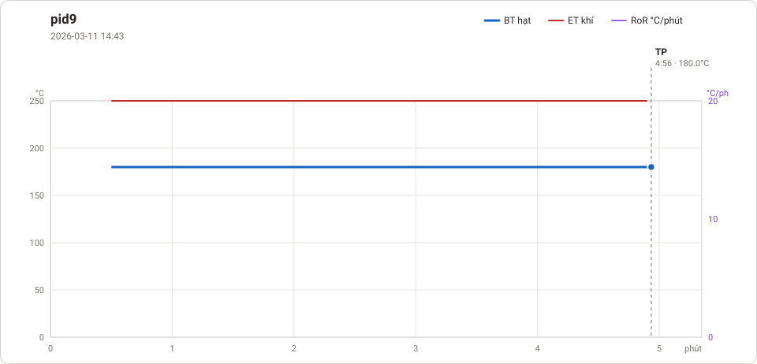

# Giản đồ rang — `Thanh`

101 profile. Bấm tên để mở tệp `.alog` (tải về, mở bằng Artisan: `File → Open`). Giản đồ sinh tự động bằng [`tools/ve_gian_do_alog.py`](../../../tools/ve_gian_do_alog.py) — [về bảng tổng](../README.md).

### [0 00_00 Roaster Scope 2024-12-07](0%2000_00%20Roaster%20Scope%202024-12-07.alog)

_Bản ghi quá ngắn, không vẽ._

### [0 00_00 Roaster Scope 2025-03-22](0%2000_00%20Roaster%20Scope%202025-03-22.alog)

_Bản ghi quá ngắn, không vẽ._

### [0 00_00 Roaster Scope 2026-03-10](0%2000_00%20Roaster%20Scope%202026-03-10.alog)

**TP** 2:28 · 180.0°C

### [0 00_00 Roaster Scope 2026-03-30](0%2000_00%20Roaster%20Scope%202026-03-30.alog)

**TP** 0:31 · 90.0°C

### [0 00_00 Roaster Scope 2026-08-13](0%2000_00%20Roaster%20Scope%202026-08-13.alog)

**TP** 1:22 · 62.4°C · **DRY** 11:32 · 155.0°C · **FCs** 17:10 · 188.5°C

### [0 00_02 Roaster Scope 2025-03-22](0%2000_02%20Roaster%20Scope%202025-03-22.alog)

_Bản ghi quá ngắn, không vẽ._

### [0 00_58 Roaster Scope 2025-03-22](0%2000_58%20Roaster%20Scope%202025-03-22.alog)

**TP** 0:29 · 93.0°C · **DRY** 0:46 · 160.0°C · **FCs** 0:54 · 198.0°C · **DROP** 0:58 · 207.0°C  —  tổng **0:58** · DTR **7.7 %**

### [0 01_09 Roaster Scope 2025-03-22](0%2001_09%20Roaster%20Scope%202025-03-22.alog)

**TP** 0:54 · 97.0°C · **DRY** 1:04 · 161.0°C · **DROP** 1:10 · 187.0°C  —  tổng **1:10**

### [0 01_26 Roaster Scope 2024-12-07](0%2001_26%20Roaster%20Scope%202024-12-07.alog)

**TP** 0:38 · 76.5°C · **DRY** 0:56 · 156.6°C · **FCs** 1:21 · 194.6°C · **DROP** 1:26 · 198.3°C  —  tổng **1:26** · DTR **5.8 %**

### [0 01_39 Roaster Scope 2025-03-22](0%2001_39%20Roaster%20Scope%202025-03-22.alog)

**TP** 0:39 · 97.0°C · **DRY** 1:14 · 160.0°C · **FCs** 1:34 · 198.0°C · **DROP** 1:39 · 199.0°C  —  tổng **1:39** · DTR **5.3 %**

### [0 01_48 Roaster Scope 2025-03-22](0%2001_48%20Roaster%20Scope%202025-03-22.alog)

**TP** 1:07 · 75.0°C · **DRY** 1:37 · 160.0°C · **FCs** 1:47 · 197.0°C · **DROP** 1:49 · 199.0°C  —  tổng **1:49** · DTR **2.1 %**

### [0 01_54 Roaster Scope 2024-12-07](0%2001_54%20Roaster%20Scope%202024-12-07.alog)

**TP** 0:38 · 65.3°C · **DRY** 1:02 · 158.8°C · **FCs** 1:40 · 194.5°C · **DROP** 1:54 · 198.4°C  —  tổng **1:54** · DTR **12.3 %**

### [0 02_10 Roaster Scope 2024-12-07](0%2002_10%20Roaster%20Scope%202024-12-07.alog)

**TP** 0:40 · 63.7°C · **DRY** 1:06 · 156.5°C · **FCs** 1:54 · 194.0°C · **DROP** 2:10 · 198.3°C  —  tổng **2:10** · DTR **12.3 %**

### [0 02_26 Roaster Scope 2024-12-07](0%2002_26%20Roaster%20Scope%202024-12-07.alog)

**TP** 1:56 · 56.3°C · **DRY** 2:14 · 160.6°C · **FCs** 2:26 · 198.3°C · **DROP** 2:26 · 198.3°C  —  tổng **2:26** · DTR **0.0 %**

### [0 02_40 Roaster Scope 2024-12-07](0%2002_40%20Roaster%20Scope%202024-12-07.alog)

**TP** 0:56 · 49.8°C · **DRY** 2:30 · 197.2°C · **FCs** 2:30 · 197.2°C · **DROP** 2:40 · 198.4°C  —  tổng **2:40** · DTR **6.2 %**

### [0 02_54 Roaster Scope 2024-12-07](0%2002_54%20Roaster%20Scope%202024-12-07.alog)

**TP** 1:38 · 44.2°C · **DRY** 2:30 · 199.8°C · **FCs** 2:30 · 199.8°C · **DROP** 2:54 · 210.3°C  —  tổng **2:54** · DTR **13.8 %**

### [0 04_28 Roaster Scope 2024-12-07](0%2004_28%20Roaster%20Scope%202024-12-07.alog)

**TP** 2:42 · 46.0°C · **DRY** 4:12 · 160.5°C · **FCs** 4:28 · 197.1°C · **DROP** 4:28 · 197.1°C  —  tổng **4:28** · DTR **0.0 %**

### [0 14_06 Roaster Scope 2024-12-07](0%2014_06%20Roaster%20Scope%202024-12-07.alog)

**TP** 1:05 · 75.0°C · **DRY** 6:42 · 155.0°C · **FCs** 10:33 · 194.0°C · **DROP** 14:06 · 218.1°C  —  tổng **14:06** · DTR **25.2 %**

### [0 14_15 Roaster Scope 2024-12-07](0%2014_15%20Roaster%20Scope%202024-12-07.alog)

**TP** 1:04 · 74.6°C · **DRY** 6:44 · 155.1°C · **FCs** 10:47 · 194.0°C · **DROP** 14:15 · 217.9°C  —  tổng **14:15** · DTR **24.4 %**

### [1 11_41 Roaster Scope 2026-06-26](1%2011_41%20Roaster%20Scope%202026-06-26.alog)

**TP** 1:16 · 71.9°C · **DRY** 6:16 · 155.2°C · **FCs** 9:34 · 194.1°C · **DROP** 11:41 · 217.0°C  —  tổng **11:41** · DTR **18.1 %**

### [1 15_02 Roaster Scope 2026-03-13](1%2015_02%20Roaster%20Scope%202026-03-13.alog)

**TP** 1:05 · 75.0°C · **DRY** 6:41 · 154.3°C · **FCs** 10:49 · 194.6°C · **DROP** 15:02 · 224.8°C  —  tổng **15:02** · DTR **28.0 %**

### [19 05_29 Roaster Scope 2026-03-14](19%2005_29%20Roaster%20Scope%202026-03-14.alog)

**TP** 1:04 · 74.9°C · **DRY** 3:02 · 157.9°C · **FCs** 4:37 · 195.9°C · **DROP** 5:29 · 212.9°C  —  tổng **5:29** · DTR **15.8 %**

### [2 02_17 Roaster Scope 2025-03-22](2%2002_17%20Roaster%20Scope%202025-03-22.alog)

**TP** 1:04 · 91.0°C · **DRY** 1:44 · 162.0°C · **FCs** 1:58 · 197.0°C · **DROP** 2:17 · 230.0°C  —  tổng **2:17** · DTR **14.2 %**

### [22 06_24 Roaster Scope 2026-03-14](22%2006_24%20Roaster%20Scope%202026-03-14.alog)

**TP** 0:53 · 87.7°C · **DRY** 3:49 · 155.1°C · **FCs** 5:31 · 194.1°C · **DROP** 6:24 · 213.0°C  —  tổng **6:24** · DTR **13.8 %**

### [24 05_12 Roaster Scope 2026-03-15](24%2005_12%20Roaster%20Scope%202026-03-15.alog)

**TP** 0:22 · 89.1°C · **DRY** 2:57 · 155.2°C · **FCs** 4:26 · 194.2°C · **DROP** 5:13 · 204.2°C  —  tổng **5:13** · DTR **14.7 %**

### [3 01_00 Roaster Scope 2025-03-22](3%2001_00%20Roaster%20Scope%202025-03-22.alog)

**TP** 0:27 · 97.0°C · **DRY** 0:40 · 161.0°C · **FCs** 0:55 · 200.0°C · **DROP** 1:00 · 206.0°C  —  tổng **1:00** · DTR **8.7 %**

### [37 00_11 Roaster Scope 2026-03-30](37%2000_11%20Roaster%20Scope%202026-03-30.alog)

**TP** 0:07 · 164.0°C · **DROP** 0:11 · 180.0°C  —  tổng **0:11**

### [38 06_27 Roaster Scope 2026-03-30](38%2006_27%20Roaster%20Scope%202026-03-30.alog)

**TP** 0:32 · 81.4°C · **DRY** 3:56 · 160.4°C · **FCs** 5:36 · 197.0°C · **DROP** 6:27 · 211.4°C  —  tổng **6:27** · DTR **13.2 %**

### [39 05_08 Roaster Scope 2026-03-31](39%2005_08%20Roaster%20Scope%202026-03-31.alog)

**TP** 0:51 · 98.0°C · **DRY** 2:58 · 160.1°C · **FCs** 4:19 · 197.3°C · **DROP** 5:08 · 218.2°C  —  tổng **5:08** · DTR **15.9 %**

### [4 01_40 Roaster Scope 2025-03-22](4%2001_40%20Roaster%20Scope%202025-03-22.alog)

**TP** 0:23 · 97.0°C · **DRY** 1:07 · 160.0°C · **FCs** 1:23 · 197.0°C · **DROP** 1:40 · 226.0°C  —  tổng **1:40** · DTR **17.2 %**

### [5 04_55 Roaster Scope 2025-03-22](5%2004_55%20Roaster%20Scope%202025-03-22.alog)

**TP** 0:28 · 95.0°C · **DRY** 3:18 · 160.2°C · **FCs** 4:50 · 197.1°C · **DROP** 4:56 · 199.2°C  —  tổng **4:56** · DTR **1.8 %**

### [6 00_57 Roaster Scope 2025-03-22](6%2000_57%20Roaster%20Scope%202025-03-22.alog)

**TP** 0:26 · 88.6°C · **DRY** 0:40 · 160.6°C · **FCs** 0:47 · 198.6°C · **DROP** 0:57 · 209.6°C  —  tổng **0:57** · DTR **17.1 %**

### [6 14_57 Roaster Scope 2026-08-12](6%2014_57%20Roaster%20Scope%202026-08-12.alog)

**TP** 1:17 · 62.0°C · **DRY** 8:08 · 155.1°C · **FCs** 12:08 · 194.0°C · **DROP** 14:57 · 221.7°C  —  tổng **14:57** · DTR **18.8 %**

### [7 01_16 Roaster Scope 2025-03-22](7%2001_16%20Roaster%20Scope%202025-03-22.alog)

**TP** 0:26 · 91.6°C · **DRY** 0:41 · 162.6°C · **FCs** 0:48 · 199.6°C · **DROP** 1:16 · 216.6°C  —  tổng **1:16** · DTR **37.3 %**

### [9 04_54 Roaster Scope 2026-03-13](9%2004_54%20Roaster%20Scope%202026-03-13.alog)

**TP** 1:03 · 74.7°C · **DRY** 4:07 · 160.6°C · **FCs** 4:47 · 202.6°C · **DROP** 4:54 · 209.6°C  —  tổng **4:54** · DTR **2.4 %**

### [DE-1](DE-1.alog)

**TP** 1:45 · 110.0°C · **DRY** 4:24 · 160.5°C · **FCs** 9:00 · 195.7°C · **DROP** 12:59 · 217.0°C  —  tổng **12:59** · DTR **30.7 %**

### [Kennya Murang's AA Top - simu - background](Kennya%20Murang's%20AA%20Top%20-%20simu%20-%20background.alog)

**TP** 1:36 · 110.6°C · **DRY** 4:00 · 153.6°C · **FCs** 7:45 · 193.1°C · **DROP** 9:15 · 199.2°C  —  tổng **9:15** · DTR **16.2 %**

### [Kenya Murang's AA Top - Drip - 90AT](Kenya%20Murang's%20AA%20Top%20-%20Drip%20-%2090AT.alog)

**TP** 0:52 · 85.5°C · **DRY** 4:22 · 155.8°C · **FCs** 8:16 · 194.0°C · **DROP** 9:50 · 196.7°C  —  tổng **9:50** · DTR **15.9 %**

### [Kenya Murang's AA Top - Drip - 92AT](Kenya%20Murang's%20AA%20Top%20-%20Drip%20-%2092AT.alog)

**TP** 0:50 · 78.6°C · **DRY** 3:52 · 155.1°C · **FCs** 7:26 · 195.3°C · **DROP** 8:50 · 198.4°C  —  tổng **8:50** · DTR **15.8 %**

### [PID 4](PID%204.alog)

**TP** 4:30 · 180.0°C

### [PID-2](PID-2.alog)

**TP** 4:41 · 180.0°C

### [PID-tesi1](PID-tesi1.alog)

**DRY** 4:00 · 151.5°C · **FCs** 7:00 · 188.8°C · **DROP** 7:59 · 205.4°C  —  tổng **7:59** · DTR **12.3 %**

### [Ro - Y - 500g - 209 - 1601 - 140924](Ro%20-%20Y%20-%20500g%20-%20209%20-%201601%20-%20140924.alog)

**TP** 0:40 · 83.4°C · **DRY** 5:48 · 155.1°C · **FCs** 10:12 · 183.6°C · **DROP** 16:24 · 209.8°C  —  tổng **16:24** · DTR **37.8 %**

### [Ro - Y - 500g - 209 - 1630 - 140924](Ro%20-%20Y%20-%20500g%20-%20209%20-%201630%20-%20140924.alog)

**TP** 0:46 · 72.7°C · **DRY** 6:30 · 155.1°C · **FCs** 10:24 · 185.0°C · **DROP** 15:42 · 213.7°C  —  tổng **15:42** · DTR **33.8 %**

### [Ro - Y - 500g - 209 - 1645- 140924](Ro%20-%20Y%20-%20500g%20-%20209%20-%201645-%20140924.alog)

**TP** 0:44 · 73.6°C · **DRY** 6:38 · 155.1°C · **FCs** 10:46 · 187.1°C · **DROP** 15:56 · 213.7°C  —  tổng **15:56** · DTR **32.4 %**

### [Ro - Y - 500g - 209 - 1700- 140924](Ro%20-%20Y%20-%20500g%20-%20209%20-%201700-%20140924.alog)

**TP** 0:46 · 72.0°C · **DRY** 6:40 · 155.2°C · **FCs** 10:24 · 185.0°C · **DROP** 15:26 · 213.8°C  —  tổng **15:26** · DTR **32.6 %**

### [pid6](pid6.alog)

**TP** 11:43 · 180.0°C

### [pid9](pid9.alog)

**TP** 4:56 · 180.0°C

### [10 01_37 Roaster Scope 2025-06-26](PDF/10%2001_37%20Roaster%20Scope%202025-06-26.alog)

**TP** 0:56 · 100.0°C · **DRY** 1:31 · 165.0°C · **DROP** 1:37 · 192.0°C  —  tổng **1:37**

### [9 03_41 Roaster Scope 2025-06-26](PDF/9%2003_41%20Roaster%20Scope%202025-06-26.alog)

**TP** 0:58 · 90.0°C · **DRY** 1:59 · 164.0°C · **FCs** 2:19 · 197.0°C · **DROP** 3:41 · 203.0°C  —  tổng **3:41** · DTR **37.1 %**

### [0 00_00 Roaster Scope 2026-03-31](TEST%20AUTO/0%2000_00%20Roaster%20Scope%202026-03-31.alog)

**TP** 20:36 · 194.2°C

### [0 00_00 Roaster Scope 2026-04-08](TEST%20AUTO/0%2000_00%20Roaster%20Scope%202026-04-08.alog)

**TP** 3:15 · 180.0°C

### [0 00_00 Roaster Scope 2026-04-09](TEST%20AUTO/0%2000_00%20Roaster%20Scope%202026-04-09.alog)

**TP** 1:16 · 74.8°C

### [0 00_00 Roaster Scope 2026-04-16](TEST%20AUTO/0%2000_00%20Roaster%20Scope%202026-04-16.alog)

**TP** 1:17 · 108.6°C

### [0 00_00 Roaster Scope 2026-04-17](TEST%20AUTO/0%2000_00%20Roaster%20Scope%202026-04-17.alog)

**TP** 8:00 · 29.6°C

### [0 00_00 Roaster Scope 2026-04-18](TEST%20AUTO/0%2000_00%20Roaster%20Scope%202026-04-18.alog)

**TP** 0:24 · 140.1°C

### [0 00_00 Roaster Scope 2026-04-19](TEST%20AUTO/0%2000_00%20Roaster%20Scope%202026-04-19.alog)

**TP** 3:10 · 150.3°C

### [0 00_00 Roaster Scope 2026-04-20](TEST%20AUTO/0%2000_00%20Roaster%20Scope%202026-04-20.alog)

**TP** 18:43 · 91.4°C

### [0 00_00 Roaster Scope 2026-04-21](TEST%20AUTO/0%2000_00%20Roaster%20Scope%202026-04-21.alog)

**TP** 0:10 · 32.3°C

### [0 00_00 Roaster Scope 2026-05-16](TEST%20AUTO/0%2000_00%20Roaster%20Scope%202026-05-16.alog)

**TP** 1:28 · 69.3°C

### [10 21_27 Roaster Scope 2026-03-31](TEST%20AUTO/10%2021_27%20Roaster%20Scope%202026-03-31.alog)

**TP** 0:45 · 91.9°C · **DRY** 4:03 · 160.0°C · **FCs** 11:24 · 197.0°C · **DROP** 21:27 · 234.6°C  —  tổng **21:27** · DTR **46.9 %**

### [11 15_58 Roaster Scope 2026-03-31](TEST%20AUTO/11%2015_58%20Roaster%20Scope%202026-03-31.alog)

**TP** 0:49 · 91.6°C · **DRY** 4:25 · 160.0°C · **FCs** 6:55 · 197.0°C · **DROP** 15:58 · 234.6°C  —  tổng **15:58** · DTR **56.7 %**

### [12 14_09 Roaster Scope 2026-04-09](TEST%20AUTO/12%2014_09%20Roaster%20Scope%202026-04-09.alog)

**TP** 1:05 · 76.0°C · **DRY** 7:13 · 160.0°C · **FCs** 11:25 · 197.0°C · **DROP** 14:09 · 213.4°C  —  tổng **14:09** · DTR **19.3 %**

### [13 05_28 Roaster Scope 2026-04-09](TEST%20AUTO/13%2005_28%20Roaster%20Scope%202026-04-09.alog)

**TP** 3:29 · 86.8°C · **DRY** 5:00 · 164.8°C · **FCs** 5:25 · 197.8°C · **DROP** 5:28 · 208.8°C  —  tổng **5:28** · DTR **0.9 %**

### [14 08_32 Roaster Scope 2026-04-16](TEST%20AUTO/14%2008_32%20Roaster%20Scope%202026-04-16.alog)

**TP** 1:47 · 86.0°C · **DRY** 7:57 · 160.2°C · **FCs** 8:19 · 198.1°C · **DROP** 8:32 · 215.1°C  —  tổng **8:32** · DTR **2.5 %**

### [15 09_26 Roaster Scope 2026-04-16](TEST%20AUTO/15%2009_26%20Roaster%20Scope%202026-04-16.alog)

**TP** 1:26 · 83.1°C · **DRY** 8:56 · 162.2°C · **FCs** 9:20 · 198.2°C · **DROP** 9:26 · 215.2°C  —  tổng **9:26** · DTR **1.1 %**

### [16 05_15 Roaster Scope 2026-04-16](TEST%20AUTO/16%2005_15%20Roaster%20Scope%202026-04-16.alog)

**TP** 1:13 · 83.2°C · **DRY** 1:28 · 165.2°C · **FCs** 5:07 · 201.2°C · **DROP** 5:15 · 216.2°C  —  tổng **5:15** · DTR **2.5 %**

### [17 08_54 Roaster Scope 2026-04-16](TEST%20AUTO/17%2008_54%20Roaster%20Scope%202026-04-16.alog)

**TP** 2:07 · 92.2°C · **DRY** 5:20 · 160.0°C · **FCs** 8:07 · 198.6°C · **DROP** 8:54 · 208.6°C  —  tổng **8:54** · DTR **8.8 %**

### [18 05_28 Roaster Scope 2026-04-16](TEST%20AUTO/18%2005_28%20Roaster%20Scope%202026-04-16.alog)

**TP** 1:14 · 80.6°C · **DRY** 2:28 · 161.6°C · **FCs** 3:19 · 200.6°C · **DROP** 5:28 · 222.9°C  —  tổng **5:28** · DTR **39.3 %**

### [19 11_22 Roaster Scope 2026-04-16](TEST%20AUTO/19%2011_22%20Roaster%20Scope%202026-04-16.alog)

**TP** 1:14 · 82.6°C · **DRY** 7:10 · 160.1°C · **FCs** 9:53 · 197.3°C · **DROP** 11:22 · 207.1°C  —  tổng **11:22** · DTR **13.0 %**

### [2 03_32 Roaster Scope 2026-05-16](TEST%20AUTO/2%2003_32%20Roaster%20Scope%202026-05-16.alog)

**TP** 0:39 · 97.2°C · **DRY** 3:19 · 159.0°C · **FCs** 3:27 · 196.0°C · **DROP** 3:32 · 225.0°C  —  tổng **3:32** · DTR **2.4 %**

### [20 00_02 Roaster Scope 2026-04-17](TEST%20AUTO/20%2000_02%20Roaster%20Scope%202026-04-17.alog)

**TP** 0:01 · 30.5°C · **DROP** 0:02 · 30.4°C  —  tổng **0:02**

### [21 00_01 Roaster Scope 2026-04-17](TEST%20AUTO/21%2000_01%20Roaster%20Scope%202026-04-17.alog)

**DROP** 0:01 · 29.1°C  —  tổng **0:01**

### [22 02_03 Roaster Scope 2026-04-17](TEST%20AUTO/22%2002_03%20Roaster%20Scope%202026-04-17.alog)

**DROP** 2:03 · 29.4°C  —  tổng **2:03**

### [23 17_44 Roaster Scope 2026-04-18](TEST%20AUTO/23%2017_44%20Roaster%20Scope%202026-04-18.alog)

**TP** 1:02 · 92.0°C · **DRY** 4:04 · 155.0°C · **FCs** 9:22 · 194.0°C · **DROP** 17:44 · 228.6°C  —  tổng **17:44** · DTR **47.2 %**

### [24 17_12 Roaster Scope 2026-04-18](TEST%20AUTO/24%2017_12%20Roaster%20Scope%202026-04-18.alog)

**TP** 1:25 · 93.6°C · **DRY** 4:00 · 155.0°C · **FCs** 9:16 · 194.0°C · **DROP** 17:12 · 228.6°C  —  tổng **17:12** · DTR **46.1 %**

### [25 13_48 Roaster Scope 2026-04-18](TEST%20AUTO/25%2013_48%20Roaster%20Scope%202026-04-18.alog)

**TP** 0:24 · 92.2°C · **DRY** 5:13 · 159.4°C · **FCs** 8:35 · 194.0°C · **DROP** 13:48 · 228.6°C  —  tổng **13:48** · DTR **37.8 %**

### [26 13_16 Roaster Scope 2026-04-18](TEST%20AUTO/26%2013_16%20Roaster%20Scope%202026-04-18.alog)

**TP** 1:00 · 81.2°C · **DRY** 6:52 · 155.0°C · **FCs** 9:38 · 194.1°C · **DROP** 13:16 · 238.6°C  —  tổng **13:16** · DTR **27.4 %**

### [27 13_18 Roaster Scope 2026-04-18](TEST%20AUTO/27%2013_18%20Roaster%20Scope%202026-04-18.alog)

**TP** 0:28 · 74.3°C · **DRY** 6:31 · 155.0°C · **FCs** 9:35 · 194.1°C · **DROP** 13:18 · 238.7°C  —  tổng **13:18** · DTR **27.9 %**

### [28 15_15 Roaster Scope 2026-04-18](TEST%20AUTO/28%2015_15%20Roaster%20Scope%202026-04-18.alog)

**TP** 1:22 · 69.1°C · **DRY** 7:32 · 155.0°C · **FCs** 11:49 · 194.0°C · **DROP** 15:15 · 215.9°C  —  tổng **15:15** · DTR **22.5 %**

### [29 15_09 Roaster Scope 2026-04-19](TEST%20AUTO/29%2015_09%20Roaster%20Scope%202026-04-19.alog)

**TP** 1:22 · 69.0°C · **DRY** 7:28 · 155.1°C · **FCs** 11:59 · 194.1°C · **DROP** 15:09 · 215.9°C  —  tổng **15:09** · DTR **20.9 %**

### [3 01_28 Roaster Scope 2026-03-31](TEST%20AUTO/3%2001_28%20Roaster%20Scope%202026-03-31.alog)

**TP** 0:20 · 84.2°C · **DRY** 1:20 · 160.2°C · **DROP** 1:28 · 194.2°C  —  tổng **1:28**

### [3 15_36 Roaster Scope 2026-05-16](TEST%20AUTO/3%2015_36%20Roaster%20Scope%202026-05-16.alog)

**TP** 1:30 · 68.0°C · **DRY** 8:01 · 155.1°C · **FCs** 11:52 · 194.0°C · **DROP** 15:36 · 212.5°C  —  tổng **15:36** · DTR **23.9 %**

### [30 14_14 Roaster Scope 2026-04-19](TEST%20AUTO/30%2014_14%20Roaster%20Scope%202026-04-19.alog)

**TP** 1:28 · 67.6°C · **DRY** 7:08 · 155.1°C · **FCs** 11:34 · 194.1°C · **DROP** 14:14 · 212.4°C  —  tổng **14:14** · DTR **18.7 %**

### [31 15_14 Roaster Scope 2026-04-19](TEST%20AUTO/31%2015_14%20Roaster%20Scope%202026-04-19.alog)

**TP** 1:28 · 69.2°C · **DRY** 7:45 · 155.0°C · **FCs** 12:22 · 194.1°C · **DROP** 15:14 · 214.2°C  —  tổng **15:14** · DTR **18.8 %**

### [32 11_49 Roaster Scope 2026-04-19](TEST%20AUTO/32%2011_49%20Roaster%20Scope%202026-04-19.alog)

**TP** 1:23 · 59.3°C · **DRY** 8:23 · 155.1°C · **DROP** 11:49 · 189.9°C  —  tổng **11:49**

### [33 14_42 Roaster Scope 2026-04-19](TEST%20AUTO/33%2014_42%20Roaster%20Scope%202026-04-19.alog)

**TP** 1:23 · 65.0°C · **DRY** 8:28 · 155.0°C · **FCs** 12:27 · 194.0°C · **DROP** 14:42 · 215.9°C  —  tổng **14:42** · DTR **15.3 %**

### [34 19_20 Roaster Scope 2026-04-20](TEST%20AUTO/34%2019_20%20Roaster%20Scope%202026-04-20.alog)

**TP** 1:36 · 63.3°C · **DRY** 8:42 · 155.1°C · **FCs** 15:12 · 194.0°C · **DROP** 19:20 · 210.5°C  —  tổng **19:20** · DTR **21.4 %**

### [35 13_56 Roaster Scope 2026-04-21](TEST%20AUTO/35%2013_56%20Roaster%20Scope%202026-04-21.alog)

**TP** 1:19 · 74.6°C · **DRY** 7:06 · 155.1°C · **FCs** 11:13 · 194.0°C · **DROP** 13:56 · 209.9°C  —  tổng **13:56** · DTR **19.5 %**

### [36 17_03 Roaster Scope 2026-04-21](TEST%20AUTO/36%2017_03%20Roaster%20Scope%202026-04-21.alog)

**TP** 1:24 · 71.0°C · **DRY** 8:18 · 155.0°C · **FCs** 13:02 · 194.0°C · **DROP** 17:03 · 210.3°C  —  tổng **17:03** · DTR **23.6 %**

### [37 16_10 Roaster Scope 2026-04-21](TEST%20AUTO/37%2016_10%20Roaster%20Scope%202026-04-21.alog)

**TP** 1:30 · 68.9°C · **DRY** 7:56 · 155.1°C · **FCs** 12:09 · 194.0°C · **DROP** 16:10 · 212.5°C  —  tổng **16:10** · DTR **24.8 %**

### [4 04_26 Roaster Scope 2026-03-31](TEST%20AUTO/4%2004_26%20Roaster%20Scope%202026-03-31.alog)

**TP** 0:22 · 86.1°C · **DRY** 3:02 · 160.4°C · **FCs** 4:14 · 197.0°C · **DROP** 4:26 · 203.1°C  —  tổng **4:26** · DTR **4.5 %**

### [4 08_37 Roaster Scope 2026-05-16](TEST%20AUTO/4%2008_37%20Roaster%20Scope%202026-05-16.alog)

**TP** 1:31 · 66.6°C · **DRY** 8:20 · 155.1°C · **FCs** 8:34 · 198.3°C · **DROP** 8:37 · 214.3°C  —  tổng **8:37** · DTR **0.6 %**

### [5 07_16 Roaster Scope 2026-03-31](TEST%20AUTO/5%2007_16%20Roaster%20Scope%202026-03-31.alog)

**TP** 0:32 · 44.1°C · **DRY** 5:23 · 160.6°C · **FCs** 6:45 · 197.2°C · **DROP** 7:16 · 212.4°C  —  tổng **7:16** · DTR **7.1 %**

### [5 12_17 Roaster Scope 2026-05-16](TEST%20AUTO/5%2012_17%20Roaster%20Scope%202026-05-16.alog)

**TP** 1:55 · 67.5°C · **DRY** 8:55 · 155.7°C · **FCs** 11:47 · 194.7°C · **DROP** 12:17 · 214.7°C  —  tổng **12:17** · DTR **4.1 %**

### [6 02_32 Roaster Scope 2026-05-16](TEST%20AUTO/6%2002_32%20Roaster%20Scope%202026-05-16.alog)

**TP** 2:05 · 88.7°C · **DRY** 2:18 · 158.7°C · **FCs** 2:25 · 198.7°C · **DROP** 2:32 · 212.7°C  —  tổng **2:32** · DTR **4.6 %**

### [6 05_44 Roaster Scope 2026-03-31](TEST%20AUTO/6%2005_44%20Roaster%20Scope%202026-03-31.alog)

**TP** 0:38 · 100.4°C · **DRY** 3:17 · 160.1°C · **FCs** 4:46 · 197.3°C · **DROP** 5:44 · 221.8°C  —  tổng **5:44** · DTR **16.9 %**

### [7 04_10 Roaster Scope 2026-03-31](TEST%20AUTO/7%2004_10%20Roaster%20Scope%202026-03-31.alog)

**TP** 1:12 · 0.8°C · **DRY** 2:07 · 160.8°C · **FCs** 4:05 · 197.8°C · **DROP** 4:10 · 198.8°C  —  tổng **4:10** · DTR **2.0 %**

### [8 08_48 Roaster Scope 2026-03-31](TEST%20AUTO/8%2008_48%20Roaster%20Scope%202026-03-31.alog)

**TP** 1:06 · 104.8°C · **DRY** 4:44 · 160.1°C · **FCs** 8:30 · 197.0°C · **DROP** 8:48 · 200.4°C  —  tổng **8:48** · DTR **3.4 %**

### [9 05_11 Roaster Scope 2026-03-31](TEST%20AUTO/9%2005_11%20Roaster%20Scope%202026-03-31.alog)

**TP** 0:31 · 93.4°C · **DRY** 3:23 · 160.1°C · **DROP** 5:11 · 194.9°C  —  tổng **5:11**

### [tacdongnhiet](TEST%20AUTO/tacdongnhiet.alog)

**DRY** 1:07 · 155.3°C · **FCs** 2:42 · 194.0°C

