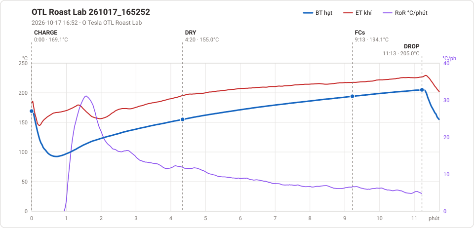

# Giản đồ rang — `_may-ca-nhan`

2 profile. Bấm tên để mở tệp `.alog` (tải về, mở bằng Artisan: `File → Open`). Giản đồ sinh tự động bằng [`tools/ve_gian_do_alog.py`](../../../tools/ve_gian_do_alog.py) — [về bảng tổng](../README.md).

### [OTL_261017_165252](Downloads/OTL_261017_165252.alog)

**DRY** 4:20 · 155.0°C · **FCs** 9:13 · 194.1°C · **DROP** 11:13 · 205.0°C  —  tổng **11:13** · DTR **17.8 %**

### [OT30 - PNG - Lufa B #59 20kg_24-05-03_1219](OneDrive/Documents/2026_old/OT30%20-%20PNG%20-%20Lufa%20B%20#59%2020kg_24-05-03_1219.alog)

**TP** 1:26 · 79.0°C · **DRY** 5:40 · 161.0°C · **FCs** 9:36 · 201.2°C · **DROP** 12:40 · 218.2°C  —  tổng **12:40** · DTR **24.2 %**

