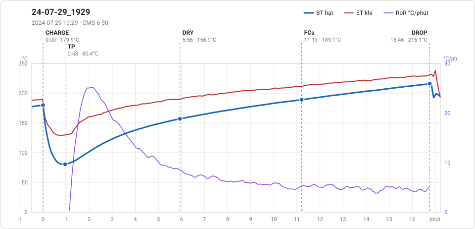

# Giản đồ rang — `_o-D`

3 profile. Bấm tên để mở tệp `.alog` (tải về, mở bằng Artisan: `File → Open`). Giản đồ sinh tự động bằng [`tools/ve_gian_do_alog.py`](../../../tools/ve_gian_do_alog.py) — [về bảng tổng](../README.md).

### [24-07-29_1929](Artisan/72_VCC_1KG/24-07-29_1929.alog)

**TP** 0:58 · 80.4°C · **DRY** 5:56 · 156.9°C · **FCs** 11:13 · 189.1°C · **DROP** 16:46 · 216.1°C  —  tổng **16:46** · DTR **33.1 %**

### [0 00_00 Roaster Scope 2025-05-07](Artisan/Thanh/0%2000_00%20Roaster%20Scope%202025-05-07.alog)

_Bản ghi quá ngắn, không vẽ._

### [0 14_15 Roaster Scope 2024-12-07](Artisan/Thanh/0%2014_15%20Roaster%20Scope%202024-12-07.alog)

**TP** 1:04 · 74.6°C · **DRY** 6:44 · 155.1°C · **FCs** 10:47 · 194.0°C · **DROP** 14:15 · 217.9°C  —  tổng **14:15** · DTR **24.4 %**

