# Giản đồ rang — `_tu-du-an`

19 profile. Bấm tên để mở tệp `.alog` (tải về, mở bằng Artisan: `File → Open`). Giản đồ sinh tự động bằng [`tools/ve_gian_do_alog.py`](../../../tools/ve_gian_do_alog.py) — [về bảng tổng](../README.md).

### [4 18_13 Roaster Scope 2026-07-11](4%2018_13%20Roaster%20Scope%202026-07-11.alog)

**TP** 0:53 · 82.6°C · **DRY** 5:24 · 155.0°C · **FCs** 12:20 · 194.0°C · **DROP** 18:13 · 218.7°C  —  tổng **18:13** · DTR **32.3 %**

### [5 17_46 Roaster Scope 2026-07-11](5%2017_46%20Roaster%20Scope%202026-07-11.alog)

**TP** 0:53 · 64.1°C · **DRY** 7:48 · 155.1°C · **FCs** 13:20 · 194.0°C · **DROP** 17:46 · 213.9°C  —  tổng **17:46** · DTR **25.0 %**

### [11 14_51 Roaster Scope 2026-06-16](101_profile_convert/Aduc/11%2014_51%20Roaster%20Scope%202026-06-16.alog)

**TP** 1:08 · 76.4°C · **DRY** 6:24 · 160.1°C · **FCs** 10:07 · 197.0°C · **DROP** 14:51 · 232.1°C  —  tổng **14:51** · DTR **31.9 %**

### [Othmane_3](101_profile_convert/output/Othmane_3.alog)

**DRY** 7:32 · 154.8°C · **FCs** 12:01 · 195.0°C · **DROP** 16:17 · 215.6°C  —  tổng **16:17** · DTR **26.2 %**

### [111 11_41 Roaster Scope 2026-10-12](112_Quanly/Artisan/3kg-david/111%2011_41%20Roaster%20Scope%202026-10-12.alog)

**TP** 0:53 · 66.7°C · **DRY** 6:05 · 162.9°C · **FCs** 9:39 · 196.1°C · **DROP** 11:41 · 210.9°C  —  tổng **11:41** · DTR **17.4 %**

### [b08-rob-helena-v1-2.7kg](112_Quanly/Artisan/3kg-david/b08-rob-helena-v1-2.7kg.alog)

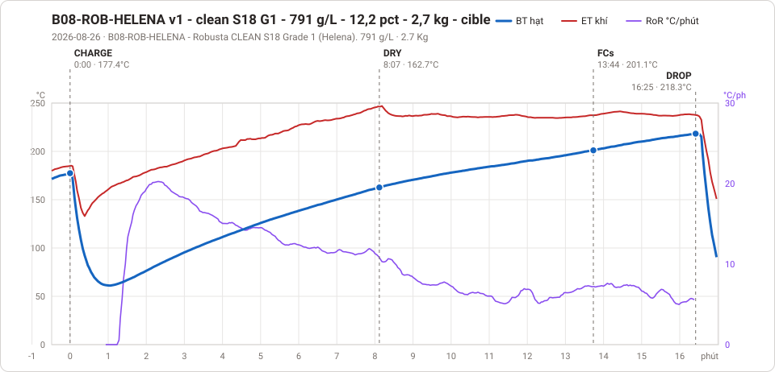

**DRY** 8:07 · 162.7°C · **FCs** 13:44 · 201.1°C · **DROP** 16:25 · 218.3°C  —  tổng **16:25** · DTR **16.3 %**

### [thu](112_Quanly/noVNC/kiem/_anh-bo-cuc/thu.alog)

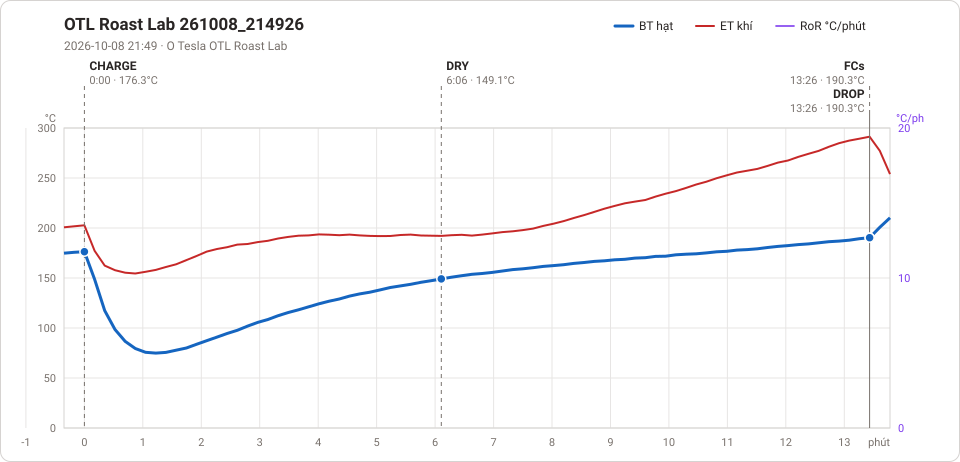

**DRY** 6:06 · 149.1°C · **FCs** 13:26 · 190.3°C · **DROP** 13:26 · 190.3°C  —  tổng **13:26** · DTR **0.0 %**

### [22-05-30_1058](Otesla_coffee_roaster_auto/Artisan/22-05-30_1058.alog)

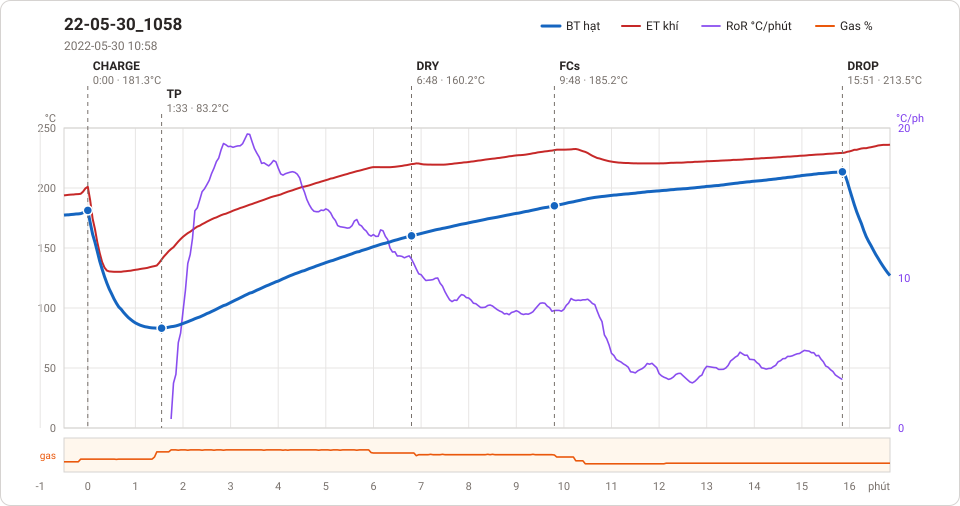

**TP** 1:33 · 83.2°C · **DRY** 6:48 · 160.2°C · **FCs** 9:48 · 185.2°C · **DROP** 15:51 · 213.5°C  —  tổng **15:51** · DTR **38.2 %**

### [semi-auto-malay-5kg](Otesla_coffee_roaster_auto/Artisan/semi-auto-malay-5kg.alog)

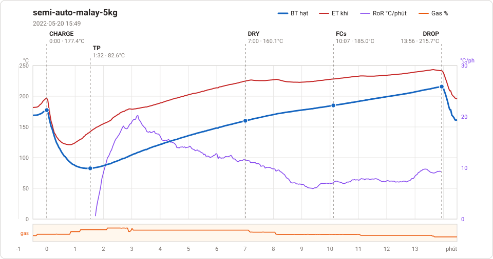

**TP** 1:32 · 82.6°C · **DRY** 7:00 · 160.1°C · **FCs** 10:07 · 185.0°C · **DROP** 13:56 · 215.7°C  —  tổng **13:56** · DTR **27.4 %**

### [23-12-07_1117 a long me 2](Otesla_coffee_roaster_auto/Firmware/11_120KG/301123/23-12-07_1117%20a%20long%20me%202.alog)

**TP** 2:12 · 98.9°C · **DRY** 7:34 · 150.1°C · **FCs** 13:24 · 197.1°C · **DROP** 20:04 · 233.4°C  —  tổng **20:04** · DTR **33.2 %**

### [slot10](Otesla_coffee_roaster_auto/Firmware/11_120KG/301123/slot10.alog)

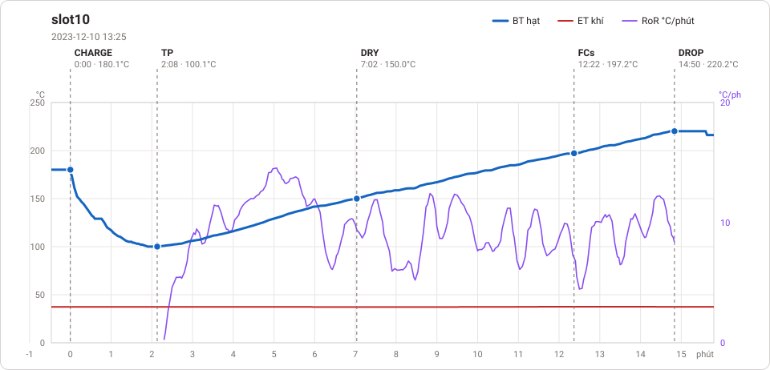

**TP** 2:08 · 100.1°C · **DRY** 7:02 · 150.0°C · **FCs** 12:22 · 197.2°C · **DROP** 14:50 · 220.2°C  —  tổng **14:50** · DTR **16.6 %**

### [21-11-22_1150-800g](Otesla_coffee_roaster_auto/Profile/21-11-22_1150-800g.alog)

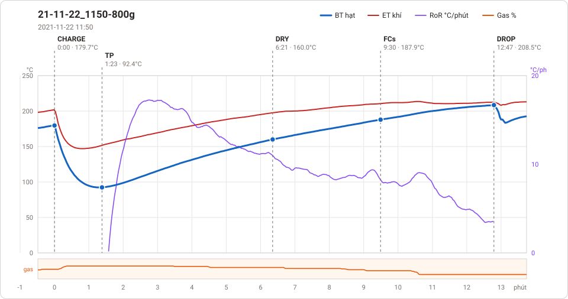

**TP** 1:23 · 92.4°C · **DRY** 6:21 · 160.0°C · **FCs** 9:30 · 187.9°C · **DROP** 12:47 · 208.5°C  —  tổng **12:47** · DTR **25.8 %**

### [21-11-22_1755-800g-v2](Otesla_coffee_roaster_auto/Profile/21-11-22_1755-800g-v2.alog)

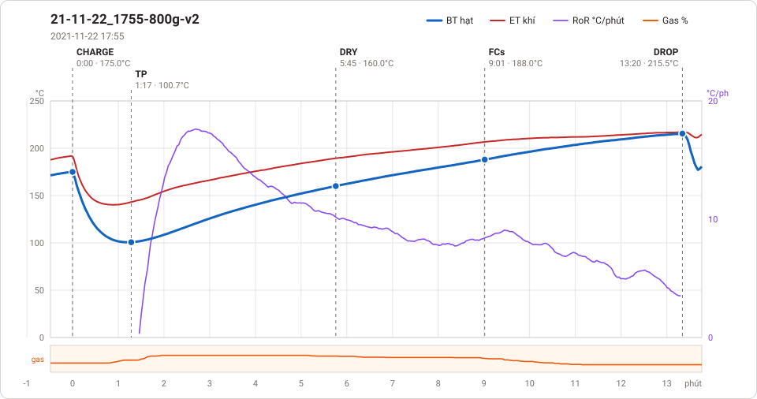

**TP** 1:17 · 100.7°C · **DRY** 5:45 · 160.0°C · **FCs** 9:01 · 188.0°C · **DROP** 13:20 · 215.5°C  —  tổng **13:20** · DTR **32.4 %**

### [auto 1](Otesla_coffee_roaster_auto/Profile/auto%201.alog)

**TP** 1:09 · 109.1°C · **DRY** 6:12 · 160.0°C · **FCs** 10:18 · 195.0°C · **DROP** 12:43 · 209.0°C  —  tổng **12:43** · DTR **18.9 %**

### [auto_v2_1](Otesla_coffee_roaster_auto/Profile/auto_v2_1.alog)

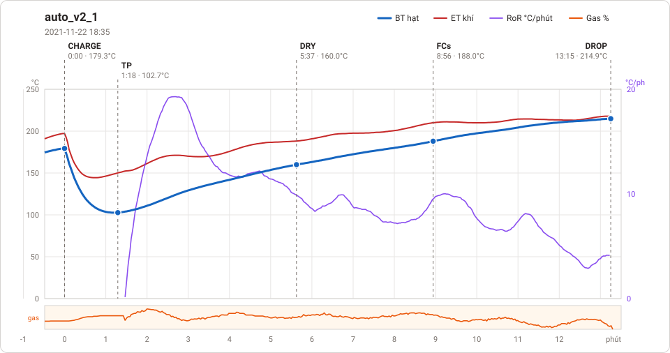

**TP** 1:18 · 102.7°C · **DRY** 5:37 · 160.0°C · **FCs** 8:56 · 188.0°C · **DROP** 13:15 · 214.9°C  —  tổng **13:15** · DTR **32.5 %**

### [auto_v2_2](Otesla_coffee_roaster_auto/Profile/auto_v2_2.alog)

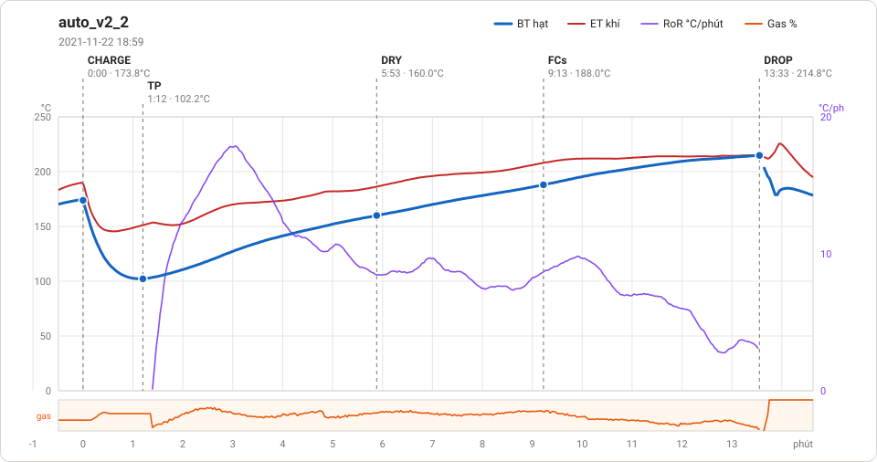

**TP** 1:12 · 102.2°C · **DRY** 5:53 · 160.0°C · **FCs** 9:13 · 188.0°C · **DROP** 13:33 · 214.8°C  —  tổng **13:33** · DTR **31.9 %**

### [pid1](Otesla_coffee_roaster_auto/Profile/pid1.alog)

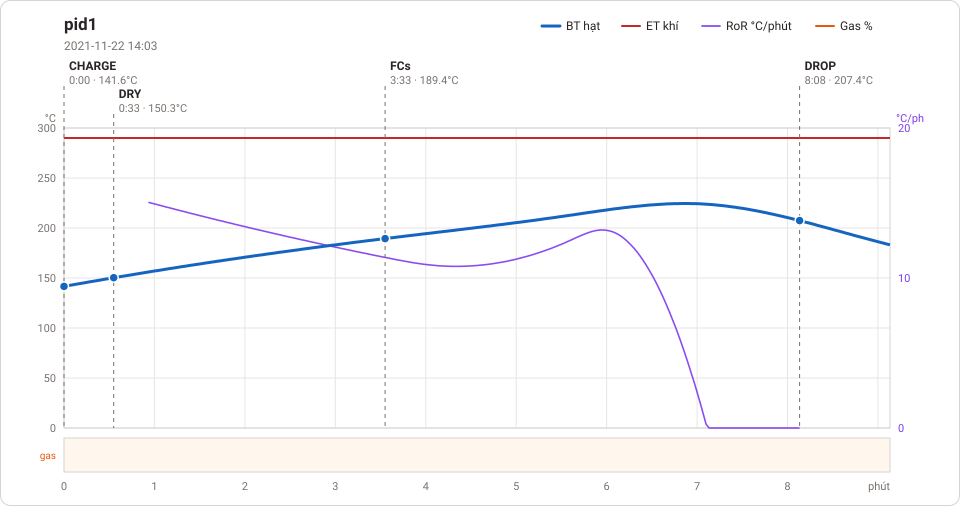

**DRY** 0:33 · 150.3°C · **FCs** 3:33 · 189.4°C · **DROP** 8:08 · 207.4°C  —  tổng **8:08** · DTR **56.4 %**

### [pid2](Otesla_coffee_roaster_auto/Profile/pid2.alog)

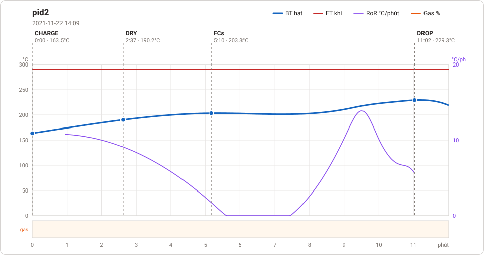

**DRY** 2:37 · 190.2°C · **FCs** 5:10 · 203.3°C · **DROP** 11:02 · 229.3°C  —  tổng **11:02** · DTR **53.2 %**

### [pid3](Otesla_coffee_roaster_auto/Profile/pid3.alog)

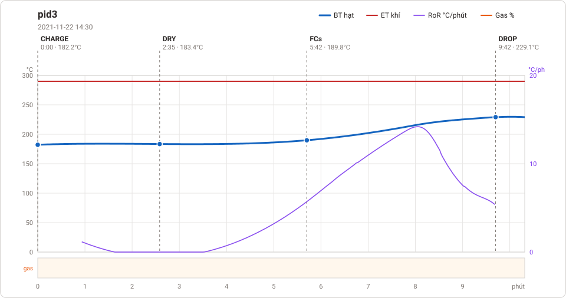

**DRY** 2:35 · 183.4°C · **FCs** 5:42 · 189.8°C · **DROP** 9:42 · 229.1°C  —  tổng **9:42** · DTR **41.2 %**

